## CAN 简介

CAN 总线（Controller Area Network Bus）控制器局域网总线

CAN 总线是由 BOSCH 公司开发的一种简洁易用、传输速度快、易扩展、可靠性高的串行通信总线，广泛应用于汽车、嵌入式、工业控制等领域

- CAN 总线特征：

  ➢ 两根通信线（CAN_H、CAN_L），线路少，无需共地

  ➢ 差分信号通信，抗干扰能力强

  **➢ 高速 CAN（ISO11898）：125k~1Mbps, <40m**

  **➢ 低速 CAN（ISO11519）：10k~125kbps, <1km**

  ➢ 异步，无需时钟线，通信速率由设备各自约定

  ➢ 半双工，可挂载多设备，多设备同时发送数据时通过仲裁判断先后顺序

  ➢ 11 位 / 29 位报文 ID，用于区分消息功能，同时==决定优先级==

  ➢ 可配置 1~8 字节的有效载荷（串口单次 1 字节）

  **➢ 可实现广播式和请求式两种传输方式**

  ➢ 应答、CRC 校验、位填充、位同步、错误处理等特性

> 虽然差分信号各设备不共地可以使用，但是这可能会让收发器承受较高的共模电压
> 在实际应用中，为了安全和稳定，CAN 通信一般还是会共地的

## 硬件电路

### CAN 硬件电路 

- 每个设备通过 CAN 收发器挂载在CAN总线网络上
- CAN 控制器引出的 TX 和 RX 与 CAN 收发器相连，CAN 收发器引出的 CAN_H 和 CAN_L分别与总线的 CAN_H和CAN_L 相连
- 高速 CAN 使用闭环网络，CAN_H 和 CAN_L 两端添加 120Ω 的终端电阻**（防止回波反射）**
- 低速 CAN 使用开环网络，CAN_H 和 CAN_L 其中一端添加 2.2kΩ 的终端电阻

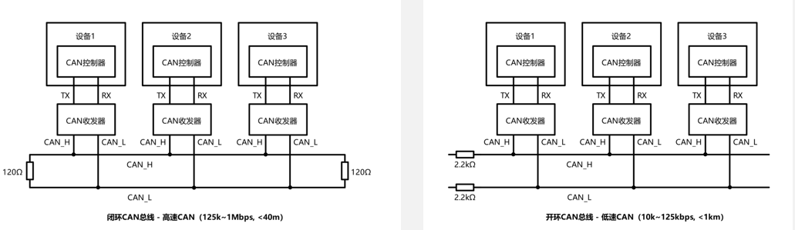

**高速 CAN**

> 差分信号，电压差为 0 时，代表的是默认的 1 状态，所以想发送 1 时，**无需对总线进行任何操作**
>
> 两端阻值不大，收紧两线电压的速度较快，使得 **CAN 总线支持的最大速率较高**，同时功耗也提高

**低速 CAN**

> 无收紧作用

------

### CAN 电平标准

  CAN 总线采用差分信号，即两线电压差 $({V_{CAN\_H}-V_{CAN\_L}})$ 传输数据位

- 高速 CAN 规定：

  > 电压差为 0V 时表示逻辑 1（隐性电平）
  > 电压差为 2V 时表示逻辑 0（显性电平）

- 低速 CAN 规定：

  > 电压差为 - 1.5V 时表示逻辑 1（隐性电平）
  > 电压差为 3V 时表示逻辑 0（显性电平）

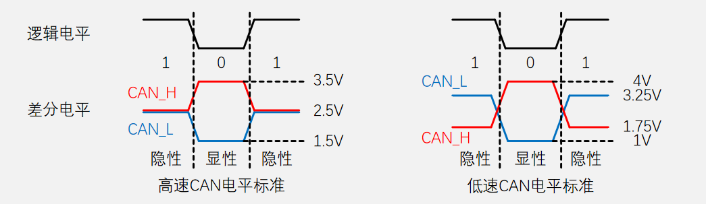

**低速 CAN 传输距离更远，考虑到线路会有压降，所以加大了逻辑 0 和 1 的电压差**

==导致高速和低速的核心原因：总线回归隐性电平的快慢==

------

### CAN 收发器 – TJA1050（高速 CAN）

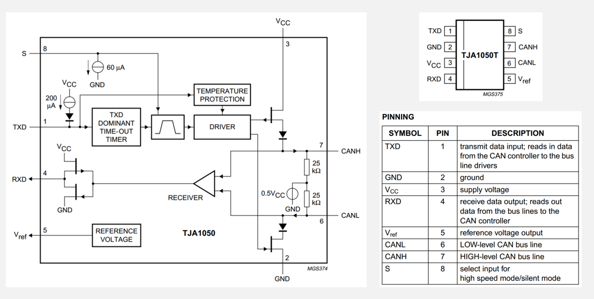

**输入部分**

1. 接收器 RECEIVER检测总线电压差

   > 总线有电压差输出 1
   >
   > 总线无电压差输出 0

2. 接收器输出通过场效应管驱动器输出到 RXD

   > RECEIVER 传来 1 时，上管断开， 下管导通，RXD 接地，输出 0
   >
   > RECEIVER 传来 0 时，上管断开， 下管导通，RXD 接 VCC，输出 1

**输出部分**

1. TXD 输出 1 时，驱动器 DRIVER 会让上下两个场效应管都断开，**相当于不对总线进行任何操作**

   > 两个 25kΩ 可以将两条总线都拉到 0.5 倍 VCC 的中间电平（默认对地电压 ≈ 2.5V）
   > 这两个电阻有一定收紧作用，但由于阻值过大，收紧作用主要还是依靠终端电阻

2. TXD 输出 0 时，驱动器 DRIVER 会让上下两个场效应管都导通

   > CANH 被拉到 VCC，CANL 被拉到 GND，产生电压差

**DOMINANT TIME-OUT TIMER：TXD 显性超时定时器**

> 防止总线卡死瘫痪
> TXD 被持续拉低时该定时器启动计时，正常发报时 TXD 拉高就重置计时
> 若低电平时长超限，收发器会关停发送驱动、释放总线，避免整条 CAN 网络卡死瘫痪

------

### CAN 物理层特性

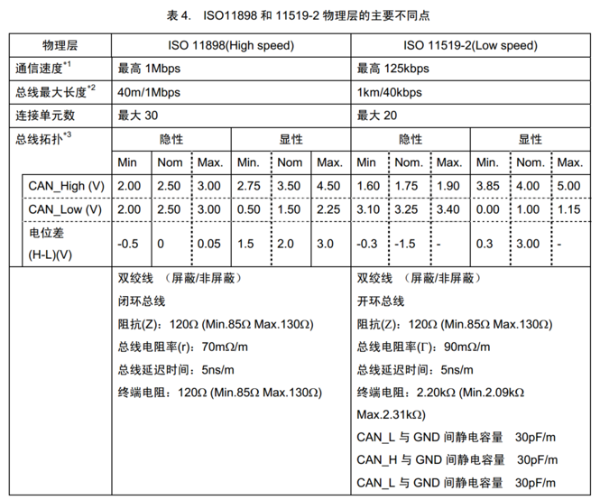

 

## 帧格式

| 帧类型 | 用途                                   |
| ------ | -------------------------------------- |
| 数据帧 | 发送设备主动发送数据（广播式）         |
| 遥控帧 | 接收设备主动请求数据（请求式）         |
| 错误帧 | 某个设备检测出错误时向其他设备通知错误 |
| 过载帧 | 接收设备通知其尚未做好接收准备         |
| 帧间隔 | 用于将数据帧及遥控帧与前面的帧分离开   |

------

### 数据帧

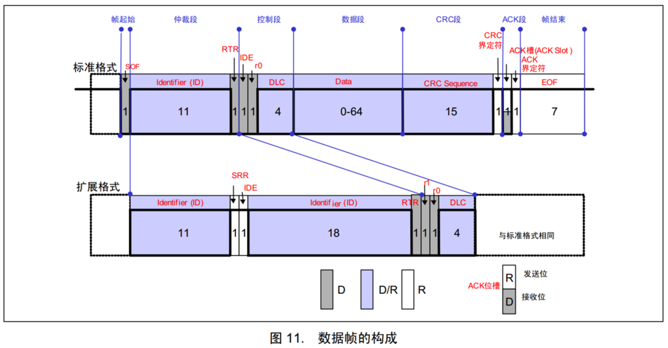

#### 1.标准格式 (11位ID)

> SOF：帧起始，表示后面一段波形为传输的数据位
>
> ID：标识符，区分功能，同时决定优先级
>
> RTR：远程请求标志位，区分数据帧和遥控帧，在数据帧里必须为显性 0，遥控帧里为隐形 1
>
> IDE：扩展标志位，用于区分标准格式还是扩展格式，标准格式固定为显性 0，扩展格式固定为隐性 1
>
> r0：保留位，显性 0
>
> DLC：<u>CAN FD 数据段长度 DLC=9/10/11/12/13/14/15 对应 12,16,20,24,32,48,64 字节</u>
>
> Data：最多 64字节
>
> CRC 段：15位，最小汉明距离是4，<u>保证百分百检测出小于 3bit的错误（4位以上有概率漏检），CAN FD 中提高至 17或 21位</u>
>
> CRC 界定符：必须是隐性 1，发送方释放总线处
>
> ACK 槽：应答，接收方置显性 0 表示收到数据，（总线操作交接处）
>
> ACK 界定符：必须是隐性 1，接收方释放总线处，<u>把 ACK 区域和 EOF 分开，保证帧结构边界清晰</u>
>
> EOF：帧结束 
>

#### 2.扩展格式 (18位ID)

> SRR：替代 RTR 位，为了兼容标准格式，置隐性 1，<u>表示拓展格式优先级低于标准格式</u>
>
> r1：保留位，显性 0

------

### 遥控帧

遥控帧无数据段，RTR为隐性电平1，其他部分与数据帧相同

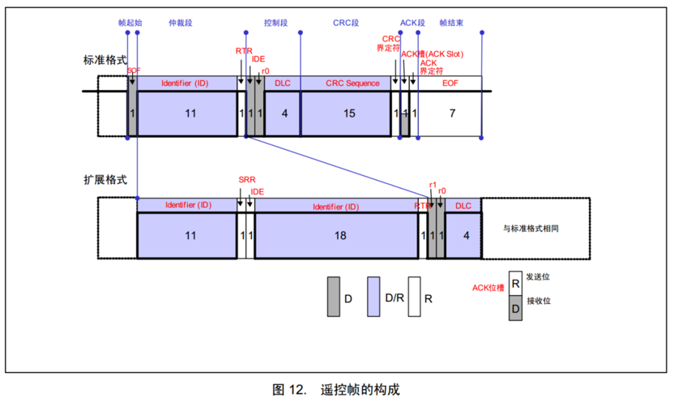

请求和反馈数据同时发生时，数据帧用于更高的优先级

DLC 指明请求的数据长度

------

### 错误帧

总线上所有设备都会监督总线的数据，一旦发现<u>“位错误”或“填充错误”或“CRC 错误”或“格式错误”或“应答错误”</u> ，这些设备便会发出错误帧**（6个显性位）**来破坏数据，同时终止当前的发送设备

<u>设备默认处于主动错误状态</u>

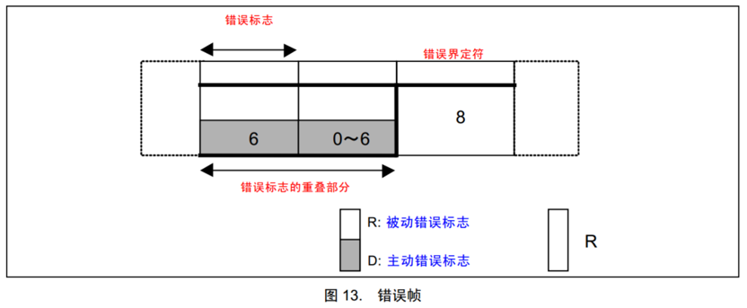

------

### 过载帧

当接收方收到大量数据而无法处理时，其可以发出过载帧，延缓发送方的数据发送，以平衡总线负载，避免数据丢失

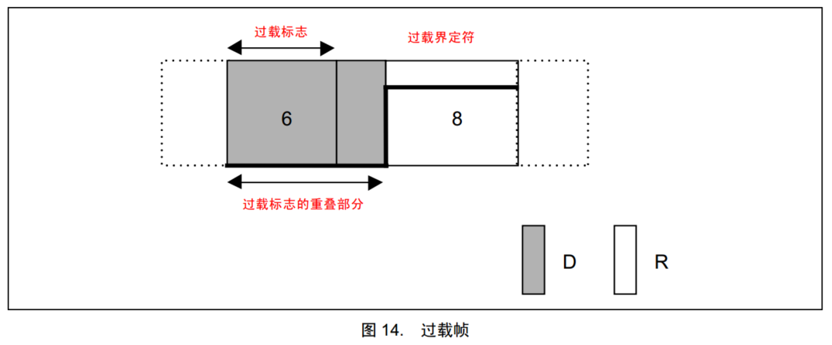

------

### 帧间隔

将数据帧和遥控帧与前面的帧分离开

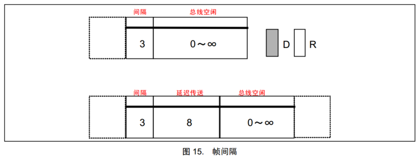

------

### 位填充

发送方每发送 5 个相同电平后，自动追加一个相反电平的填充位，接收方检测到填充位时，会自动移除填充位，恢复原始数据

> 即将发送：　　100000110　　　10000011110　　　0111111111110
>
> 实际发送：　　100000==1==110　　100000==1==1111==0==0　　011111==0==11111==0==10
>
> 实际接收：　　100000==1==110　　100000==1==1111==0==0　　011111==0==11111==0==10
>
> 移除填充后：　100000110　　　10000011110　　　0111111111110

位填充作用：

➢ 增加波形的定时信息，利于接收方执行 “再同步”，**防止波形长时间无变化**，导致接收方不能精确掌握数据采样时机

➢ **将正常数据流与 “错误帧” 和 “过载帧” 区分开**，标志 “错误帧” 和 “过载帧” 的特异性

➢ 保持 CAN 总线在发送正常数据流时的活跃状态，<u>防止被误认为总线空闲</u>

## 位同步

### 位时序

为了灵活调整每个采样点的位置，使采样点对齐数据位中心附近，CAN总线对每一个数据位的时长进行了更细的划分，分为 **同步段（SS）、传播时间段（PTS）、相位缓冲段1（PBS1）和相位缓冲段2（PBS2）**，每个段又由若干个最小时间单位（Tq）构成 

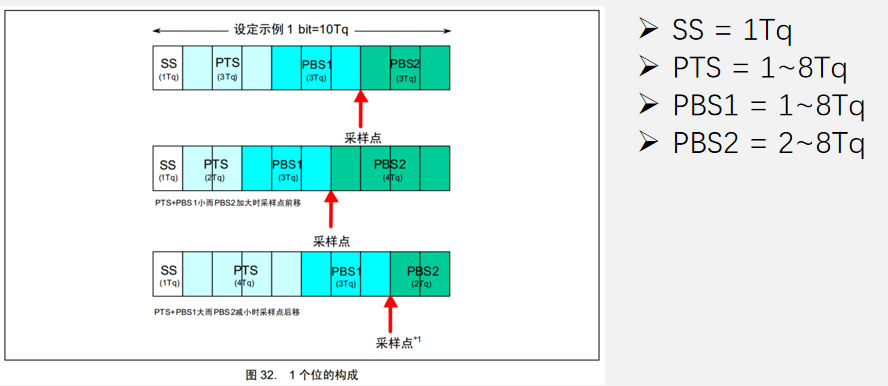

------

### 硬同步

- 每个设备都有一个位时序计时周期，当某个设备（发送方）率先发送报文，其他所有设备（接收方）收到SOF的下降沿时，**接收方会将自己的位时序计时周期拨到SS段的位置，与发送方的位时序计时周期保持同步**
- 硬同步只在帧的第一个下降沿（SOF 下降沿）有效
- 经过硬同步后，若发送方和接收方的时钟没有误差，则后续所有数据位的采样点必然都会对齐数据位中心附近

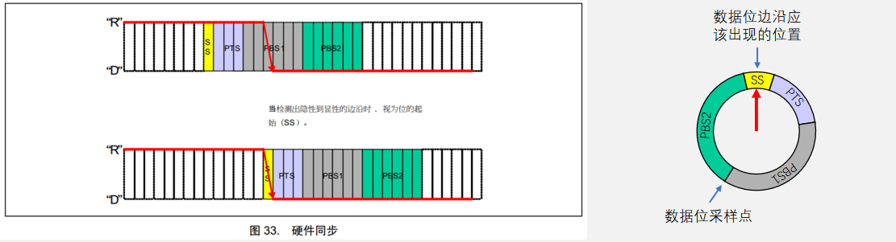

------

### 再同步

- 若发送方或接收方的时钟有误差，随着误差积累，数据位边沿逐渐偏离SS段，则此时接收方根据再同步补偿宽度值（SJW）通过**加长 PBS1 段，或缩短 PBS2 段**，以调整同步
- 再同步可以发生在第一个下降沿之后的每个数据位跳变边沿

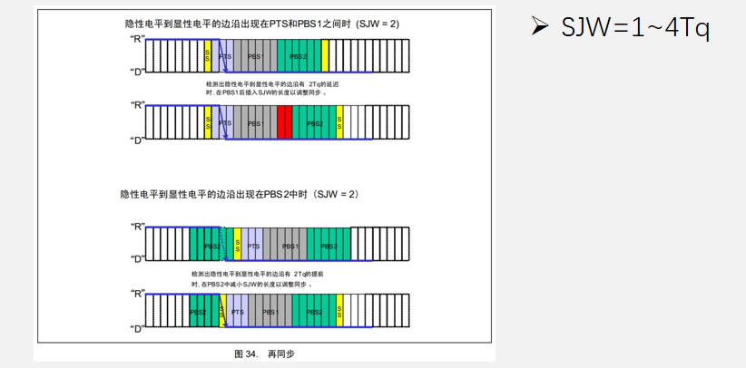

> ==误差值小于等于 SJW 指定值，则只补偿误差大小而给 SJW 大小==
>
> ==误差值大于 SJW 指定值，则值补偿 SJW 大小的 Tq 值==
>
> SJW 作为补偿**最大限制**是为了防止噪声导致补偿程度过大导致接收出错

------

###  ==波特率计算==

$波特率 = 1 / 一个数据位的时长 = 1 / (T_{SS} + T_{PTS} + T_{BS1} + T_{BS2})$

> $SS = 1Tq，PTS = 3Tq，PBS1 = 3Tq，PBS2 = 3Tq，Tq = 0.5us  $
>
> $波特率 = 1 / (0.5us + 1.5us + 1.5us + 1.5us) = 200kbps $

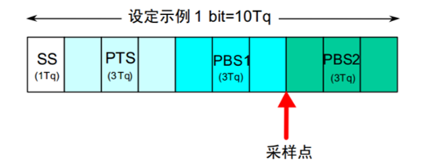

## 仲裁

### 规则1 - 先占先得

- 若当前已经有设备正在操作总线发送数据帧/遥控帧，则其他任何设备不能再同时发送数据帧/遥控帧（可以发送错误帧/过载帧破坏当前数据）
- 任何设备检测到**连续11个隐性电平**，即认为总线空闲，<u>只有在总线空闲时，设备才能发送数据帧/遥控帧</u>
- 一旦有设备正在发送数据帧/遥控帧，总线就会变为活跃状态，必然不会出现连续11个隐性电平，其他设备自然也不会破坏当前发送
- 若总线活跃状态其他设备有发送需求，则需要等待总线变为空闲，才能执行发送需求

------

### 规则2 - 非破坏性仲裁

- 若多个设备的发送需求同时到来或因等待而同时到来，则CAN总线协议会根据ID号（仲裁段）进行非破坏性仲裁，ID号小的（优先级高）取到总线控制权，ID号大的（优先级低）仲裁失利后将转入接收状态，等待下一次总线空闲时再尝试发送
- 实现非破坏性仲裁需要两个要求：

> **线与特性**：总线上任何一个设备发送显性电平0时，总线就会呈现显性电平 0 状态，只有当所有设备都发送隐性电平 1 时，总线才呈现隐性电平 1 状态，即：0 & X & X = 0，1 & 1 & 1 = 1
>
> **回读机制**：每个设备发出一个数据位后，都会读回总线当前的电平状态，以确认自己发出的电平是否被真实地发送出去了，根据线与特性，发出 0 读回必然是 0，发出 1 读回不一定是 1

1. 数据位从前到后依次比较，出现差异且数据位为 1 的设备仲裁失利

   >  **位填充不会影响仲裁结果**

2. 数据帧和遥控帧ID号一样时，数据帧的优先级高于遥控帧

3. 标准格式11位ID号和扩展格式29位ID号的高11位一样时，标准格式的优先级高于扩展格式（SRR必须始终为1，以保证此要求）

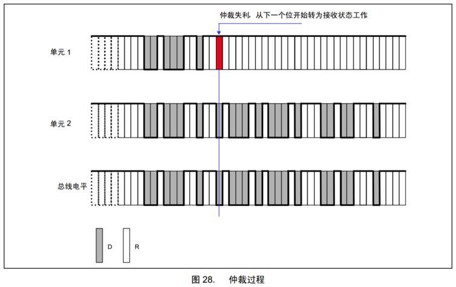

## 错误处理

### 错误类型

错误共有5种： 位错误、填充错误、CRC错误、格式错误、应答错误

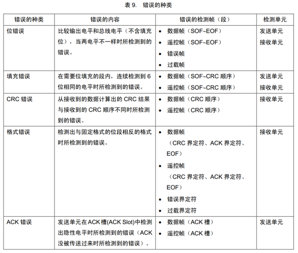

------

### 错误状态

- 主动错误状态的设备正常参与通信并在检测到错误时发出主动错误帧
- 被动错误状态的设备正常参与通信但检测到错误时只能发出被动错误帧
- 总线关闭状态的设备不能参与通信
- 每个设备内部管理一个TEC和REC，根据TEC和REC的值确定自己的状态

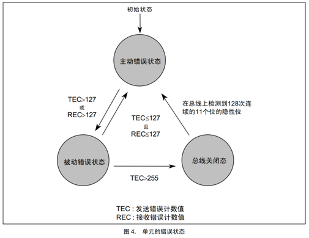

TEC：发送错误计数器，设备在发送时，**每发送一个错误，TEC +，每有一次正常的发送，TEC -**

REC：接收错误计数器，设备在接收时，**每接收一个错误，REC +，每有一次正常的接收，REC -**

------

### 错误计数器

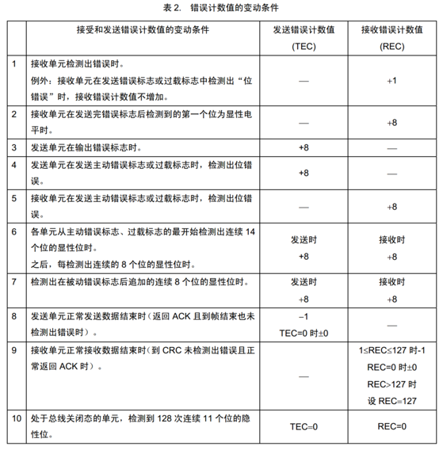

> 如果某设备因为 REC > 127 转移到被动错误状态，那么它只要接收到一次正常数据就可以恢复到主动错误状态

------

### 波形示例

设备处于**主动错误状态**，发送标准数据帧，正常传输

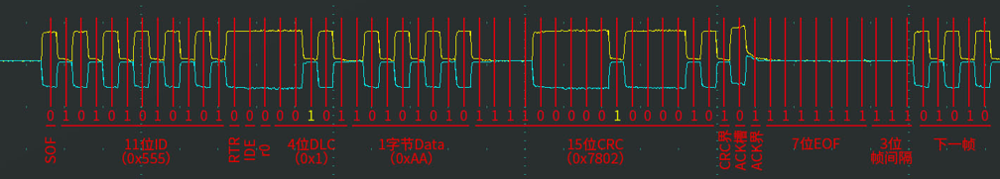

设备处于**主动错误状态**，发送标准数据帧，检测到ACK错误

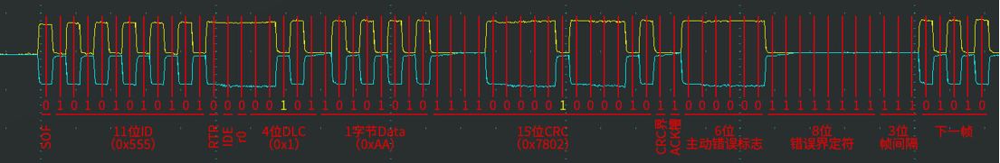

设备处于**被动错误状态**，发送标准数据帧，检测到ACK错误

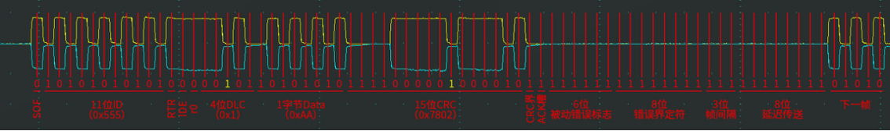

> 8 位延迟传送使得主动错误状态直接取得总线控制权，不会和被动错误状态的设备进行仲裁

## CAN 外设（stm32）

### ==CAN 基本结构==

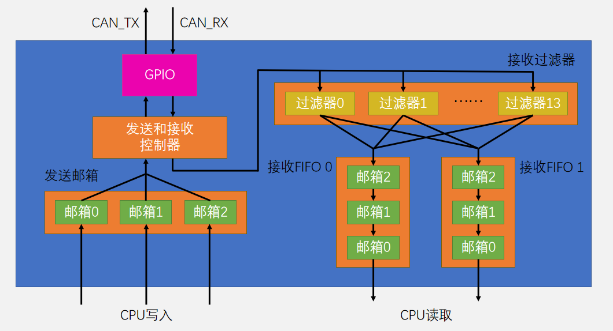

------

### 发送过程

基本流程：选择一个空置邮箱→写入报文 →请求发送

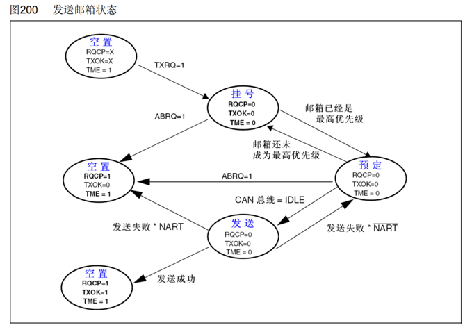

> TXRQ：报文发送申请
>
> NART：值为 0，表示使用自动重传；值为 1，表示禁止自动重传
>
> ABRQ：终止发送

------

### 接收过程

基本流程：接收到一个报文→匹配过滤器后进入FIFO 0或FIFO 1→CPU读取

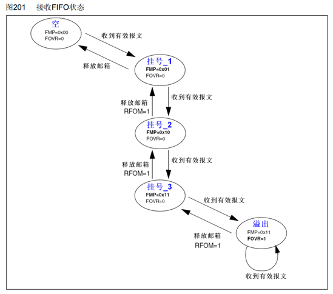

------

### 发送和接收配置位

- NART：置1，关闭自动重传，CAN报文只被发送1次，不管发送的结果如何（成功、出错或仲裁丢失）；置0，自动重传，CAN硬件在发送报文失败时会一直自动重传直到发送成功
- ==TXFP==：置1，优先级由发送请求的顺序来决定，先请求的先发送；置0，优先级由报文标识符来决定，标识符值小的先发送（标识符值相等时，邮箱号小的报文先发送）
- RFLM：置1，接收FIFO锁定，FIFO溢出时，新收到的报文会被丢弃；置0，禁用FIFO锁定，FIFO溢出时，FIFO中最后收到的报文被新报文覆盖

------

### 标识符过滤器

- 每个过滤器的核心由两个32位寄存器组成：R1[31:0]和R2[31:0]
- FSCx：位宽设置    置0，16位；置1，32位
- FBMx：模式设置    置0，屏蔽模式；置1，列表模式
- FFAx：关联设置    置0，FIFO 0；置1，FIFO 1
- FACTx：激活设置    置0，禁用；置1，启用

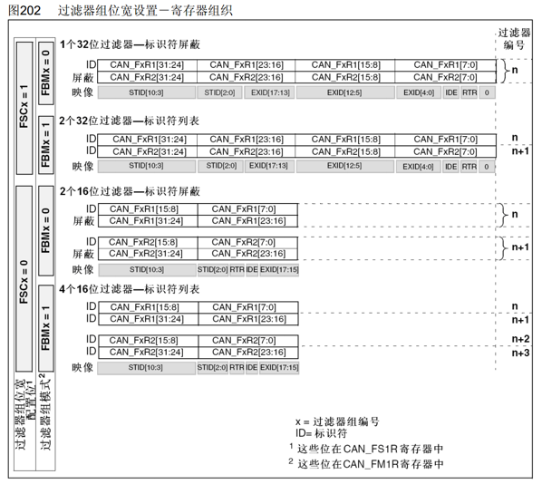

------

### 过滤器配置示例

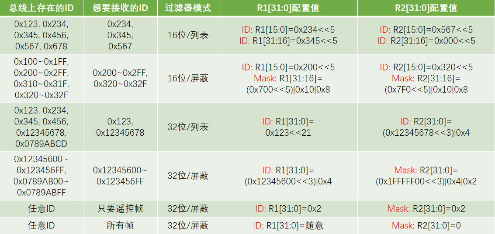

------

### 测试模式

- 静默模式：用于分析CAN总线的活动，不会对总线造成影响
- 环回模式：用于自测试，同时发送的报文可以在CAN_TX引脚上检测到
- 环回静默模式：用于热自测试，自测的同时不会影响CAN总线

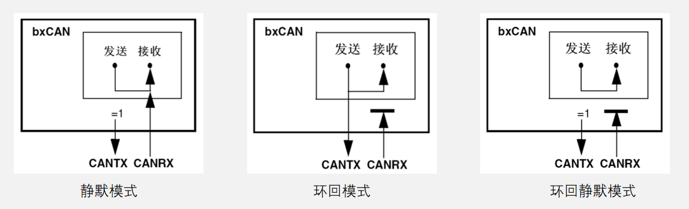

------

### 工作模式

- 初始化模式：用于配置CAN外设，禁止报文的接收和发送
- 正常模式：配置CAN外设后进入正常模式，以便正常接收和发送报文
- 睡眠模式：低功耗，CAN外设时钟停止，可使用软件唤醒或者硬件自动唤醒
- AWUM：置1，自动唤醒，一旦检测到CAN总线活动，硬件就自动清零SLEEP，唤醒CAN外设；置0，手动唤醒，软件清零SLEEP，唤醒CAN外设

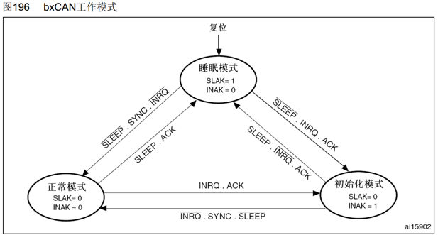

------

### 位时间特性

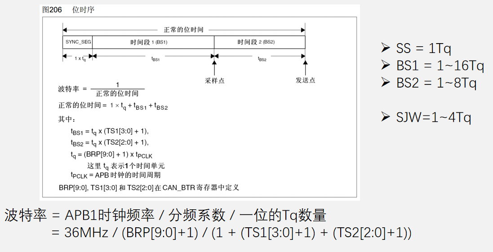

------

### 中断

- CAN外设占用4个专用的中断向量
- 发送中断：发送邮箱空时产生
- FIFO 0中断：收到一个报文/FIFO 0满/FIFO 0溢出时产生
- FIFO 1中断：收到一个报文/FIFO 1满/FIFO 1溢出时产生
- 状态改变错误中断：出错/唤醒/进入睡眠时产生

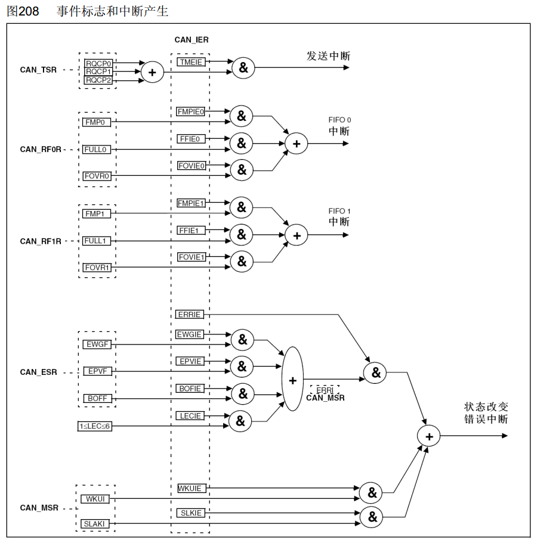

------

### 时间触发通信

- TTCM：置1，开启时间触发通信功能；置0，关闭时间触发通信功能
- CAN外设内置一个16位的计数器，用于记录时间戳
- TTCM置1后，该计数器在每个CAN位的时间自增一次，溢出后归零
- 每个发送邮箱和接收FIFO都有一个TIME[15:0]寄存器，发送帧SOF时，硬件捕获计数器值到发送邮箱的TIME寄存器，接收帧SOF时，硬件捕获计数器值到接收FIFO的TIME寄存器
- 发送邮箱可配置TGT位，捕获计数器值的同时，也把此值写入到数据帧数据段的最后两个字节，为了使用此功能，DLC必须设置为8

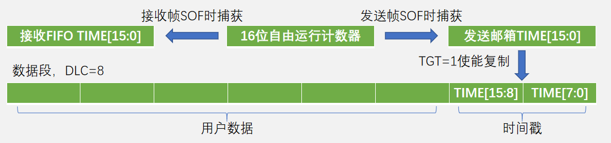

------

### 错误处理和离线恢复

- TEC和REC根据错误的情况增加或减少
- ABOM：置1，开启离线自动恢复，进入离线状态后，就自动开启恢复过程；置0，关闭离线自动恢复，软件必须先请求进入然后再退出初始化模式，随后恢复过程才被开启

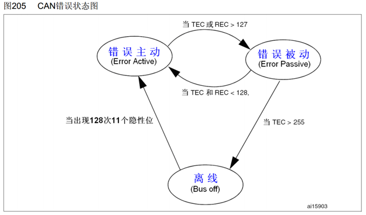

​       

## 程序编写

### 初始化

#### 1.时钟初始化

> GPIO 时钟，CAN 外设时钟

#### 2.GPIO初始化

> 上拉输入，复用推挽

#### 3.CAN外设初始化

> 模式选择：静默、回环 ......
> 位时序：分频系数，BS1 和 BS2 Tq 数，再同步补偿宽度  （这些参数计算得到的波特率要在高速 CAN 或者低速 CAN 范围内）
> 其他参数：是否自动重传（NART），发送邮箱优先级（TXFP），FIFO锁定（RFLM），自动唤醒（AWUM），时间触发通信模式（TTCM），离线自动h恢复（ABOM）

#### 4.过滤器初始化

> 过滤器 NUM，ID号，掩码，过滤器位宽，过滤器模式(屏蔽 / 列表)，目标 FIFO，过滤器开关

------

### 过滤器

> 过滤数据帧：`0x234 << 5`
>
> 过滤遥控帧：`(0x234 << 5) | 0x10`   **将第五位 RTR置为 0**

# 面试

CAN 和 RS485 的传输速率和传输距离是多少，，造成这种差异的原因是什么？

> CAN：1Mbit/s 最大约 40m；125kbit/s 最大约 500m
> RS485：100kbit/s 时最大约 1200m；速率越高，传输距离同样变短
>
> 核心差异是 CAN 有非破坏性位仲裁，对信号边沿质量要求高
> （非破坏性仲裁要求多个节点一边发送一边实时采样总线电平做比较）

广播式和请求式的使用场景

> 广播式适合高频传输数据，适合自动上报类事件，时序稳定，总线负载可以预测
> 请求式涉及请求帧和遥控帧一来一回，带来较大总线开销，适合频率较低的数据

主动错误和被动错误状态有什么区别

> 主动错误：设备检测到错误，发送连续 6个显性电平强行通知其他设备数据错误
>
> 被动错误：检测到错误时，发送连续 6个隐性电平，仅做通知，不干扰总线。在出现较多错误的情况进入，防止因为同一错误反复发起错误通知导致总线瘫痪
>
> <u>进入被动错误转态的方式：发送错误计数器 TEC ≥128，或者接收错误计数器 REC ≥128</u>

CAN 总线是怎么实现线与特性的

> CAN 收发器驱动管发显性时控制总线，发隐性时松开总线（类似 I2C）

错误标志为什么会有重叠部分？

> 当设备发送错误帧的适合可能会连带其他设备发送错误帧，导致错误帧可能被延长 0~6位的时间

帧间隔的作用是什么

> 给接收节点留出处理时间
> 区分帧边界
> 给错误状态节点提供恢复时机

CAN 稳定可靠的原因

> 电气特性：差分信号抗干扰
>
> 线与 + 非破坏性仲裁：多节点同时发送不会破坏报文，优先级高的发送，低优先级自动退出
>
> 完善的检测机制：位填充，错误帧，过载帧，CRC校验，应答机制

多个节点组网时，ID 怎么分配避免冲突？

> 核心分配原则：不能有相同 ID，否则会发生仲裁冲突，报文损坏
> 优先级较高的数据发送方 ID较小，符合线与总线仲裁特性

什么情况下认定为总线空闲？

> 总线出现连续 11个隐性电平认为总线空闲

每个界定符的作用

> CRC 界定符标记 CRC 段结束
>
> ACK 界定符分隔 ACK 槽与 EOF
>
> IDE 界定符区分标准帧和扩展帧

通信双方帧采样时可能会碰到什么样的问题？怎么解决？

> 双方以约定的时长进行采样，但是采样点没有对齐数据中心
>
> 双方起始采样准确，但是时钟有误差，随着误差积累，采样点逐渐偏移
>
> 硬同步解决采样点误差（相位校准），再同步解决时钟误差（补偿机制）

一开始有误差，怎么判断是相位还是时钟导致的，使用哪种同步？

> 硬同步只在 SOF执行，一次性修正帧起始的初始相位误差
>
> 后续如果还有误差可以确定是时钟误差导致，将会使用再同步来校准
