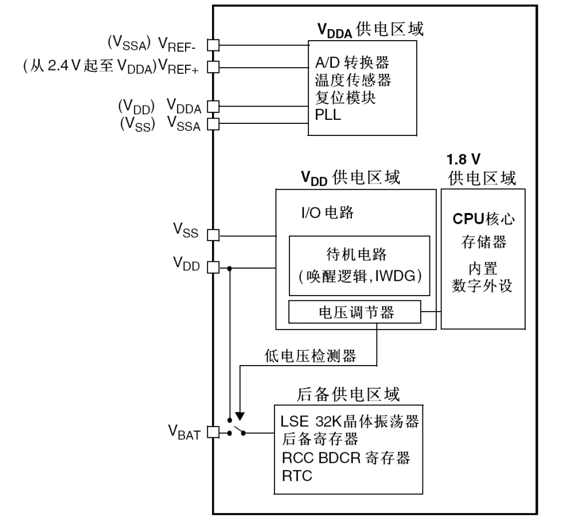
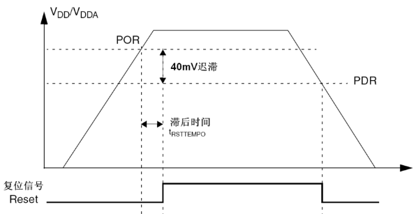
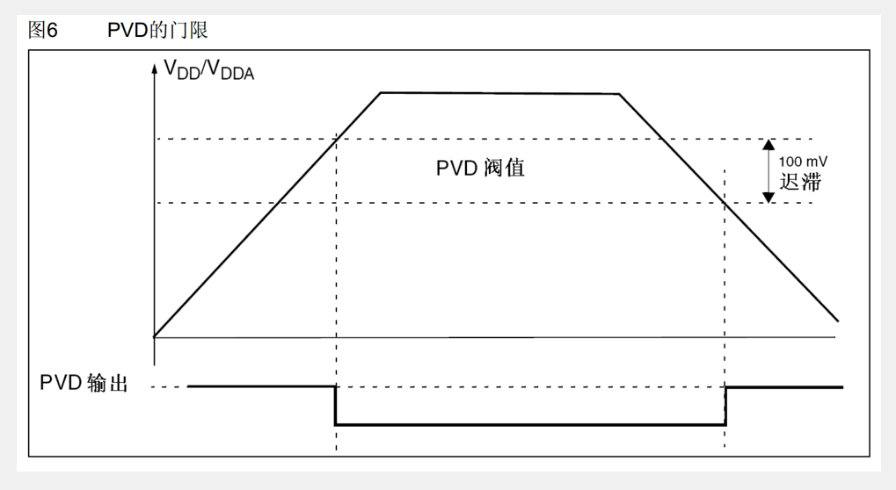
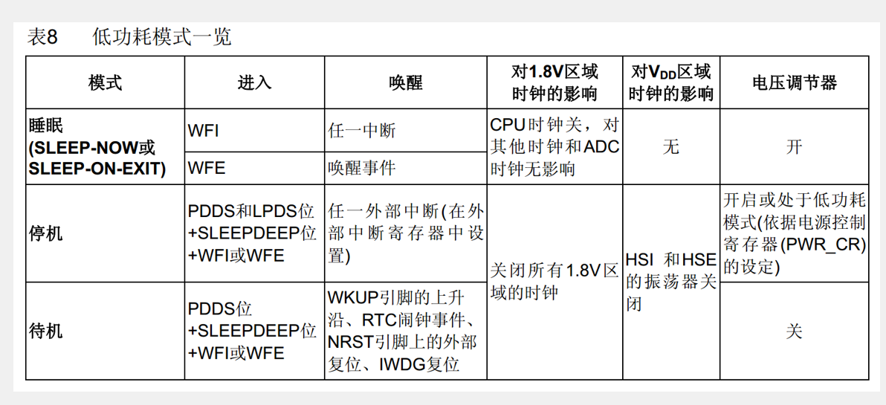
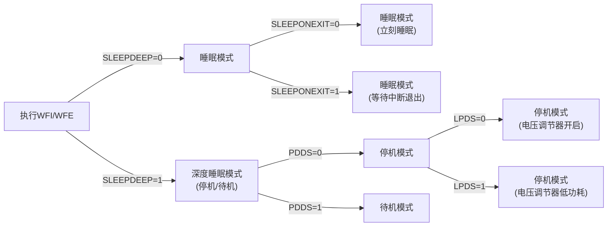

# UART

1. 使能GPIO、UART时钟
2. 配置引脚模式，RX上拉输入，TX复用推挽输出
3. 复用推挽输出由UART硬件外设控制，普通推挽输出由CPU软件控制
4. 配置串口参数(波特率，校验位，数据位，停止位，收发模式)
5. 使能中断(可选收发中断，空闲中断，DMA)
6. 使能UART外设

## 串口收发中断

接收寄存器非空中断，置 $RXNE$ 标志位

发送寄存器空中断，置 $TXNE$ 标志位

## 空闲中断

串口传输线上，连续空闲时长大于一个帧数据传输时间，硬件置IDLE标志，使能中断后触发

## DMA中断

传输完成中断 TC：DMA完成设定数据长度的传输

半传输中断 HT：DMA完成设定数据长度一半的传输

传输错误中断 TE：DMA出错

# RTC

- 只要有备用电源（比如纽扣电池），就算主 MCU 断电、系统关机，它也能一直走时
- 可以持续记录年、月、日、时、分、秒，保证设备下次上电时时间不会重置
- 支持秒中断、闹钟中断、唤醒中断（Wakeup），可以定时叫醒 CPU，实现**低功耗**下的定时任务。

| 特性           | RTC                                  | 普通定时器（TIM）                    |
| -------------- | ------------------------------------ | ------------------------------------ |
| **时钟源**     | 专用 32.768kHz 晶振（LSE），功耗极低 | 依赖主时钟（比如 HSE 84MHz），功耗高 |
| **掉电运行**   | 支持（只要备份域有电）               | 主电源断电就停                       |
| **计时精度**   | 晶振误差小，适合长期计时             | 主时钟漂移大，不适合长期计时         |
| **低功耗模式** | STOP/STANDBY 模式下仍可运行          | 主时钟关了就停止计数                 |
| **典型用途**   | 系统时间、定时唤醒、闹钟             | PWM、电机控制、普通定时任务          |

## 上电初始化流程

1. 开启电源管理时钟

   RTC 属于备份域，先使能 PMU 外设时钟

2. 解锁备份域写保护

   必须执行，否则无法修改 RTC、备份寄存器

3. 判断是否首次上电

   读取 RTC 备份寄存器标记：

   - 标记不存在 = 首次上电，完整初始化；
   - 标记存在 = 非首次上电，仅恢复时钟、同步寄存器

4. 启动低速晶振 LSE (32.768kHz)

   开启 32.768kHz 外部晶振，等待晶振稳定

5. 选择 RTC 时钟源

   指定 RTC 时钟来自 LSE，并开启 RTC 外设时钟

6. 等待 RTC 寄存器同步

   保证寄存器读写稳定。

7. 配置分频器

   把 32.768kHz 分频为 1Hz 每秒计数一次

8. 设置初始时间

   写入年 / 月 / 日 / 时 / 分 / 秒（计数器型写总秒数，日历型直接写时间）。

9. 写入初始化标记

   往备份寄存器写入固定值，如 

   ```
   0xA5A5
   ```

   下次上电不再重设时间。

10. （可选）配置中断

    开启 RTC 秒中断 / 唤醒中断，配置 NVIC/EXTI，使能中断。

**可以通过读时间接口获取当前时间，也可以开启中断，由中断自动刷新软件时间**

唤醒中断看 rk2 -> RTC.c -> RTC_Wakeup_Config

# ADC

## 初始化流程

1. 开启对应 GPIO 外设时钟
2. 开启 ADC 外设时钟
3. 配置 ADC 预分频时钟（保证 ADC 时钟不超额定值）
4. 将模拟输入引脚配置为**模拟模式**
5. ADC 外设复位（恢复默认状态）
6. 配置 ADC 工作模式：扫描模式、连续转换模式
7. 配置触发方式、数据对齐、规则通道序列长度
8. 使能 ADC 模块
9. 等待 ADC 稳定，执行 **ADC 自校准**（必做）
10. 初始化完成，进入正常采集

# SPI

## 初始化流程

1. **开启外设时钟**

   开启 SPI 模块时钟 + SPI 对应 GPIO 端口时钟。

2. **GPIO 引脚初始化**

   软件：

   - SCK、MOSI：复用推挽输出
   - MISO：复用浮空输入
   - NSS 片选：普通通用推挽输出，默认拉高

   硬件：

   只控制片选线，其他 IO 口通过复用交给硬件外设

3. **填充 SPI 初始化结构体**

   通信模式、主从、CPOL/CPHA、分频速率、数据位、高低位先行、硬件 / 软件片选。

4. **调用 SPI 初始化函数**

   将配置写入 SPI 寄存器。

5. **使能 SPI 外设**

   置位 SPI 使能位，外设开始工作。

6. **（可选）中断 / DMA 初始化**

   配置中断优先级、DMA 通道，开启对应传输请求。

## 四种SPI模式

| 模式  | CPOL | CPHA | 空闲 SCK | 采样边沿              |
| :---- | :--- | :--- | :------- | :-------------------- |
| Mode0 | 0    | 0    | 低       | 第 1 个边沿（上升沿） |
| Mode1 | 0    | 1    | 低       | 第 2 个边沿（下降沿） |
| Mode2 | 1    | 0    | 高       | 第 1 个边沿（下降沿） |
| Mode3 | 1    | 1    | 高       | 第 2 个边沿（上升沿   |

## 核心规则

**SPI没有单独的发送通道、没有单独的接收通道，收发共用同一套时钟、同一个移位寄存器，发和收是绑定死的，并行同时进行。**

**来1个SCK时钟脉冲：MOSI推出去1位数据，同一瞬间MISO必须拉进来1位数据。**

✅ 发1bit = 同时收1bit

✅ 发1字节 = 同时同步收1字节

❌ 绝对不允许：先发完所有数据，再停时钟、等待对方回复、再单独收数据

# WDG

## IWDG 独立看门狗

内部 40kHz 低速 RC 时钟，**无需开启 APB 时钟**，不受系统时钟影响；一旦开启就不能关闭。

### 初始化流程

1. 解锁 IWDG 寄存器写保护（写入 0x5555）
2. 设置预分频系数
3. 设置重载计数值 ARR
4. 使能启动独立看门狗
5. 程序中周期性喂狗（重装载计数器）

## WWDG 窗口看门狗

挂载 APB1 时钟，系统时钟失效则失效；有**窗口阈值**，过早喂狗也会复位，防止程序卡死在喂狗代码

### 初始化流程

1. 开启 WWDG 外设总线时钟
2. 配置 WWDG 预分频
3. 设置窗口比较值
4. 设置计数器初始值（最高位 1 代表开启 WWDG）
5. 调用初始化函数写入配置
6. 可选：配置提前唤醒中断、NVIC 中断优先级
7. 在窗口时间段内定期喂狗

## 两种看门狗对比

| 对比项   | IWDG（独立看门狗）             | WWDG（窗口看门狗）                         |
| -------- | ------------------------------ | ------------------------------------------ |
| 核心定位 | 硬件级兜底复位                 | 程序级时序监控                             |
| 时钟来源 | 独立内部 RC 时钟，与系统无关   | 依赖系统总线时钟                           |
| 喂狗规则 | 任意时间喂狗都有效             | 必须到指定窗口才能喂狗，提前喂狗会触发复位 |
| 软件关闭 | 开启后无法关闭                 | 可随时通过软件关闭                         |
| 核心用途 | 防整机死机、时钟失效等极端故障 | 防代码跑飞、程序执行时序异常               |

# Flash

芯片上电后，flash默认是上锁状态，防止程序跑飞和意外擦写，所以执行flash操作之前要先解锁

- **Flash 只能 1→0，不能 0→1**
- **写数据前必须先擦除**
- **最小擦除单位：页 / 扇区**
- **写 / 擦必须先解锁，完成后上锁**
- **擦写时 CPU 不能跑 Flash 代码**（需放 RAM 或关中断）

**整片 (Chip) → 块 (Block) → 扇区 (Sector) → 页 (Page) → 半字 (HalfWord) → 字节 (Byte)**

- 扇区（Sector）— 最小擦除单位
- 半字（Half Word）— 最小写入单位
- 字节（Byte）— 最小存放单位

# FMC 控制器

FMC = Flash Memory Controller（片内 Flash 控制器）**单片机内置硬件，全权管控片内 Flash 读写擦除。**

## 核心 4 个功能

1. **读取 Flash**：运行程序、读取配置参数
2. **擦除 Flash**：必须先擦才能写
3. **写入 Flash**：保存数据、参数
4. **保护 Flash**：解锁 / 上锁，防止误擦写

## 通用用途

1. 程序固件存储
2. **掉电保存参数（模拟 EEPROM）**
3. 升级固件（IAP）
4. 存储校准数据、序列号、配置表

# BKP 备份寄存器

**RTC 备份区（BKP）是断电不丢失的**

为了安全，**默认锁住不让写**，防止误操作破坏数据。

1. 开 PMU 时钟
2. 解除写保护

# PWR（stm32为例）

## 简介

PWR（Power Control）电源控制

- PWR 负责管理单片机内部的电源供电部分，可以实现可编程电压监测器和低功耗模式的功能
- 可编程电压监测器（PVD）可以监控 VDD 电源电压，当 VDD 下降到 PVD 阀值以下或上升到 PVD 阀值之上时，PVD 会触发中断，用于执行紧急关闭任务
- 低功耗模式包括睡眠模式（Sleep）、停机模式（Stop）和待机模式（Standby），可在系统空闲时，降低 STM32 的功耗，延长设备使用时间

## 电源框图



**VDDA 负责模拟部分供电，电压调节器负责给 1.8 V区域供电**

## 上电复位和掉电复位



**stm32 数据手册 5.3.3 有说明**

- 上电/掉电复位阈值 1.92 - 1.88 = 40 mV (迟滞时间)  1
- 复位持续时间 2.5 ms
- 常态电压 3.3 V 下降到 2.2 ~ 2.9 V 到达 PVD 可检测范围，再降低到 1.9 V 到复位电路检测范围，低于 1.9 V，复位住，不让下降

## 可编程电压检测器 (PVD)

PVD 是 STM32 内部集成的**硬件电压监测模块**，用于实时监控主电源电压（VDD/VDDA），在电压跌破安全阈值前提前预警或触发系统保护，避免程序跑飞、数据丢失或硬件损坏。



**使用PVD要使用外部中断**

## 低功耗模式



**三种低功耗模式主要区别：关闭设备的多少**

**关闭越多设备，系统越省电，唤醒也越麻烦**

**PDDS = 0 进入停机模式，PDDS = 2 进入待机模式**

## 模式选择



## 睡眠模式

- 执行完 WFI/WFE 指令后，STM32 进入睡眠模式，程序暂停运行，唤醒后程序从暂停的地方继续运行
- SLEEPONEXIT 位决定 STM32 执行完 WFI 或 WFE 后，是立刻进入睡眠，还是等 STM32 从最低优先级的中断处理程序中退出时进入睡眠
- 在睡眠模式下，所有的 I/O 引脚都保持它们在运行模式时的状态
- WFI 指令进入睡眠模式，可被任意一个 NVIC 响应的中断唤醒
- WFE 指令进入睡眠模式，可被唤醒事件唤醒

## 停止模式

- 执行完 WFI/WFE 指令后，STM32 进入停止模式，程序暂停运行，唤醒后程序从暂停的地方继续运行
- 1.8V 供电区域的所有时钟都被停止，PLL、HSI 和 HSE 被禁止，SRAM 和寄存器内容被保留下来
- 在停止模式下，所有的 I/O 引脚都保持它们在运行模式时的状态
- 当一个中断或唤醒事件导致退出停止模式时，HSI 被选为系统时钟
- 当电压调节器处于低功耗模式下，系统从停止模式退出时，会有一段额外的启动延时
- WFI 指令进入停止模式，可被任意一个 EXTI 中断唤醒
- WFE 指令进入停止模式，可被任意一个 EXTI 事件唤醒

## 待机模式

- 执行完 WFI/WFE 指令后，STM32 进入待机模式，唤醒后程序从头开始运行
- 整个 1.8V 供电区域被断电，PLL、HSI 和 HSE 也被断电，SRAM 和寄存器内容丢失，只有备份的寄存器和待机电路维持供电
- 在待机模式下，所有的 I/O 引脚变为高阻态（浮空输入）
- WKUP 引脚的上升沿、RTC 闹钟事件的上升沿、NRST 引脚上外部复位、IWDG 复位退出待机模式
