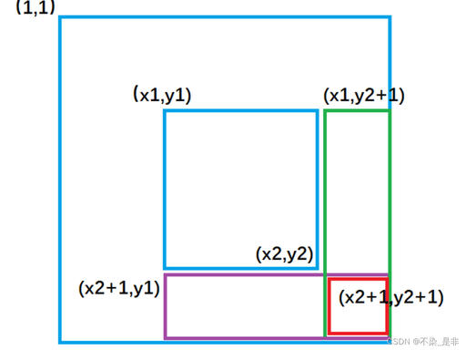

## 代码框架

```C++
#include <iostream>
#include <vector>
using namespace std;

int main() {
    ios::sync_with_stdio(false);
    cin.tie(0);

}
```


# 常见数据与结构


## 前缀和

**左闭右开公式**：子数组 $[left,right)$ 的元素和为 $sum[right]−sum[left]$。把下标区间定义成左闭右开，就不需要加一减一了

```C++
// 1. 构建前缀和数组
vector<int> nums = {1, 2, 3, 4, 5};
int n = nums.size();
vector<int> prefix(n + 1, 0);  // prefix[i] 表示 nums[0..i-1] 的和

for (int i = 0; i < n; i++) {
    prefix[i + 1] = prefix[i] + nums[i];
}

// 2. 查询区间和 [left, right]（闭区间）
int rangeSum(int left, int right) {
    return prefix[right + 1] - prefix[left];
}
```


### 二维前缀和

```C++
class NumMatrix {
    vector<vector<int>> sum;

public:
    NumMatrix(vector<vector<int>>& matrix) {
        int m = matrix.size(), n = matrix[0].size();
        sum.resize(m + 1, vector<int>(n + 1));
        for (int i = 0; i < m; i++) {
            for (int j = 0; j < n; j++) {
                sum[i + 1][j + 1] = sum[i + 1][j] + sum[i][j + 1] - sum[i][j] + matrix[i][j];
            }
        }
    }

    // 返回左上角在 (r1, c1)，右下角在 (r2, c2) 的子矩阵元素和
    int sumRegion(int r1, int c1, int r2, int c2) {
        return sum[r2 + 1][c2 + 1] - sum[r2 + 1][c1] - sum[r1][c2 + 1] + sum[r1][c1];
    }
};
```


## 差分

*a* 中连续子数组的操作，可以转变成对差分数组 *d* 中两个数的操作。

对于数组 *a*，定义其**差分数组**（difference array）为

$d[i] = \begin{cases} a[0], & i = 0 \\ a[i] - a[i-1], & i \ge 1 \end{cases}$​

> 性质 1：从左到右累加 d 中的元素，可以得到数组 a。
>
> 性质 2：如下两个操作是等价的。
>
> - 把 $a$ 的子数组 $a[i],a[i+1],…,a[j]$ 都加上 $x$。
> - 把 $d[i]$ 增加 x，把$ d[j+1] $减少 $x$。

```C++
// 已知数组长度 n，操作列表 queries（每个操作包含 l, r, val）
vector<int> diffTemplate(int n, vector<vector<int>>& queries) {
    // 1. 初始化差分数组（长度为 n+1，多开一个位置防止越界）
    vector<int> diff(n + 1, 0);   // diff[i] 表示原数组 a[i] 与 a[i-1] 的差
    /* 也可以使用map, map 内部会自动升序 */

    // 2. 执行所有区间加操作
    for (auto& q : queries) {
        int l = q[0], r = q[1], val = q[2];  // 区间 [l, r] 加 val
        diff[l] += val;                      // 区间起点加 val
        diff[r + 1] -= val;                  // 区间终点后一位减 val（闭区间）
    }

    // 3. 还原原数组（对差分数组求前缀和）
    vector<int> result(n);
    int cur = 0;
    for (int i = 0; i < n; i++) {
        cur += diff[i];
        result[i] = cur;
    }
    // 4. 返回最终数组
    return result;
}

// 注意事项：
// 1. 闭区间 [l, r] 使用 diff[l] += val; diff[r+1] -= val;
// 2. 左闭右开区间 [l, r) 使用 diff[l] += val; diff[r] -= val;
// 3. 差分数组长度必须为 n+1，保证 r+1 不越界
```


### 二维差分

二维前缀和 `diff[i][j]` 的定义是：

> 从矩阵的左上角 `(0,0)` 到当前位置 `(i,j)` 这个矩形区域内所有元素的总和



```C++
// 已知矩阵大小 n x m，操作列表 queries（每个操作包含 x1,y1,x2,y2,val）
vector<vector<int>> diff2DTemplate(int n, int m, vector<vector<int>>& queries) {
    // 1. 初始化差分数组（大小为 (n+2) x (m+2)，多开一圈防止越界）
    vector<vector<int>> diff(n + 2, vector<int>(m + 2, 0));
    
    // 2. 执行所有子矩阵加操作
    for (auto& q : queries) {
        int x1 = q[0], y1 = q[1];  // 子矩阵左上角
        int x2 = q[2], y2 = q[3];  // 子矩阵右下角
        int val = q[4];            // 加的值
        
        // 二维差分：四个标记点（坐标偏移 +1，避免越界）
        diff[x1 + 1][y1 + 1] += val;  // 这个位置开始往后区域全部 + 1
        diff[x1 + 1][y2 + 2] -= val;  // 减掉绿色区域
        diff[x2 + 2][y1 + 1] -= val;  // 减掉紫色区域
        diff[x2 + 2][y2 + 2] += val;  // 最后一个区域被减了两次
    }
    
    // 3. 还原原矩阵（对差分数组求二维前缀和）
    vector<vector<int>> result(n, vector<int>(m, 0));
    for (int i = 0; i < n; i++) {
        for (int j = 0; j < m; j++) {
            diff[i + 1][j + 1] += diff[i + 1][j] + diff[i][j + 1] - diff[i][j];
            result[i][j] = diff[i + 1][j + 1];
        }
    }
    
    // 4. 返回最终矩阵
    return result;
}
```


## 单调队列

```C++
// 计算 nums 的每个长为 k 的窗口的最大值
// 时间复杂度 O(n)，其中 n 是 nums 的长度
vector<int> maxSlidingWindow(const vector<int>& nums, int k) {
    int n = nums.size();
    vector<int> ans(n - k + 1); // 窗口个数
    deque<int> q; // 双端队列

    for (int i = 0; i < n; i++) {
        // 1. 右边入
        while (!q.empty() && nums[q.back()] <= nums[i]) {
            q.pop_back(); // 维护 q 的单调性
        }
        q.push_back(i); // 注意保存的是下标，这样下面可以判断队首是否离开窗口

        // 2. 左边出
        int left = i - k + 1; // 窗口左端点
        if (q.front() < left) { // 队首离开窗口
            q.pop_front();
        }

        // 3. 在窗口左端点处记录答案
        if (left >= 0) {
            // 由于队首到队尾单调递减，所以窗口最大值就在队首
            ans[left] = nums[q.front()];
        }
    }
    return ans;
}
```


## 并查集

```C++
class UnionFind {
    vector<int> fa; // 代表元
    vector<int> sz; // 集合大小

public:
    int cc; // 连通块个数

     UnionFind(int n) {
        fa.assign(n);
        sz.assign(n, 1);
        cnt = n;
        // 初始化父节点自己指向自己
        for(int i = 0; i < n; i++) fa[i] = i;
    }

    // 返回 x 所在集合的代表元
    // 同时做路径压缩，也就是把 x 所在集合中的所有元素的 fa 都改成代表元
    int find(int x) {
        // 如果 fa[x] == x，则表示 x 是代表元
        while (fa[x] != x)
            x = fa[x]; // fa 改成代表元
        return x;
    }

    // 判断 x 和 y 是否在同一个集合
    bool is_same(int x, int y) {
        // 如果 x 的代表元和 y 的代表元相同，那么 x 和 y 就在同一个集合
        // 这就是代表元的作用：用来快速判断两个元素是否在同一个集合
        return find(x) == find(y);
    }

    // 把 from 所在集合合并到 to 所在集合中
    // 返回是否合并成功
    bool union(int from, int to) {
        int x = find(from), y = find(to);
        if (x == y) // from 和 to 在同一个集合，不做合并
            return false;
        
        fa[x] = y; 		// 合并集合。修改后就可以认为 from 和 to 在同一个集合了
        sz[y] += sz[x]; // 更新集合大小（注意集合大小保存在代表元上）
        // 无需更新 sz[x]，因为我们不用 sz[x] 而是用 sz[find(x)] 获取集合大小，但 find(x) == y，我们不会再访问 sz[x]
        cc--; // 成功合并，连通块个数减一
        return true;
    }

    // 返回 x 所在集合的大小
    int get_size(int x) {
        return sz[find(x)]; // 集合大小保存在代表元上
    }
};
```


# 动态规划模板


## 经典DP


### 爬楼梯模型

```C++
// 爬楼梯通用模板
// 问题：每次可以爬 1 到 k 个台阶，爬到第 n 阶有多少种方法？

int climbStairs(int n, int k) {
    // 1. 初始化 dp 数组，dp[i] 表示爬到第 i 阶的方法数
    vector<int> dp(n + 1, 0);   // 总共有 n + 1 个台阶
    
    // 2. 边界条件：爬到第 0 阶（地面）有 1 种方法（不动）
    dp[0] = 1;
    
    // 3. 递推：从第 1 阶到第 n 阶
    for (int i = 1; i <= n; i++) {
        // 枚举最后一次跨的步数：1 到 k
        for (int j = 1; j <= min(i, k); j++) {
            dp[i] += dp[i - j];
        }
    }
}

// 地宫探宝
// 问题：每次可以爬 1 到 k 个台阶，最多只能爬 m 次，爬到第 n 阶有多少种方法？
int climbStairsWithLimit(int n, int k, int m) {
    // dp[i][t] 表示爬到第 i 阶，恰好用了 t 次的方法数
    vector<vector<int>> dp(n + 1, vector<int>(m + 1, 0));
    dp[0][0] = 1;  // 在地面，用了0次
    
    for (int i = 1; i <= n; i++) {
        for (int t = 1; t <= m; t++) {  // 用了 t 次
            for (int j = 1; j <= min(i, k); j++) {
                dp[i][t] += dp[i - j][t - 1];
            }
        }
    }
    
    // 返回爬到 n 阶，用了不超过 m 次的所有方法
    int ans = 0;
    for (int t = 0; t <= m; t++) {
        ans += dp[n][t];
    }
    return ans;
}
```


### 打家劫舍模型

```C++
// 打家劫舍标准模板
// nums[i] 表示第 i 个房子的金额
int rob(vector<int>& nums, int start, int end) {
    int len = end - start + 1;
    if (len == 0) return 0;
    if (len == 1) return nums[start];
    
    // dp[i] 表示偷到第 i 个房子时的最大收益（相对于 start 的偏移）
    vector<int> dp(len, 0);
    dp[0] = 0;
    dp[1] = nums[start];
    
    for (int i = 1; i < len; i++) {
        // 选当前房子：dp[i-2] + nums[start + i]
        // 不选当前房子：dp[i-1]
        dp[i] = max(dp[i - 1], dp[i - 2] + nums[start + i]);
    }
    return dp[len];
}

// 空间优化
// 偷窃范围 [start, end] 闭区间
int rob(vector<int>& nums, int start, int end) {
    int len = end - start + 1;
    if (len == 0) return 0;
    if (len == 1) return nums[start];
    
    int prev2 = 0; // dp[i-2]
    int prev1 = 0; // dp[i-1]
    
    for (int i = start; i <= end; i++) {
        int cur = max(prev1, prev2 + nums[i]);
        prev2 = prev1;
        prev1 = cur;
    }
    return prev1;
}

// return max(nums[0] + rob1(nums, 2, n - 1), rob1(nums, 1, n)); // 环形
```


### Kadane 算法和前缀和

```C++
// 最大子数组和 - Kadane算法
// 返回nums中最大子数组的和
int maxSubArray(vector<int>& nums) {
    // 1. 初始化：dp_prev 表示以 nums[0] 结尾的最大子数组和
    int dp_prev = nums[0];
    int ans = nums[0];
    
    // 2. 从第二个元素开始遍历
    for (int i = 1; i < nums.size(); i++) {
        // 状态转移：要么从当前元素重新开始，要么接在前面的子数组后面
        // f[i] = max(f[i-1], 0) + nums[i]
        int dp_cur = max(dp_prev, 0) + nums[i];
        
        // 3. 更新全局最大值
        ans = max(ans, dp_cur);
        
        // 4. 滚动前进
        dp_prev = dp_cur;
    }
    return ans;
}

// 最大子数组和 - 前缀和 + 最小前缀
// 返回nums中最大子数组的和
int maxSubArray(vector<int>& nums) {
    int n = nums.size();
    // 1. 构建前缀和数组，prefix[i] 表示 nums[0..i-1] 的和
    // 为了方便，prefix[0] = 0
    vector<int> prefix(n + 1, 0);
    for (int i = 0; i < n; i++) {
        prefix[i + 1] = prefix[i] + nums[i];
    }
    
    // 2. 遍历前缀和，维护遇到的最小前缀和，并计算最大差值
    int minPrefix = prefix[0]; // 初始化为第一个前缀和
    int ans = INT_MIN;
    
    for (int i = 1; i <= n; i++) {
        // 当前前缀和减去之前的最小前缀和，就是以 nums[i-1] 结尾的最大子数组和
        ans = max(ans, prefix[i] - minPrefix);
        // 更新最小前缀和，为后续计算做准备
        minPrefix = min(minPrefix, prefix[i]);
    }
    return ans;
}
```


## 网格DP

```C++
int gridDpTemplate(vector<vector<int>>& grid) {
    int m = grid.size();
    int n = grid[0].size();

    vector<vector<int>> dp(m, (n, 0));
    // 初始化边界
    dp[0][0] = grid[0][0];
    for(int i = 1; i < m; i++) // 上边界
        dp[i][0] = grid[i][0] + dp[i - 1][0];

    for(int i = 1; i < n; i++) // 左边界
        dp[0][i] = grid[0][i] + dp[0][i - 1];

    for(int i = 1; i < m; i++) {
        for(int j = 1; j < n; j++) {
            dp[i][j] = grid[i][j] + min(dp[i][j - 1], dp[i - 1][j]);
        }
    }
    return dp[m - 1][n - 1];
}
```


### 带代价约束的网格图 DP

```C++
// 适用场景：
//   1. 从左上角 (0,0) 走到右下角 (m-1, n-1)
//   2. 只能向右或向下移动
//   3. 经过每个格子会消耗代价并获取得分
//   4. 要求恰好消耗 k 代价，最大化得分

int gridDPWithCost(vector<vector<int>>& grid, int k) {
    int m = grid.size();
    int n = grid[0].size();
    
    // dp[i][j][c]：到达 (i,j) 时，剩余/已用代价为 c 时的最优值
    // 初始化为极小值（表示不可达）
    vector<vector<vector<int>>> dp(m, vector<vector<int>>(n, vector<int>(k + 1, INT_MIN)));
    
    // 1. 初始化起点
    dp[0][0][k] = 0;  // 剩余代价为 k，得分为 0
    
    // 2. 遍历网格
    for (int i = 0; i < m; i++) {
        for (int j = 0; j < n; j++) {
            // 根据格子类型决定转移方式
            int cost = grid[i][j];     // 经过此格子消耗的代价
            int score = grid[i][j];    // 经过此格子获得的得分（根据题目调整）
            // 从上方来 (i-1, j)
            if (i > 0)
                for (int c = cost; c <= k; c++)
                    if (dp[i-1][j][c] != INT_MIN)   // 第一次dp可以不取最大值
                        dp[i][j][c - cost] = max(dp[i][j][c - cost], dp[i-1][j][c] + score);

            // 从左边来 (i, j-1)
            if (j > 0)
                for (int c = cost; c <= k; c++)
                    if (dp[i][j-1][c] != INT_MIN)
                        dp[i][j][c - cost] = max(dp[i][j][c - cost], dp[i][j-1][c] + score);
        }
    }
    
    // 3. 答案：遍历最后一维，取最大值
    int ans = -1;
    for (int c = 0; c <= k; c++)
        ans = max(ans, dp[m-1][n-1][c]);
    
    return ans;
}
```


## 背包模型


### 0-1 背包

有 n 个物品，第 i 个物品的体积为 $w[i]$，价值为 $v[i]$​ 每个物品至多选一个，求体积和不超过 capacity 时的最大价值和

当前操作：

- 不选，剩余容量不变
- 选，剩余容量减少 $w[i]$，价值增加 $v[i]$

```c++
dfs(i, c) = max(dfs(i - 1, c), dfs(i - 1, c - w[i]) + v[i])
```

```C++
#include <vector>
#include <algorithm>
using namespace std; 

//=================== 二维 - 正序遍历容量 ===========================
// n:物品数量, cap:背包容量, w[]体积, v[]价值
int zero_one_knapsack(int n, int cap, vector<int>& w, vector<int>& v) {
    // dp[i][c]：前i件物品，容量c的最大价值
    vector<vector<int>> dp(n + 1, vector<int>(cap + 1, 0));
    for (int i = 1; i <= n; i++) {
        for (int c = 0; c <= cap; c++) {
            // 不选第i件
            dp[i][c] = dp[i - 1][c];
            // 能装下，则尝试选
            if (c >= w[i - 1]) {
                dp[i][c] = max(dp[i - 1][c], dp[i - 1][c - w[i - 1]] + v[i - 1]);
            }
        }
    }
    return dp[n][cap];
}

// =================== 一维 - 逆序遍历容量 ===========================
// n:物品数量, cap:背包容量, w[]体积, v[]价值
int zero_one_knapsack_1d(int n, int cap, vector<int>& w, vector<int>& v) {
    // dp[c]：容量c的最大价值
    vector<int> dp(cap + 1, 0);
    
    for (int i = 0; i < n; i++) {
        // 逆序遍历容量，保证每个物品只选一次
        for (int c = cap; c >= w[i]; c--) {
            dp[c] = max(dp[c], dp[c - w[i]] + v[i]);
        }
    }
    return dp[cap];
}
```


### 完全背包

和 01背包区别：关键在于`dp[j - w]`是上一轮留下来的旧值还是本轮已经更新过的值

```C++
#include <vector>
#include <algorithm>
using namespace std;

// n:物品数量, cap:背包容量, w[]体积, v[]价值
int complete_knapsack(int n, int cap, vector<int>& w, vector<int>& v) {
    // dp[c]：容量c的最大价值
    vector<int> dp(cap + 1, 0);
    
    for (int i = 0; i < n; i++) {
        // 正序遍历容量（与0-1背包相反）
        // 因为正序允许同一个物品被多次使用
        for (int c = w[i]; c <= cap; c++) {
            dp[c] = max(dp[c], dp[c - w[i]] + v[i]);
        }
    }
    return dp[cap];
}
```


### 完全背包逆问题

```C++
// 问题：有无限数量的每种物品，装满容量为 W 的背包，有多少种方案？
// 物品重量 weight[i]，价值不考虑（或每种物品价值为1）

// 一直一个完整 dp 数组
vector<int> dp(W + 1, 0);
dp[0] = 1;  // 容量为0时，什么也不装，算1种方案

for (int i = 0; i < n; i++) {          // 遍历每种物品
    // 获得一个 item 时，重新 dp，然后和已知数组比较继续获得下一个 item
    for (int j = weight[i]; j <= W; j++) {  // 完全背包：正序遍历
        dp[j] += dp[j - weight[i]];
        // 如果需要取模：dp[j] = (dp[j] + dp[j - weight[i]]) % MOD;
    }
}

return dp[W];
```


### 多重背包

```C++
// ==================== 多重背包 - 基础版 ====================
// n: 物品数量, cap: 背包容量
// cnt[i]: 第i件物品的数量, w[i]: 重量, v[i]: 价值
// 求最大价值

int multiple_knapsack(int n, int cap, vector<int>& cnt, vector<int>& w, vector<int>& v) {
    vector<int> dp(cap + 1, 0);
    
    for (int i = 0; i < n; i++) {
        for (int j = cap; j >= w[i]; j--) {      // 逆序
            for (int k = 1; k <= cnt[i]; k++) {   // 选k件
                if (j - k * w[i] < 0) break;
                dp[j] = max(dp[j], dp[j - k * w[i]] + k * v[i]);
            }
        }
    }
    return dp[cap];
}
```


### 分组背包	


### 树上背包

依赖型，选子必选父

```C++
// dp[u][t]：选u，u子树花费 t 时间最大价值
void dfs(int u){
    // 初始化：只选自己
    dp[u][cost[u]] = val[u];
    for(auto v : children[u]){
        dfs(v);
        // 备份旧dp[u]，避免原地覆盖（等价01倒序）
        auto tmp = dp[u];
        for(int i = 0; i <= T; i++){        // 父已用体积
            if(dp[u][i] == -INF) continue;  // 该体积 i 是不可达状态，不存在合法方案
            for(int j = 0; i + j <= T; j++){ // 子树v消耗j体积
                if(dp[v][j] == -INF) continue;
                tmp[i+j] = max(tmp[i+j], dp[u][i] + dp[v][j]);
            }
        }
        dp[u] = move(tmp);
    }
}
```


## 线性DP

在这条线上从左到右（或从右到左）依次做决策，每个位置的状态只依赖于前面有限个位置的状态


### LCS

```C++
// ==================== LCS 模板 ====================
// 求最长公共子序列的长度
// dp[i][j]：text1前i个字符 和 text2前j个字符的LCS长度
// 转移：相等则 dp[i-1][j-1]+1，不相等则 max(dp[i-1][j], dp[i][j-1])

vector<vector<int>> dp(n + 1, vector<int>(m + 1, 0));
for (int i = 1; i <= n; i++) {
    for (int j = 1; j <= m; j++) {
        if (text1[i-1] == text2[j-1])
            dp[i][j] = dp[i-1][j-1] + 1;
        else
            dp[i][j] = max(dp[i-1][j], dp[i][j-1]);
    }
}
return dp[n][m];
```


### LIS

```C++
// ==================== LIS 递推模板 ====================
// dp[i]：以 nums[i] 结尾的最长递增子序列长度
// 转移：dp[i] = max(dp[j]) + 1，其中 j < i 且 nums[j] < nums[i]

int lengthOfLIS(vector<int>& nums) {
    int n = nums.size();
    vector<int> dp(n, 0);
    
    for (int i = 0; i < n; i++) {
        for (int j = 0; j < i; j++) {
            if (nums[j] < nums[i]) {
                dp[i] = max(dp[i], dp[j]);  // 找到子问题最大值
            }
        }
        dp[i] += 1;  // 加上自己
    }
    return *max_element(dp.begin(), dp.end());
}

// dfs -> dp数组  递归 -> 循环

// ==================== LIS 纯递归 ====================
// dfs(i)：以 nums[i] 结尾的最长递增子序列长度
// 枚举所有 j < i 且 nums[j] < nums[i]，取 max(dfs(j)) + 1

class Solution {
public:
    int dfs(vector<int>& nums, int i) {
        int res = 0;
        for (int j = 0; j < i; j++)
            // 枚举比自己小的前项，拆解成对于前项的子问题
            if (nums[j] < nums[i])
                res = max(res, dfs(nums, j));

        return res + 1;
    }
    
    int lengthOfLIS(vector<int>& nums) {
        int n = nums.size();
        int ans = 0;
        for (int i = 0; i < n; i++) {
            ans = max(ans, dfs(nums, i));
        }
        return ans;
    }
};
```


## 划分型dp


### 判定能否划分

```C++
// ==================== 划分型DP - 判定能否划分 ====================
// dp[i]：前 i 个元素能否被有效划分
// 转移：枚举最后一段 [j, i-1]，如果 dp[j] 为 true 且 [j, i-1] 满足条件，则 dp[i] = true

bool canPartition(vector<int>& nums) {
    int n = nums.size();
    vector<bool> dp(n + 1, false);
    dp[0] = true;  // 空串合法
    
    for (int i = 1; i <= n; i++) {
        // 枚举最后一段的起点 j（从 i-1 往前枚举）
        for (int j = i - 1; j >= 0; j--) {
            if (dp[j] && isValid(nums, j, i - 1)) {
                dp[i] = true;
                break;  // 找到一种方案即可
            }
        }
    }
    return dp[n];
}
```


### 最优划分

```C++
// ==================== 最优划分DP - 通用模板 ====================
// dp[i]：前 i 个字符/元素的最优值
// 转移：枚举最后一段 [j, i-1]，dp[i] = min(dp[i], dp[j] + cost)

int solve(string s) {
    int n = s.size();
    vector<int> dp(n + 1, 0);  // 或 n, INT_MAX
    
    for (int i = 1; i <= n; i++) {
        // 初始化：方案1，单独处理最坏情况
        dp[i] = dp[i - 1] + 1;  // 或 INT_MAX
        
        // 枚举最后一段的起点 j
        for (int j = i - 1; j >= 0; j--) {
            if (check(j, i - 1)) {   // 判断是否符合条件
                dp[i] = min(dp[i], dp[j] + cost);  // 更新最优答案
            }
        }
    }	
    return dp[n];
}
```


### 约束型划分

```C++
// ==================== 约束型DP - 恰好分成m段 ====================
// dp[i][m]：前 i 个元素恰好分成 m 段的最优值
// 转移：枚举最后一段 [j, i-1] 的起点 j

int solve(vector<int>& nums, int k) {
    int n = nums.size();
    vector<vector<int>> dp(n + 1, vector<int>(k + 1, INT_MAX));
    
    // 1. 初始化：分成 1 段的情况
    for (int i = 1; i <= n; i++) {
        dp[i][1] = /* 一般是前缀和 */;
    }
    
    // 2. 转移：段数从 2 到 k
    for (int m = 2; m <= k; m++) {
        // 分成 m 段至少需要 m 项
        for (int i = m; i <= n; i++) {
            for (int j = m - 1; j < i; j++) {
                // 将 j - i 视为一段
                int cur = /* 进行数据处理 */;
                dp[i][m] = max(dp[i][m], dp[j][m - 1] + cur);
            }
        }
    }
    return dp[n][k];
}
```


## 状态机DP

一般定义 $dp[i][j] $ 表示前缀 $a[:i]$ 在状态  $j$  下的最优值。$j$ 一般很小

```C++
// ==================== 状态机DP通用模板 ====================
// 定义每个状态的含义，然后按状态转移图更新

int solve(vector<int>& nums) {
    int n = nums.size();
    
    // 初始化各状态（第一个元素）
    int state0 = initial0;
    int state1 = initial1;
    int state2 = initial2;
    
    for (int i = 1; i < n; i++) {
        // 从旧状态计算新状态
        int new0 = max(state0, state1 + nums[i]);   // 状态0的来源
        int new1 = max(state1, state2 + nums[i]);   // 状态1的来源
        int new2 = max(state2, state0 - nums[i]);   // 状态2的来源
        
        // 更新状态
        state0 = new0;
        state1 = new1;
        state2 = new2;
    }
    return max({state0, state1, state2});
}
```


### 买卖股票

```C++
int maxProfit(vector<int>& prices) {
    int n = prices.size();
    if (n <= 1) return 0;
    
    // 第0天的状态
    int empty = 0;           // 不持有：利润0
    int hold = -prices[0];   // 持有：花掉prices[0]的钱
    
    for (int i = 1; i < n; i++) {
        // 不持有 = max(之前不持有, 之前持有+今天卖出)
        int new_empty = max(empty, hold + prices[i]);
        // 持有 = max(之前持有, 之前不持有-今天买入) - 根据题目调整
        int new_hold = max(hold, empty - prices[i]);
        
        empty = new_empty;
        hold = new_hold;
    }
    return max(empty, hold);
}

// ================== 交易k次模板 ====================
class Solution {
public:
    int maxProfit(int k, vector<int>& prices) {
        // dp[i] 代表使用了 i 次交易机会
        vector<vector<int>> dp(k + 1, vector<int>(2, INT_MIN));

        for(int j = 0; j <= k; j ++)
            dp[j][0] = 0;

        for(int p : prices) {
            for(int j = k; j > 0; j--) {
                dp[j][0] = max(dp[j][0], dp[j][1] + p);
                // 在买入的时候使用掉一次交易机会
                dp[j][1] = max(dp[j][1], dp[j - 1][0] - p);
            }
        }
        int ans = dp[k][0];
        return max(ans, 0);
    }
};
```


## 状态压缩 DP


### 排列型状压 DP

一整套布尔选择信息，打包进一个整数 s（掩码 mask）

```C++
// ==================== 排列型状压 DP 通用模板 ====================
// dp[mask]：已经选择集合为 mask 时的方案数/最优值
// 转移：枚举最后一个选择的元素 j，从 mask ^ (1<<j) 转移过来

int solve(int n) {
    int total = 1 << n;
    vector<int> dp(total, 0);
    dp[0] = 1;  // 空集
    
    for (int mask = 1; mask < total; mask++) {
        int pos = popcount(mask);  // 已经选了多少个元素（下一个要放的位置）
        // 或者用 __builtin_popcount(mask)
        
        for (int j = 0; j < n; j++) {
            if (mask & (1 << j)) {  // j 在 mask 中
                int prev = mask ^ (1 << j);
                if (isValid(pos, j)) {  // 检查合法性
                    dp[mask] += dp[prev];  // 或取最值
                }
            }
        }
    }
    return dp[total - 1];
}

class Solution {
public:
    int solve(vector<int>& A, vector<int>& B) {
        int n = A.size(); 
        vector<int> dp(1 << n, INT_MAX); 
        dp[0] = 0; // 一个都没配时，代价为 0

        for (int mask = 0; mask < (1 << n); mask++) {
            // 即 A 中下一个要配对的是 A[k]
            int k = __builtin_popcount(mask); 

            for (int i = 0; i < n; i++) {
                if (!(mask >> i & 1)) { // 如果 B[i] 还没被使用
                    int new_mask = mask | (1 << i);
                    // 转移：当前代价 + A[k] 与 B[i] 的配对代价
                    dp[new_mask] = min(dp[new_mask], dp[mask] + cost(A[k], B[i]));
                }
            }
        }
        return dp[(1 << n) - 1];
    }
};
```


### 轮廓线 DP

```C++
// ==================== 轮廓线 DP 通用模板 ====================
// 问题：在 m x n 网格上，求满足某种相邻约束的方案数/最优值
// dp[state]：当前轮廓线状态为 state 时的方案数/最优值

int contourDP(int m, int n) {
    int total = 1 << n;  // 每行 n 列，状态数 2^n
    vector<int> dp(total, 0);
    dp[0] = 1;  // 初始状态：轮廓线全为空
    
    for (int i = 0; i < m; i++) {
        for (int j = 0; j < n; j++) {
            vector<int> next(total, 0);
            
            for (int state = 0; state < total; state++) {
                if (dp[state] == 0) continue;
                
                // 获取当前格子 (i,j) 上方格子的状态
                int up = (state >> j) & 1;
                // 获取当前格子左边格子的状态（可以从上一行状态推导）
                int left = (j > 0) ? (state >> (j - 1)) & 1 : 0;
                
                // 根据题目条件，枚举当前格子的状态 cur（0 或 1）
                for (int cur = 0; cur <= 1; cur++) {
                    if (/* 满足约束条件 */) {
                        int newState = (state & ~(1 << j)) | (cur << j);
                        next[newState] += dp[state];  // 或取最值
                    }
                }
            }
            dp = move(next);
        }
    }
    return dp[0];  // 最终状态：轮廓线全为空
}
```


## 树形DP


### 树的直径

```C++
// dfs返回：当前节点向下的单链收益
int dfs(TreeNode* root, int &globalAns){
    if(!root) return 0;
    int left = dfs(root->left, globalAns);
    int right = dfs(root->right, globalAns);

    // 业务逻辑：计算左右可贡献的单链
    int l = 0;
    int r = 0;
    // 这里写题目的约束条件

    globalAns = max(globalAns, l + r);
    return max(l_contrib, r_contrib);
}
```


# 滑动窗口模板


### 定长滑动窗口

```C++
class Solution {
public:
    int func(vector<int>& arr, int win_len) {
        int n = arr.size();
        int left = 0;

        // 答案初始化：求min用INT_MAX / 求max用INT_MIN；也可以用业务边界值兜底
        int ans = INT_MAX;
        int cur = 0;   // cur：当前窗口内统计值

        for(int right = 0; right < n; right++) {
            // 1. 入窗：右端点纳入窗口，更新统计量cur
            cur += arr[right];

            // 2. 判断窗口长度达标（定长窗口核心条件）
            if(right >= win_len - 1) {
                // 3. 更新全局最优答案
                ans = min(ans, cur); 

                // 4. 出窗：移除左端点，更新统计量cur
                cur -= arr[left];
                left++;
            }
        }
        return ans;
    }
};
```


### 不定长滑动窗口

```C++
// 问题：在数组/字符串中找满足某个条件的最长/最短子数组（子串）
int slidingWindow(vector<int>& nums) {
    int n = nums.size();
    int left = 0;           // 窗口左边界
    int res = 0;            // 存储答案（最长/最短/计数）
    unordered_map<int, int> window;  // 记录窗口内元素出现次数（或其他状态）
    // 也可以用 vector<int>、set、单一变量等，取决于题目
    
    for (int right = 0; right < n; right++) {
        // 1. 把 nums[right] 加入窗口
        window[nums[right]]++;
        // 或者：sum += nums[right]; 等
        
        // 2. 当窗口不满足条件时，移动左指针缩小窗口
        while (/* 窗口不满足条件 */) {
            // 把 nums[left] 移出窗口
            window[nums[left]]--;
            if (window[nums[left]] == 0)
                window.erase(nums[left]);  // 如果是map，可擦除以节省空间
            
            left++;  // 或者：sum -= nums[left];
        }
        
        // 3. 更新答案（此时窗口一定满足条件）
        res = max(res, right - left + 1);          // 求最长
        // 或者：res = min(res, right - left + 1);  // 求最短
        // 或者：res += right - left + 1;           // 求个数
    }
    return res;
}
```


### 相向双指针

```C++
// 问题：在数组/字符串中，两个指针从两端向中间移动
int twoPointers(vector<int>& nums) {
    int left = 0;
    int right = nums.size() - 1;
    int res = 0;  // 存储答案
    
    while (left <= right) {  // 或者 left < right，取决于是否处理中间元素
        // 根据条件决定移动哪一侧指针
        if (/* 条件满足，移动左指针 */) {
            // 处理 nums[left]
            // 更新答案
            left++;
        } else if (/* 条件满足，移动右指针 */) {
            // 处理 nums[right]
            // 更新答案
            right--;
        } else {
            // 两边都不满足时，可以同时移动或跳出
            // 或者根据具体问题处理
            break;
        }
    }
    return res;
}
```


### 同向双指针

```C++
// 问题：两个指针都从同一端出发，一快一慢（或一前一后）向同一方向移动
vector<int> twoPointers(vector<int>& nums) {
    int slow = 0;  // 慢指针（左指针）
    int fast = 0;  // 快指针（右指针）
    vector<int> res;  // 存储答案
    
    while (fast < nums.size()) {
        // 1. 检查 fast 指向的元素是否触发某些条件
        if (/* 条件满足，需要处理 */) {
            // 2. 移动 slow 指针处理区间 [slow, fast]
            while (/* slow 移动条件 */) {
                // 处理 nums[slow] 或记录区间
                // 更新答案
                slow++;
            }
        }
        // 3. 移动 fast 指针继续扫描
        fast++;
    }
    return res;
}
```


### 双序列双指针

```C++
// 问题：两个数组/字符串，两个指针分别遍历
void twoPointers(vector<int>& nums1, vector<int>& nums2) {
    int i = 0;  // 指向 nums1 的指针
    int j = 0;  // 指向 nums2 的指针
    int n1 = nums1.size();
    int n2 = nums2.size();
    
    while (i < n1 && j < n2) {  // 两个指针都在有效范围内
        if (/* 条件：找到目标或满足某种关系 */) {
            // 处理逻辑
            // 通常根据题目决定如何移动指针
            i++;
            j++;  // 或者只移动其中一个
        } else if (/* 条件：nums1[i] 更小或更大 */) {
            // 移动 nums1 的指针
            i++;
        } else {
            // 移动 nums2 的指针
            j++;
        }
    }
    
    // 处理剩余元素（如果有）
    while (i < n1) {
        // 处理 nums1 剩余
        i++;
    }
    while (j < n2) {
        // 处理 nums2 剩余
        j++;
    }
}
```


# 二分算法模板


## 二分查找

设 nums 为递增（非递减）数组，长为 n。

常用转化：

| 需求                     | 写法                          | 如果不存在 |
| ------------------------ | ----------------------------- | ---------- |
| ≥ x 的第一个元素的下标   | `lowerBound(nums, x)`         | 结果为 n   |
| > x 的第一个元素的下标   | `lowerBound(nums, x + 1)`     | 结果为 n   |
| < x 的最后一个元素的下标 | `lowerBound(nums, x) - 1`     | 结果为 -1  |
| ≤ x 的最后一个元素的下标 | `lowerBound(nums, x + 1) - 1` | 结果为 -1  |

| 需求           | 写法                     |
| -------------- | ------------------------ |
| < x 的元素个数 | `lowerBound(nums,x)`     |
| ≤ x 的元素个数 | `lowerBound(nums,x+1)`   |
| ≥ x 的元素个数 | `n−lowerBound(nums,x)`   |
| > x 的元素个数 | `n−lowerBound(nums,x+1)` |

注意 < x 和 ≥ x 互为补集，元素个数之和为 n，≤ x 和 > x 同理。

```C++
// 二分模板 - 查找第一个 >= target 的位置（左边界）
// 适用场景：在非递减数组中，找 target 的第一个出现位置
// 返回：最小的满足 nums[i] >= target 的下标 i
//       如果所有数都 < target，返回 nums.size()

int lower_bound(vector<int>& nums, int target) {
    int left = 0;
    int right = nums.size() - 1;  // 闭区间 [left, right]
    
    while (left <= right) {        // 区间不为空
        int mid = left + (right - left) / 2;
        if (nums[mid] >= target)
            right = mid - 1;       // 往左缩，找更左的
        else
            left = mid + 1;        // 往右缩
    }
    return left;                   // 返回第一个 >= target 的位置
}
```


## 二分查找库函数

```C++
#include <algorithm>

// lower_bound：返回第一个 >= target 的迭代器
vector<int>::iterator it = lower_bound(nums.begin(), nums.end(), target);

// upper_bound：返回第一个 > target 的迭代器
vector<int>::iterator it = upper_bound(nums.begin(), nums.end(), target);

// lower_bound 默认要求数组是升序的，如果你传入 greater<int>()，就表示数组是降序的
auto it = lower_bound(nums.begin(), nums.end(), target, greater<int>());
```


## 二分答案

看到**「最大化最小值」或者「最小化最大值」**就要想到二分答案，这是一个固定的套路

假设你参加一系列考试（范围相当于可能的答案值）。分数越高，代表能力限制越宽松。

- 考 60 分：不及格（不能完成任务）
- 考 65 分：不及格
- 考 70 分：**刚好及格（找到了第一个‘能’的位置，就是最小化最大值的最优解）**
- 考 75 分：及格
- 考 100 分：肯定及格


**找最小值**

```C++
class Solution {
public:
    // 判断mid是否满足条件，自行填充逻辑
    bool check(vector<int>& nums, int mid) {
        // TODO：在这里写判定逻辑
        return false;
    }
    
    // 计算满足 check(x) == true 的最小整数 x
    int binarySearchMin(vector<int>& nums) {
        // 二分猜答案：判断 mid 是否满足题目要求
        int left = ; // 循环不变量：check(left) 恒为 false
        int right = ; // 循环不变量：check(right) 恒为 true
        while (left + 1 < right) { // 开区间不为空
            int mid = left + (right - left) / 2;
            if (check(mid)) { // 说明 check(>= mid 的数) 均为 true
                right = mid; // 接下来在 (left, mid) 中二分答案
            } else { // 说明 check(<= mid 的数) 均为 false
                left = mid; // 接下来在 (mid, right) 中二分答案
            }
        }
        // 循环结束后 left+1 = right
        // 此时 check(left) == false 而 check(left+1) == check(right) == true
        // 所以 right 就是最小的满足 check 的值
        return right;
    }
};
```


**找最大值**

```C++
class Solution {
public:
    // 判断mid是否满足条件，自行填充逻辑
    bool check(vector<int>& nums, int mid) {
        // TODO：在这里写判定逻辑
        return false;
    }
    
    // 计算满足 check(x) == true 的最大整数 x
    int binarySearchMax(vector<int>& nums) {
        // 二分猜答案：判断 mid 是否满足题目要求
        int left = ; // 循环不变量：check(left) 恒为 true
        int right = ; // 循环不变量：check(right) 恒为 false
        while (left + 1 < right) {
            int mid = left + (right - left) / 2;
            if (check(mid)) {
                left = mid; // 注意这里更新的是 left，和上面的模板反过来
            } else {
                right = mid;
            }
        }
        // 循环结束后 left+1 = right
        // 此时 check(left) == true 而 check(left+1) == check(right) == false
        // 所以 left 就是最大的满足 check 的值
        return left; // check 更新的是谁，最终就返回谁
    }
};
```


# 图论模板


## 图遍历算法


### 深度优先搜索（DFS）

```C++
#include <vector>
#include <cstdint>
using namespace std;

/**
 * @brief dfs递归，计算当前节点所在连通块的节点总数
 * @param x 当前遍历节点
 * @param g 无向图邻接表
 * @param vis 访问标记数组，1代表已访问，0未访问
 * @return 当前连通块大小
 */
int dfs(int x, vector<vector<int>>& g, vector<bool>& vis)
{
    vis[x] = true;         // 标记当前节点已经访问，防止重复遍历
    int size = 1;       // 当前节点本身算1个节点

    // 遍历x所有相邻节点
    for (int y : g[x])
        if (!vis[y])    // 邻居y没有被访问过，递归访问
            size += dfs(y, g, vis);

    return size;
}

/**
 * @brief 求无向图所有连通块大小
 * @param n 节点总个数，节点编号 0 ~ n‑1
 * @param edges 边集合，每条边两个端点
 * @return vector<int> 每个连通块的节点数量
 */
vector<int> solve(int n, vector<vector<int>>& edges) {
    // 构建邻接表
    vector<vector<int>> g(n);
    for (auto& e : edges) {
        int x = e[0], y = e[1];
        g[x].push_back(y);
        g[y].push_back(x);  // 无向图，双向添加边
    }

    vector<bool> vis(n, false);   // 访问标记，初始全部未访问
    vector<int> ans;            // 保存各个连通块大小

    // 遍历全部节点，如果没访问，说明找到新连通块
    for (int i = 0; i < n; i++) {
        if (!vis[i]) {
            int sz = dfs(i, g, vis);
            ans.push_back(sz);
        }
    }
    return ans;
}
```


### 回溯

```C++
void backtracking(参数) {
    if (终止条件) {
        存放结果;
        return;
    }
    for (选择：本层集合中元素（树中节点***的数量就是集合的大小）) {
        处理节点;
        backtracking(路径，选择列表); // 递归
        回溯，撤销处理结果
    }
}
```


### 广度优先搜索（BFS）

```C++
// 计算从 start 到各个节点的最短路长度
// 如果节点不可达，则最短路长度为 -1
// 节点编号从 0 到 n-1，边权均为 1
vector<int> bfs(int n, vector<vector<int>>& edges, int start) {
    vector<vector<int>> g(n);
    for (auto& e : edges) {
        int x = e[0], y = e[1];
        g[x].push_back(y);
        g[y].push_back(x); // 无向图
    }
	
    /**
     * BFS 计算步数也可以使用全局变量 step
     * 然后得到 q.size(), 整层处理队列，每处理完一层 step++
     */
    vector<int> dis(n, -1); // -1 表示尚未访问到
    queue<int> q;
    dis[start] = 0;
    q.push(start);
    while (!q.empty()) {
        int x = q.front();
        q.pop();
        for (int y : g[x]) {
            // BFS, 路径短的一定先到达，只更新第一次就可以
            if (dis[y] == -1) {
                dis[y] = dis[x] + 1;
                q.push(y);
            }
        }
    }
    return dis;
}
```


## 拓扑排序 - Kahn 算法

```C++
// 返回有向无环图（DAG）的其中一个拓扑序
// 如果图中有环，返回空列表
// 节点编号从 0 到 n-1
vector<int> topologicalSort(int n, vector<vector<int>>& edges) {
    vector<vector<int>> g(n);
    vector<int> in_deg(n);   // 入度
    for(auto& edge : edges) {
        int from = edge[0];
        int to = edge[1]; 
        g[from].push_back(to);
        in_deg[to]++; // 统计 y 的先修课数量
    }

    queue<int> q;
    for (int i = 0; i < n; i++) {
        if (in_deg[i] == 0) { // 没有先修课，可以直接上
            q.push(i); // 加入学习队列
        }
    }

    vector<int> topo_order;
    while (!q.empty()) {
        int x = q.front();
        q.pop();
        topo_order.push_back(x);
        for (int y : g[x]) {
            in_deg[y]--; // 修完 x 后，y 的先修课数量减一
            if (in_deg[y] == 0) { // y 的先修课全部上完
                q.push(y); // 加入学习队列
            }
        }
    }

    if (topo_order.size() < n) { // 图中有环
        return {};
    }
    return topo_order;
}
```


### 刷表法

```C++
// ==================== 刷表法通用模板 ====================
// 适用场景：状态之间具有依赖关系（DAG、拓扑序、树等）

vector<int> solve() {
    // 1. 初始化 dp：答案数组，dp[i] = i（自己为初始候选）
    vector<int> dp(n);
    for (int i = 0; i < n; i++) dp[i] = i;
    
    // 2. 按拓扑序遍历（确保依赖的前驱已处理）
    while (!que.empty()) {
        int x = que.front();
        que.pop();
        
        // 3. 刷表：用当前状态 x 更新所有后继 y
        for (int y : graph[x]) {
            // 用 dp[x] 更新 dp[y]
            if (/* dp[y] 可以被 dp[x] 优化 */ ) 
                dp[y] = dp[x];
            
            // 拓扑相关逻辑（如入度减1）
            indeg[y]--;
            if (indeg[y] == 0) que.push(y);
        }
    }
    return dp;
}
```


### 基环树

内向基环树：连通有向图，每个节点出度严格等于 1，全图恰好只有一个有向环

```C++
// ==================== 基环树通用处理模板 ====================
// 场景：每个点有一条出边，需要处理环上信息 + 枝上信息

class BaseRingTree {
    int n;
    vector<int> next;      // next[i]：节点 i 的出边
    vector<int> indeg;     // 入度
    vector<int> depth;     // 树枝深度（从叶子到环的距离）
    vector<vector<int>> rings;  // 所有环
    
public:
    BaseRingTree(vector<int>& _next) : next(_next) {
        n = next.size();
        indeg.assign(n, 0);
        depth.assign(n, 1);
        build();
    }
    
    void build() {
        // 1. 计算入度
        for (int i = 0; i < n; i++) {
            indeg[next[i]]++;
        }
        
        // 2. 拓扑排序：剪枝 + 计算深度
        queue<int> q;
        for (int i = 0; i < n; i++) {
            if (indeg[i] == 0) q.push(i);
        }
        
        while (!q.empty()) {
            int x = q.front(); q.pop();
            int y = next[x];
            
            // 更新深度（树枝上的传递）
            depth[y] = max(depth[y], depth[x] + 1);
            
            if (--indeg[y] == 0) {
                q.push(y);
            }
        }
        
        // 3. 提取环
        for (int i = 0; i < n; i++) {
            if (indeg[i] == 0) continue;
            
            vector<int> ring;
            int x = i;
            while (indeg[x] != 0) {
                indeg[x] = 0;
                ring.push_back(x);
                x = next[x];
            }
            rings.push_back(ring);
        }
    }
    
    // 获取所有环
    vector<vector<int>> getRings() { return rings; }
    
    // 获取节点深度（树枝长度）
    int getDepth(int i) { return depth[i]; }
};
```


### 双端队列 BFS

普通 BFS 只适合所有边权 = 1；边有 0/1 就用 deque 实现 0‑1BFS，时间复杂度 O (mn)，等价于 Dijkstra，但比堆 Dijkstra 快很多

```C++
/**
 * @brief 0‑1BFS求单源最短路
 * @param n 节点总数
 * @param graph 邻接表 graph[u] = {{v,w}}，w只能是0或1
 * @param start 起点编号
 * @return dis数组 dis[i]代表起点到i的最短距离
 */
vector<int> bfs01(int n, vector<vector<pair<int, int>>>& graph, int start)
{
    vector<int> dis(n, INT_MAX);
    dis[start] = 0;   //起点距离初始化为0
    deque<int> dq;
    dq.push_front(start); //起点入队首

    while (!dq.empty())
    {
        int u = dq.front();
        dq.pop_front(); //从队头取出节点
		/* 处理结果，符合条件添加或返回答案 */
        // 遍历u所有出边
        for (auto [v, w] : graph[u])
        {
            // 松弛操作：找到到v更短的路径
            if (dis[v] > dis[u] + w)
            {
                dis[v] = dis[u] + w;
                //0‑1BFS核心逻辑
                if (w == 0)
                    //代价不变，插入队头优先处理
                    dq.emplace_front(v);
                else
                    //代价+1，插入队尾
                    dq.emplace_back(v);
            }
        }
    }
    return dis;
}
```


## 最短路


### Dijkstra 算法

定义 $g[i][j]$ 表示节点 i 到节点 j 这条边的边权。如果没有 i 到 j 的边，则 $g[i][j]=∞$。

定义 $dis[i]$ 表示起点 k 到节点 i 的最短路长度，一开始 $dis[k]=0$，其余 $dis[i]=∞$ 表示尚未计算出。

目标是计算出最终的 dis 数组。

```C++
// 返回从起点 start 到每个点的最短路长度 dis，如果节点 x 不可达，则 dis[x] = LLONG_MAX
// 要求：没有负数边权
// 时间复杂度 O(n + mlogm)，注意堆中有 O(m) 个元素
vector<long long> shortestPathDijkstra(int n, vector<vector<int>>& edges, int start) {
    // 注：如果节点编号从 1 开始（而不是从 0 开始），可以把 n 加一
    vector<vector<pair<int, int>>> g(n); // 邻接表
    for (auto& e : edges) {
        int x = e[0], y = e[1], wt = e[2];
        g[x].emplace_back(y, wt);
        // g[y].emplace_back(x, wt); // 无向图加上这行
    }

    vector<long long> dis(n, LLONG_MAX);
    // 堆中保存 (起点到节点 x 的最短路长度，节点 x)
    priority_queue<pair<long long, int>, vector<pair<long long, int>>, greater<>> pq;
    dis[start] = 0; // 起点到自己的距离是 0
    pq.emplace(0, start);

    while (!pq.empty()) {
        auto [dis_x, x] = pq.top();
        pq.pop();
        if (dis_x > dis[x]) { // x 之前出堆过
            continue;
        }
        for (auto& [y, wt] : g[x]) {
            auto new_dis_y = dis_x + wt;
            if (new_dis_y < dis[y]) {
                dis[y] = new_dis_y; // 更新 x 的邻居的最短路
                // 懒更新堆：只插入数据，不更新堆中数据
                // 相同节点可能有多个不同的 new_dis_y，除了最小的 new_dis_y，其余值都会触发上面的 continue
                pq.emplace(new_dis_y, y);
            }
        }
    }

    return dis;
}
```


### Floyd 算法

```C++
// 返回一个二维列表，其中 (i,j) 这一项表示从 i 到 j 的最短路长度
// 如果无法从 i 到 j，则最短路长度为 LLONG_MAX / 2
// 允许负数边权
// 如果计算完毕后，存在 i，使得从 i 到 i 的最短路长度小于 0，说明图中有负环
// 节点编号从 0 到 n-1
// 时间复杂度 O(n^3 + m)，其中 m 是 edges 的长度
vector<vector<long long>> shortestPathFloyd(int n, vector<vector<int>>& edges) {
    const long long INF = LLONG_MAX / 2; // 防止加法溢出
    vector f(n, vector<long long>(n, INF));
    for (int i = 0; i < n; i++) {
        f[i][i] = 0;
    }

    for (auto& e : edges) {
        int x = e[0], y = e[1];
        long long wt = e[2];
        f[x][y] = min(f[x][y], wt); // 如果有重边，取边权最小值
        f[y][x] = min(f[y][x], wt); // 无向图
    }

    for (int k = 0; k < n; k++) {
        for (int i = 0; i < n; i++) {
            if (f[i][k] == INF) { // 针对稀疏图的优化
                continue;
            }
            for (int j = 0; j < n; j++) {
                f[i][j] = min(f[i][j], f[i][k] + f[k][j]);
            }
        }
    }
    return f;
}
```


## 最小生成树

### Kruskal 算法模板

```C++
class UnionFind {
    vector<int> fa; // 代表元

public:
    int cc; // 连通块个数

    UnionFind(int n) : fa(n), cc(n) {
        // 一开始有 n 个集合 {0}, {1}, ..., {n-1}
        // 集合 i 的代表元是自己
        ranges::iota(fa, 0);
    }

    // 返回 x 所在集合的代表元
    // 同时做路径压缩，也就是把 x 所在集合中的所有元素的 fa 都改成代表元
    int find(int x) {
        // 如果 fa[x] == x，则表示 x 是代表元
        if (fa[x] != x) {
            fa[x] = find(fa[x]); // fa 改成代表元
        }
        return fa[x];
    }

    // 把 from 所在集合合并到 to 所在集合中
    // 返回是否合并成功
    bool merge(int from, int to) {
        int x = find(from), y = find(to);
        if (x == y) { // from 和 to 在同一个集合，不做合并
            return false;
        }
        fa[x] = y; // 合并集合。修改后就可以认为 from 和 to 在同一个集合了
        cc--; // 成功合并，连通块个数减一
        return true;
    }
};

// 计算图的最小生成树的边权之和
// 如果图不连通，返回 LLONG_MAX
// 节点编号从 0 到 n-1
// 时间复杂度 O(n + mlogm)，其中 m 是 edges 的长度
long long mstKruskal(int n, vector<vector<int>>& edges) {
    ranges::sort(edges, {}, [](const auto& e) { return e[2]; });

    UnionFind uf(n);
    long long sum_wt = 0;
    for (auto& e : edges) {
        int x = e[0], y = e[1], wt = e[2];
        if (uf.merge(x, y)) {
            sum_wt += wt;
        }
    }

    if (uf.cc > 1) { // 图不连通
        return LLONG_MAX;
    }
    return sum_wt;
}
```


# 贪心算法模板


## 贪心策略


### 划分型贪心

```C++
// ==================== 划分型贪心通用模板 ====================
// 问题：将序列划分成若干段，每段满足某个条件，求最少/最多段数

int greedyPartition(vector<int>& nums) {
    int n = nums.size();
    int cnt = 1;        // 段数（至少1段）
    int cur = nums[0];  // 当前段的某个状态值
    
    for (int i = 1; i < n; i++) {
        if (/* 当前元素不能加入当前段 */) {
            cnt++;           // 新开一段
            cur = nums[i];   // 重置状态
        } else {
            // 更新当前段状态
            cur = max(cur, nums[i]);  // 或其他更新
        }
    }
    return cnt;
}
```


### 先枚举再贪心

当题目满足以下特征时，考虑"枚举 + 贪心"：

1. **需要选择某个阈值/基准**（如：最小值、最大值、分界点）
2. **选定基准后，最优策略是确定的**（贪心可直接计算）
3. **基准值来自数组中的元素**（枚举候选值）

```C++
// ==================== 枚举 + 贪心 通用模板 ====================
// 场景：枚举每个元素作为"基准"，贪心计算当前方案的最优值

int solve(vector<int>& nums) {
    // 1. 预处理：排序 + 去零
    sort(nums.begin(), nums.end());
    
    // 2. 可选：去除无效元素（如0）
    // 或保留所有元素用于枚举
    
    // 3. 枚举每个元素作为基准
    long long ans = LLONG_MAX;
    for (int i = 0; i < n; i++) {
        long long cur = 0;
        long long base = nums[i];
        
        // 4. 贪心计算当前基准下的最优值
        // 左边：所有小于 base 的元素需要提升到 base（或删除）
        // 右边：所有大于 base+k 的元素需要降低到 base+k（或删除）
        
        // 5. 更新全局答案
        ans = min(ans, cur);
    }
    return ans;
}
```


# 单调栈模板

单调栈专门解决：**找下一个更大元素 / 下一个更小元素**。

```C++
// 返回 left[i]：nums[i] 左侧最近的大于 nums[i] 的元素下标，不存在则为 -1
vector<int> leftGreater(vector<int>& nums) {
    int n = nums.size();
    vector<int> left(n, -1);
    stack<int> st;  // 存下标
    
    // 逆序遍历，和 rightGreater 逻辑一致
    for (int i = n - 1; i >= 0; i--) {
        while (!st.empty() && nums[st.top()] < nums[i]) {
            int index = st.top();
            left[index] = i;  // 当前 i 是左侧更大元素
            st.pop();
        }
        st.push(i);
    }
    return left;
}

// 返回 right[i]：nums[i] 右侧最近的大于 nums[i] 的元素下标，不存在则为 n
vector<int> rightGreater(vector<int>& nums) {
    int n = nums.size();
    vector<int> right(n, n);
    stack<int> st;  // 存下标
    
    for (int i = 0; i < n; i++ {
        int val = nums[i];
        // 当前值大于栈顶元素，更新栈顶元素答案
        while (!st.empty() && nums[st.top()] >= nums[i]) { // 条件根据需求
            int index = st.top();
            right[index] = i;
            st.pop();  // 获取到答案，出栈
        }
        st.push(i);
    }
    return right;
}
```


# KMP 算法

```C++
void kmp(string& str) {
	int n = str.size();
	int j = 0;
	vector<int> next(n);  // next : 最长相等真前后缀的长度
    next[0] = 0;  // 初始化next[0]的值
	for (int i = 1; i < n; i++) {
        // 当这一位不匹配时，将j指向此位之前最大公共前后缀的位置
		while (j > 0 && str[i] != str[j])
			j = next[j - 1];
        // 如果这一位匹配，那么将j+1，继续判断下一位
		if (str[i] == str[j])
			j++;
        // 更新next[i]的值
		next[i] = j;
	}
}
int len = n - next[n - 1];
if(n % len == 0)  // str 符合长度为 len 的子串的循环
```


# 树状数组

```C++
#include <iostream>
#include <vector>
using namespace std;

// 树状数组模板（1-based索引）
struct BIT {
    int n;
    vector<long long> tree;

    BIT(int size) {   // 构造函数
        n = size;
        tree.assign(n + 1, 0);
    }

    int lowbit(int x) {
        return x & -x;
    }

    // 单点更新：位置pos加delta
    void add(int pos, long long delta) {
        for (; pos <= n; pos += lowbit(pos)) {
            tree[pos] += delta;
        }
    }

    // 前缀和查询：[1, pos]的和
    long long query(int pos) {
        long long res = 0;
        for (; pos > 0; pos -= lowbit(pos)) {
            res += tree[pos];
        }
        return res;
    }

    // 区间查询：[left, right]的和
    long long queryRange(int left, int right) {
        return query(right) - query(left - 1);
    }
};

// 使用示例
int main() {
    int n = 10;
    BIT bit(n);
    
    // 单点更新
    bit.add(1, 5);   // 位置1加5
    bit.add(3, 2);   // 位置3加2
    bit.add(5, 7);   // 位置5加7
    
    // 前缀和查询
    cout << bit.query(5) << endl;        // [1,5]的和 = 14
    cout << bit.queryRange(3, 5) << endl; // [3,5]的和 = 9
    
    return 0;
}
```


# 根据前序遍历 + 中序遍历建树

```C++
vector<int> pre;  // 前序遍历
vector<int> in;   // 中序遍历
int rootIndex = 0;
unordered_map<int, int> map;

// 递归函数：构造中序[l,r]区间的子树
TreeNode* buildTree(int l, int r) {
    // 递归终止：左边界>右边界，没有节点了，返回空
    if (l < r) return nullptr;

    int rootVal = pre[rootIndex];
    rootIndex++;
    TreeNode* root = new TreeNode(rootVal);  // 创建根节点

    int mid = map[rootVal];  // 中序找根的位置，切分左右子树范围

    // 递归建左子树：中序 l ~ mid-1 都是左子树节点
    root->left = buildTree(l, mid - 1);
    // 递归建右子树：中序 mid+1 ~ r 都是右子树节点
    root->right = buildTree(mid + 1, r);

    return root;
}

int main() {
    // 将中序遍历加入哈希表
	for (int i = 0; i < in.size(); i++)
    	map[in[i]] = i;
}
```


# 辅助函数模板处理模板


## 字符串分割

```C++
// s 为要处理的字符串，ch 为分割字符
vector<string> div(string& s, char ch) {
	vector<string> res;
	string temp;  // 暂存字符
	for (char c : s) {
		if (c == ch)
			res.push_back(temp);
		else
			temp += c;
	}
	res.push_back(temp); // 将最后一部分存入
	return res;
}
```


## 根据大小写数量转换字符串

```C++
// 字符串转换函数
void convert(string& s) {
	int lowerCnt = 0, upperCnt = 0;

	for (char ch : s) {
		if (ch >= 'a' && ch <= 'z')
			lowerCnt++;
		else (ch >= 'A' && ch <= 'Z')
			upperCnt++;
	}
	if (lowerCnt == upperCnt) return;
	else if (lowerCnt > upperCnt) {
		for (char ch : s)
			ch = tolower(ch);  // 转换为全小写
	}
	else {
		for (char ch : s)
			ch = toupper(ch);  // 转换为全大写
	}
}
```


## 分割字符串的相等字符

```C++
// 通用：将字符串切分为连续相同字符段，保存每段长度
vector<int> seg_len;
int i = 0, j = 0;
int n = s.size();
while (i < n)
{
    j = i;
    while (j < n && s[i] == s[j])
        j++;   // 一次性找到下一串的起始位置
    seg_len.push_back(j - i);  // 保存长度
    i = j;
}
```


## 数字字符串大小比较

```C++
// 返回 true 表示 str2 较大
bool stringCompare(string str1, string str2) {
    if(str1.size() != str2.size())
        return str1.size() < str2.size();
    // 字符串长度相等
    int index = 0;
    while(index < str1.size()) {
        if(str1[index] - '0' != str2[index] - '0')
            return str1[index] - '0' < str2[index] - '0';
        index++;  // 字符相等，对比下一个
    }
    return true;  //相等，返回任意一个皆可
}
```


## 回文串判定

```C++
int n = s.size();
// ispal[l][r] 表示 s[l] 到 s[r] 是否为回文串
vector<vector<bool>> ispal(n, vector<bool>(n, true)); // 注意先全部初始化为 true
for(int l = n - 2; l >= 0; l--) {
    for(int r = l + 1; r < n; r++) {
        if(s[l] == s[r] && ispal[l + 1][r - 1])
            ispal[l][r] = true;
        	// 更新回文串最大长度  重点！！! 长度初始要设置为 1
        else
            ispal[l][r] = false;
    }
}
```


## 将字符串转换为全小/大写

```C++
#include <cctype>
// 将字符串转换为小写
void toLowerCase(string& str) {
	for (char& ch : str)
		ch = tolower((unsigned char)ch);
}
// 将字符串转换为大写
void toUpperCase(string& str) {
	for (char& ch : str)
		ch = toupper((unsigned char)ch);
}
```


## 16进制字符串与整型转换

```C++
int hexToInt(char c) {
	if (c >= '0' && c <= '9') return c - '0';
	if (c >= 'A' && c <= 'F') return c - 'A' + 10;
	if (c >= 'a' && c <= 'f') return c - 'a' + 10;
	return 0;
}

string toHexString(int num) {
	const char hex[] = "0123456789ABCDEF";
	string res;
	res.push_back(hex[num]);
	return res;
}
```


## 字典序比较

```C++
auto cmp = [&](string a, string b) {
    int num = min(a.size(), b.size());
    for (int i = 0; i < num; i++) {
        if (a[i] != b[i])
            return a[i] > b[i];  // 前缀
    }
    return a.size() > b.size();  // 如果前缀都相同长度短的在前面
    };
priority_queue<string, vector<string>, decltype(cmp)> que(cmp);
```


# 位运算技巧

| 功能               | 运算表达式                    | 原理与说明                                    |
| :----------------- | :---------------------------- | :-------------------------------------------- |
| 乘 2 的幂          | `n << k`                      | 左移，等价于 n×2k*n*×2*k*                     |
| 除 2 的幂          | `n >> k`                      | 算术右移，等价于 n/2k*n*/2*k*（向下取整）     |
| 判断奇偶           | `n & 1`                       | 结果为 1 是奇数，0 是偶数。只检查最后一位     |
| 清除最低位的 1     | `n & (n - 1)`                 | 将 `n` 的二进制表示中，最低位的 1 变为 0      |
| **获取最低位的 1** | `n & -n`                      | 提取出最低位的 1，结果是一个只有该位为 1 的数 |
| 获取指定位         | `(n >> i) & 1`                | 获取 `n` 的第 `i` 位（从 0 开始）             |
| **设置指定位为 1** | `n | (1 << i)`                | 无论第 `i` 位原来是什么，强制变为 1           |
| **设置指定位为 0** | `n & ~(1 << i)`               | 无论第 `i` 位原来是什么，强制变为 0           |
| **指定位取反**     | `n ^ (1 << i)`                | 第 `i` 位是 1 则变 0，是 0 则变 1             |
| 判断是否为 2 的幂  | `n > 0 && (n & (n - 1)) == 0` | 2 的幂的二进制形式只有一个 1，清除它会变 0    |
| 交换两个数         | `a ^= b; b ^= a; a ^= b;`     | 利用异或的性质，不需临时变量                  |
| 取绝对值 (32位)    | `(n ^ (n >> 31)) - (n >> 31)` | `n >> 31` 是符号位，正数全0，负数全1          |
| 求平均数防溢出     | `(a & b) + ((a ^ b) >> 1)`    | 先加相同的位，再加不同位的一半                |
| **大小写转换**     | `ch ^= 32`                    | 英文字母的 ASCII 码，第 5 位控制大小写        |


# 问题排查


## 段错误

- 输入读取数组时，注意看数组有没有开辟空间
- 除 0 会发生段错误
- 注意输入的下标是从 0 还是 1 开始的
- 滑动窗口注意做完所有判断再移动边界


## 数组越界

- 检查循环，看循环变量的更新方向是否正确
- 检查边界判断条件
- LCS 注意判断下标要减去偏移


## 内存超限

- 检查可变长数组的变量是否初始化


## 超时

- 检查函数调用时参数是否是引用传递
- BFS 检查队列是否有弹出操作


## DP

- 使用 ndp 要判断是否用 dp 来更新 ndp
- 如果要加原值（比如计算方式总和）一定要用 ndp + dp 来计算
- 背包问题数值过大要考虑数据重复更新


## 图论

- 注意建图方向不要错误
- 拓扑排序要防止重复入队


## 滑动窗口

- 一定要在合法的范围内更新答案


## 双端队列

- 窗口内最大值最小值一定存的是索引，比较要使用值，不要用索引比较


## min、max

- 报错查看比较类型是否相同


> 对于map，count只能判断键是否存在，不能得到计数

# 其他


## 获取字符 ASCLL 码

```C++
char ch = 'a';
int ascll = (int)ch;   // 97 - 'a'
```


## 获得数组所有项最大值

```C++
*max_element(dp.begin(), dp.end())  // 注意解引用
```


## 获得值的位宽

```C++
bit_width((uint32_t) val);  // bit_width 要求无符号
```


## map 拷贝成 pair 元素的 vector

```C++
unordered_map<string, int> count;
vector<pair<string, int>> rec(count.begin(), count.end());
```


## 头文件

```C++
#include <algorithm>
#include <bit>
#include <range>
#include <climits>
#include <sstream>
```


## 01 翻转

```C++
x ^= 1
```


## 删除数组中等于某个值的元素

```C++
vector<int> cnt;
auto it = remove(cnt.begin(), cnt.end(), 0);  // 将所有 0 元素放到末尾，返回一个迭代器
cnt.erase(it, cnt.end());		// 删除迭代器之后的元素
```


## 获取二进制数有多少个1

```C++
int i = __builtin_popcount((unsigned)s);   // s是待统计的二进制数
```


## 输出 hex

```C++
cout << hex << uppercase << x << endl;
```

