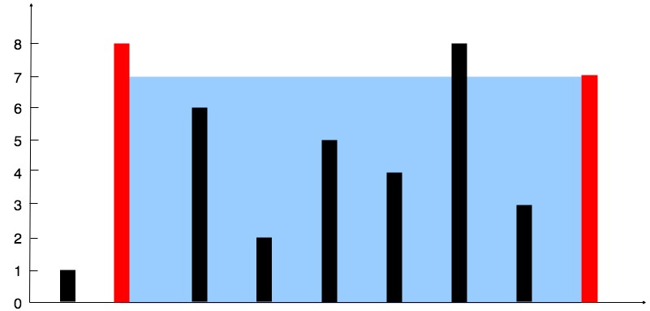
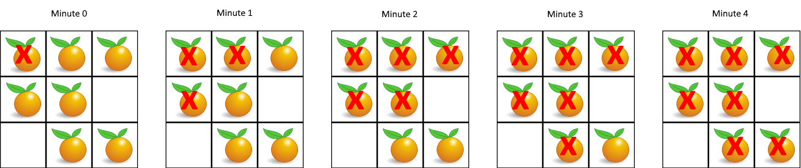
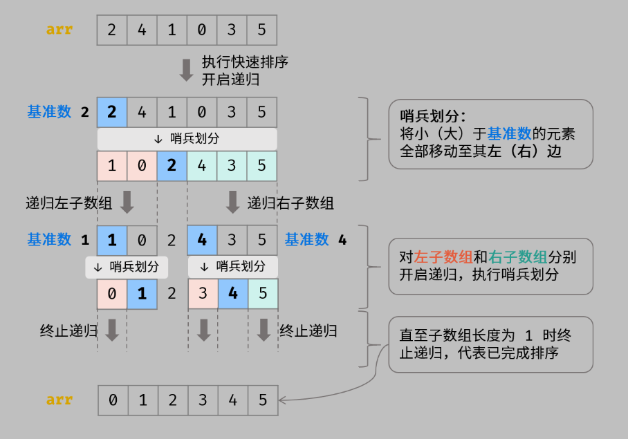
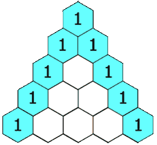
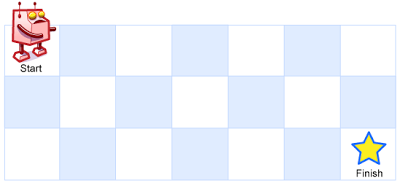
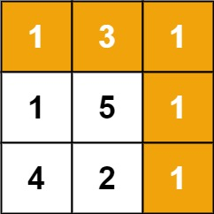

# 哈希表

## 四种哈希容器

### 1. unordered_set 哈希集合

- 头文件：`#include <unordered_set>`
- 存储：单一数值，无键值对
- 约束：元素唯一，无序
- 特性：**无 [] 运算符**
- 场景：去重、判断元素是否存在

### 2. unordered_map 哈希映射

- 头文件：`#include <unordered_map>`
- 存储：`key-value` 键值对
- 约束：key 唯一，value 可重复，无序
- 特性：支持 `mp[key]` 读写
- 场景：计数、建立映射关系

### 3. unordered_multiset 多重哈希集合

- 头文件：`#include <unordered_set>`
- 存储：单一数值
- 约束：**允许重复元素**，无序
- 特性：无 []；count (x) 返回该元素总个数（可大于 1）
- 场景：需要保存重复元素、统计元素总数量

### 4. unordered_multimap 多重哈希映射

- 头文件：`#include <unordered_map>`
- 存储：`key-value` 键值对
- 约束：**允许相同 key**，无序
- 特性：不支持 `[]` 运算符；count (x) 返回同 key 键值对总数
- 场景：一个 key 对应多个 value（一对多映射）

## 哈希容器通用 API

1. find (x)

   返回迭代器，找不到等于 

   ```
   .end()
   ```

- set/multiset：查找值 x
- map/multimap：查找 key=x

1. erase (x)

   删除匹配 x 的所有元素 / 键，不存在不报错

2. size () /empty () /clear () /begin () /end ()

   容量、迭代器接口完全一致

3. count (x)

   统计匹配 x 的数量

- unordered_set /unordered_map：只返回 0 或 1
- unordered_multiset /unordered_multimap：返回 ≥0 的真实总数

## 各容器独有接口

### unordered_set /unordered_multiset 独有

```
st.insert(val); // 插入单个数值
```

### unordered_map 独有

```
mp[key];                  // 下标读写value，不存在自动新建key
mp.insert({key, value});  // 插入键值对
it->first; it->second;    // 分别取key、value
```

### unordered_multimap 独有

无 `[]`；同一 key 多条数据，需结合循环遍历同 key 迭代器

```
auto range = mp.equal_range(key); // 获取该key所有键值对区间
for(auto it = range.first; it != range.second; it++){}
```

## 四者核心对比速查表

| 容器               | 存储类型  | key / 元素是否重复 | 支持 [] | count 返回值 |
| :----------------- | :-------- | :----------------- | :------ | :----------- |
| unordered_set      | 单值      | 不允许重复         | ❌       | 0 / 1        |
| unordered_multiset | 单值      | 允许重复           | ❌       | ≥0           |
| unordered_map      | key-value | key 不可重复       | ✅       | 0 / 1        |
| unordered_multimap | key-value | key 允许重复       | ❌       | ≥0           |

# 二叉树

## 二叉树基础结构

```c++
// 二叉树节点结构
typedef struct TreeNode {
    int val;
    struct TreeNode* left;
    struct TreeNode* right;
} TreeNode;

// 创建新节点
TreeNode* createNode(int val) {
    TreeNode* node = (TreeNode*)malloc(sizeof(TreeNode));
    node->val = val;
    node->left = NULL;
    node->right = NULL;
    return node;
}

// 释放整棵树（后序遍历释放）
void freeTree(TreeNode* root) {
    if (!root) return;
    freeTree(root->left);
    freeTree(root->right);
    free(root);
}
```

## 二叉树的遍历（核心）

### 递归序

```c++
// 递归序演示：每个节点会被访问3次
void recursiveOrder(TreeNode* node) {
    if (!node) return;
    // 第1次到达节点
    printf("第1次到达: %d\n", node->val);
    
    recursiveOrder(node->left);
    // 第2次到达节点（左子树返回后）
    printf("第2次到达: %d\n", node->val);
    
    recursiveOrder(node->right);
    // 第3次到达节点（右子树返回后）
    printf("第3次到达: %d\n", node->val);
}
```

### 三种深度优先遍历

| 遍历方式     | 打印时机            | 顺序         |
| :----------- | :------------------ | :----------- |
| **前序遍历** | 第1次到达节点时打印 | 根 → 左 → 右 |
| **中序遍历** | 第2次到达节点时打印 | 左 → 根 → 右 |
| **后序遍历** | 第3次到达节点时打印 | 左 → 右 → 根 |

#### 递归实现：

```c++
// 前序遍历：根→左→右
void preorderRecur(TreeNode* root) {
    if (!root) return;
    printf("%d ", root->val);      // 第1次到达打印
    preorderRecur(root->left);
    preorderRecur(root->right);
}

// 中序遍历：左→根→右
void inorderRecur(TreeNode* root) {
    if (!root) return;
    inorderRecur(root->left);
    printf("%d ", root->val);      // 第2次到达打印
    inorderRecur(root->right);
}

// 后序遍历：左→右→根
void postorderRecur(TreeNode* root) {
    if (!root) return;
    postorderRecur(root->left);
    postorderRecur(root->right);
    printf("%d ", root->val);      // 第3次到达打印
}
```

#### 迭代实现（重要）：

**迭代**：用**循环 + 容器（栈 / 队列 / 数组）** 手动重复执行逻辑，靠循环条件终止流程，不调用自身。

```c++
// 前序遍历：用栈，先压右再压左
void preorderIter(TreeNode* root) {
    if (!root) return;
    
    TreeNode* stack[1000];
    int top = -1;
    stack[++top] = root;
    
    while (top >= 0) {
        TreeNode* node = stack[top--];
        printf("%d ", node->val);
        
        // 先压右，再压左（保证左子树先出栈）
        if (node->right) stack[++top] = node->right;
        if (node->left) stack[++top] = node->left;
    }
}

// 中序遍历：先一路压左，弹出一个后处理右子树
void inorderIter(TreeNode* root) {
    TreeNode* stack[1000];
    int top = -1;
    TreeNode* cur = root;
    
    while (top >= 0 || cur) {
        while (cur) {      	// 一路向左，压入栈
            stack[++top] = cur;
            cur = cur->left;
        }
        
        cur = stack[top--]; // 弹出并访问
        printf("%d ", cur->val);
        
        cur = cur->right;   // 转向右子树
    }
}

// 后序遍历：用两个栈，或"根右左"反转
void postorderIter(TreeNode* root) {
    if (!root) return;
    
    TreeNode* stack1[1000];
    TreeNode* stack2[1000];
    int top1 = -1, top2 = -1;
    
    stack1[++top1] = root;
    
    // 第一个栈做"根右左"遍历
    while (top1 >= 0) {
        TreeNode* node = stack1[top1--];
        stack2[++top2] = node;  // 压入第二个栈
        
        if (node->left) stack1[++top1] = node->left;
        if (node->right) stack1[++top1] = node->right;
    }
    
    // 弹出第二个栈就是"左右根"
    while (top2 >= 0) {
        TreeNode* node = stack2[top2--];
        printf("%d ", node->val);
    }
}
```

####  层序遍历（BFS）

```c++
// 简单队列实现
typedef struct {
    TreeNode* data[1000];
    int front;
    int rear;
} Queue;

void initQueue(Queue* q) {
    q->front = q->rear = 0;
}

bool isEmpty(Queue* q) {
    return q->front == q->rear;
}

void enqueue(Queue* q, TreeNode* node) {
    q->data[q->rear++] = node;
}

TreeNode* dequeue(Queue* q) {
    return q->data[q->front++];
}

// 层序遍历：按层输出
void levelOrder(TreeNode* root) {
    if (!root) return;
    
    Queue q;
    initQueue(&q);
    enqueue(&q, root);
    
    while (!isEmpty(&q)) {
        int levelSize = q.rear - q.front;  // 当前层节点数
        
        for (int i = 0; i < levelSize; i++) {
            TreeNode* node = dequeue(&q);
            printf("%d ", node->val);
            
            if (node->left) enqueue(&q, node->left);
            if (node->right) enqueue(&q, node->right);
        }
        printf("\n");  // 每层换行
    }
}
```

# 图遍历算法

## DFS（深度优先搜索）

### 核心思想

> **“不撞南墙不回头”** — 沿着一条路径一直走到底，无法继续时回退到上一个岔路口，换条路再走。

**比喻**：走迷宫时，扶着墙一直走，走到死胡同再退回来。

------

### 数据结构

| 项目         | 内容                                |
| :----------- | :---------------------------------- |
| **数据结构** | 栈（Stack）                         |
| **处理原则** | 后进先出（LIFO）                    |
| **实现方式** | 递归（隐式调用系统栈）或 显式声明栈 |

------

### 递归实现（先序遍历）

```c++
void dfs(TreeNode* root) {
    if (root == nullptr) return;
    cout << root->val << " ";   // 处理当前节点
    dfs(root->left);            // 递归深入左子树
    dfs(root->right);           // 递归深入右子树
}
```

> 调自己，调左，调右，打印放前面 → 先序

**三种遍历只需移动 print 位置：**

- 先序：打印放最前面
- 中序：打印放中间（左和右之间）
- 后序：打印放最后面

------

### 迭代实现（重要）

```c++
#include <iostream>
using namespace std;

void dfs_iterative(TreeNode* root) {
    if (root == nullptr) return;
    
    stack<TreeNode*> st;
    st.push(root);              // 根节点入栈
    
    while (!st.empty()) {
        TreeNode* node = st.top();
        st.pop();               // 弹出栈顶
        cout << node->val << " "; // 处理当前节点
        
        if (node->right != nullptr) {  // 先压右（栈反序）
            st.push(node->right);
        }
        if (node->left != nullptr) {   // 再压左（保证左先出）
            st.push(node->left);
        }
    }
}
```

> 弹栈处理，先压右，再压左

------

### 适用场景

| 场景         | 说明                     |
| :----------- | :----------------------- |
| 迷宫寻路     | 判断两点是否连通         |
| 回溯算法     | 八皇后、全排列、组合问题 |
| 拓扑排序     | 有向图的依赖顺序         |
| 连通分量     | 岛屿数量、朋友圈         |
| 寻找所有路径 | 需要枚举全部可行方案     |

------

## BFS（广度优先搜索）

### 核心思想

> **“层层推进，水波扩散”** — 从一个节点出发，先访问所有邻居，再逐层向外扩散。

**比喻**：石子投入水面，涟漪一圈一圈向外扩散。

------

### 数据结构

| 项目         | 内容                              |
| :----------- | :-------------------------------- |
| **数据结构** | 队列（Queue）                     |
| **处理原则** | 先进先出（FIFO）                  |
| **实现方式** | 循环 + 队列（无递归，无爆栈风险） |

------

### 迭代实现

```c++
#include <queue>
#include <iostream>
using namespace std;

void bfs(TreeNode* root) {
    if (root == nullptr) return;
    
    queue<TreeNode*> q;
    q.push(root);               // 根节点入队
    
    while (!q.empty()) {
        TreeNode* node = q.front();
        q.pop();                // 弹出队首
        cout << node->val << " "; // 处理当前节点
        
        if (node->left != nullptr) {   // 先加左
            q.push(node->left);
        }
        if (node->right != nullptr) {  // 再加右
            q.push(node->right);
        }
    }
}
```

> 出队处理，先加左，再加右

------

### 适用场景

| 场景     | 说明                       |
| :------- | :------------------------- |
| 最短路径 | 无权图两点间最短距离       |
| 层序遍历 | 二叉树按层输出             |
| 社交网络 | 几度人脉关系               |
| Web爬虫  | 抓取策略                   |
| 状态搜索 | 最少步数问题（如单词接龙） |

------

## DFS vs BFS 对比

| 对比维度       | DFS                | BFS                  |
| :------------- | :----------------- | :------------------- |
| **数据结构**   | 栈（Stack）        | 队列（Queue）        |
| **实现方式**   | 递归 / 显式栈      | 循环 + 队列          |
| **空间复杂度** | O(深度) — 省内存   | O(宽度) — 费内存     |
| **最短路径**   | ❌ 不保证           | ✅ 保证（边权相等时） |
| **爆栈风险**   | ⚠️ 递归深时可能溢出 | ✅ 无风险             |
| **代码简洁度** | ✅ 递归极简         | ⚠️ 队列稍长           |

------

## 遍历顺序示例

```
树结构：
        1
      /   \
     2     3
    / \     \
   4   5     6

DFS（先序）：1 → 2 → 4 → 5 → 3 → 6
BFS（层序）：1 → 2 → 3 → 4 → 5 → 6
```

>  DFS（栈）和 BFS（队列）的**非递归实现代码结构几乎一样**，唯一区别是邻居的**入栈/入队顺序**和**弹出位置**。

>  如果**边的权重不同**，BFS 不再保证最短路径，需改用 Dijkstra 算法。

------

# 回溯算法

## 回溯算法的基本思想

通过递归的方式进行搜索，每一步都尝试扩展当前的解，直到找到满足条件的解或者确定无解。在搜索的过程中，如果当前的解不满足约束条件，就会回溯到上一步进行其他选择，继续搜索

## 一般步骤

1. 定义问题的解空间，确定问题的约束条件。
2. 通过递归的方式搜索解空间，每一步都进行选择，并进行约束条件的检查。
3. 如果当前的选择满足约束条件，则继续递归地进行下一步选择。
4. 如果当前的选择不满足约束条件，进行回溯，撤销当前选择，返回上一步继续搜索其他选择。
5. 当搜索完成后，得到所有满足条件的解。

回溯算法的==时间复杂度通常较高==，因为它需要枚举所有可能的解。可以通过剪枝等优化策略来减少搜索空间，提高算法效率。

------

# 哈希

## 两数之和

给定整数数组 `nums` 和一个整数目标值 `target`，请你在该数组中找出和为目标值 *`target`* 的那两个整数，并返回它们的数组下标。
你可以假设每种输入只会对应一个答案，并且你不能使用两次相同的元素。

哈希表存：`数值 → 下标`

遍历每个数字：

- 算出需要的配对数
- 表中有配对数 → 直接返回两个下标
- 表中无配对数 → 把当前数 + 下标存入表

```c++
#include <vector>
#include <unordered_map>
using namespace std;

class Solution {
public:
    vector<int> twoSum(vector<int>& nums, int target) {
        unordered_map<int, int> mp;      //C++ 哈希表容器，键值对存储：key → value
        for (int i = 0; i < nums.size(); i++) {
            int need = target - nums[i];
            if (mp.find(need) != mp.end()) {
                return {mp[need], i};    // 找到配对数字，直接返回下标
            }
            mp[nums[i]] = i;             // 存入当前值和下标
        }
        return {};
    }
};
```

------

## 字母异位词分组

给你一个字符串数组，请你将 **字母异位词** 组合在一起。可以按任意顺序返回结果列表。

> **输入:** strs = ["eat", "tea", "tan", "ate", "nat", "bat"]
>
> **输出:** [["bat"],["nat","tan"],["ate","eat","tea"]]

```c++
class Solution {
public:
    vector<vector<string>> groupAnagrams(vector<string>& strs) {
        unordered_map<string, vector<string>>mp;
        vector<vector<string>> res;
        for(string &s : strs)
        {
            string key = s;
            sort(key.begin(), key.end());   // 对字符串排序
            mp[key].push_back(s);
        }
        for(auto &p : mp) {
            res.push_back(p.second);
        }
        return res;
    }
};
```


# ==双指针==

## 移动零

给定一个数组 `nums`，编写一个函数将所有 `0` 移动到数组的末尾，同时保持非零元素的相对顺序。
**请注意** ，必须在不复制数组的情况下原地对数组进行操作。

快指针记录要存储的值，慢指针记录存储的索引

```c++
class Solution {
public:
    void moveZeroes(vector<int>& nums) {
        int s = 0;
        for(int i=0; i < nums.size(); i++)
            if(nums[i]) 
            	swap(nums[s++],nums[i]);
    }
};
```

**for 循环指针自动移动，不需要自己写逻辑**


## 盛水最多的容器

给定一个长度为 `n` 的整数数组 `height` 。有 `n` 条垂线，第 `i` 条线的两个端点是 `(i, 0)` 和 `(i, height[i])` 。

找出其中的两条线，使得它们与 `x` 轴共同构成的容器可以容纳最多的水。

返回容器可以储存的最大水量。

**说明：**你不能倾斜容器。



```C++
#include <iostream>
#include <vector>
#include <algorithm>

using namespace std;

// 使用两个指针分别指向数组的两端，然后每次移动高度较短的那条线
int maxArea(vector<int>& height)
{
    int n = height.size();
    int maxarea = 0;

    int left = 0, right = n-1;
    while(left < right) {
        maxarea = max(maxarea, (right - left) * min(height[left], height[right]));
        if(height[left] < height[right])
            left++;
        else
            right--;
    }
    return maxarea;
}

int main() {
    int res = 0;
    int x;
    vector<int> height;
    while(cin >> x)
        height.push_back(x);
    res = maxArea(height);
    count << res << endl;
    return 0;
}
```


## 三数之和

给你一个整数数组 `nums` ，判断是否存在三元组 `[nums[i], nums[j], nums[k]]` 满足 `i != j`、`i != k` 且 `j != k` ，同时还满足 `nums[i] + nums[j] + nums[k] == 0` 。请你返回所有和为 `0` 且不重复的三元组。

**注意：**答案中不可以包含重复的三元组。

```
输入：nums = [-1,0,1,2,-1,-4]
输出：[[-1,-1,2],[-1,0,1]]
解释：
nums[0] + nums[1] + nums[2] = (-1) + 0 + 1 = 0 。
nums[1] + nums[2] + nums[4] = 0 + 1 + (-1) = 0 。
nums[0] + nums[3] + nums[4] = (-1) + 2 + (-1) = 0 。
不同的三元组是 [-1,0,1] 和 [-1,-1,2] 。
注意，输出的顺序和三元组的顺序并不重要。
```

```C++
#include <iostream>
#include <vector>
#include <algorithm>
#include <set>

using namespace std;

vector<vector<int>> threeSum(vector<int>& nums)
{
    set<vector<int>> res_set;    // 去重 ！！！
    // !!! 排序 三元组自动是升序的，可以使用set去重数组成员
    sort(nums.begin(), nums.end());
    int left, right;
    for(int i = 0; i < nums.size(); i++) {
        left  = i + 1;
        right = nums.size() - 1;
        while(left < right) {
            if(nums[i] + nums[left] + nums[right] == 0) {
                res_set.insert({nums[i], nums[left], nums[right]});
                left++;
                right--;
            }
            else if(nums[i] + nums[left] + nums[right] > 0)
                right--;
            else if(nums[i] + nums[left] + nums[right] < 0)
                left++;
        }
    }
    // 将 set 转换为 vector
    vector<vector<int>> res(res_set.begin(), res_set.end());
    return res;
}

int main ()
{
    int x;
    vector<int> nums;
    vector<vector<int>> res;
    while(cin >> x)
        nums.push_back(x);
    
    res = threeSum(nums);
    for(int i = 0; i < res.size(); i++) {
        cout << '[';
        for(int j = 0; j < 3; j++) {
            if(!j)
                cout << res[i][j];
            else
                cout << ',' << res[i][j];
        }
        cout << ']';
    } 
}
```


# ==滑动窗口==

## 无重复字符的最长子串

给定一个字符串 `s` ，请你找出其中不含有重复字符的 **最长 子串** 的长度。

```c++
#include <string>
#include <unordered_set>
#include <algorithm>
using namespace std;

class Solution {
public:
    int lengthOfLongestSubstring(string s) {
        unordered_set<char> window;    // 存储当前窗口内无重复字符
        int left = 0;                  // 滑动窗口左边界，窗口区间[left, right]
        int maxLen = 0;                // 保存最长无重复子串长度

        for (int right = 0; right < s.size(); right++) {  // right为窗口右边界，遍历全部字符
            while (window.count(s[right])) {              // 当前字符存在于窗口，发生重复
                window.erase(s[left]);                    // 删除窗口最左侧字符
                left++;                                   // 左边界右移，缩小窗口
            }
            window.insert(s[right]);                      // 将当前字符加入窗口
            maxLen = max(maxLen, right - left + 1);       // 更新最大长度
        }
        return maxLen;
    }
};
```


## 找到字符串中所有字母异位词

给定两个字符串 `s` 和 `p`，找到 `s` 中所有 `p` 的 **异位词** 的子串，返回这些子串的起始索引。不考虑答案输出的顺序。

>输入: s = "cbaebabacd", p = "abc"
>输出: [0,6]
>解释:
>起始索引等于 0 的子串是 "cba", 它是 "abc" 的异位词。
>起始索引等于 6 的子串是 "bac", 它是 "abc" 的异位词。

```c++
#include <iostream>
#include <vector>
#include <array>

using namespace std;

vector<int> findAnagrams(string s, string p)
{
    array<int, 26> cnt_p{};
    array<int, 26> cnt_s{};
    vector<int> arr;
    for(char c : p)
        cnt_p[c - 'a']++;

    for(int i = 0; i < s.size(); i++) {
        cnt_s[s[i] - 'a']++;
        int j = i - p.size() + 1;
        if(j < 0)
            continue;

        if(cnt_p == cnt_s)
            arr.push_back(j);
        cnt_s[s[j] - 'a']--;
    }  
    return arr;
}

int main()
{
    string s, p;
    cin >> s >> p;
    vector<int> res;
    res = findAnagrams(s, p);

    cout << "[";
    for(int i = 0; i < res.size();i++){
        if(i > 0) cout << ", ";
        cout << res[i];
    }
    cout << "]" << endl;
}
```


## 长度最小的子数组

给定一个含有 `n` 个正整数的数组和一个正整数 `target` **。**

找出该数组中满足其和 `≥ target` 的长度最小的 **连续子数组** `[numsl, numsl+1, ..., numsr-1, numsr]` ，并返回其长度**。**如果不存在符合条件的子数组，返回 `0` 

> 输入：target = 7, nums = [2,3,1,2,4,3]
> 输出：2
> 解释：子数组 [4,3] 是该条件下的长度最小的子数组。

```C++
#include <iostream>
#include <vector>
#include <algorithm>
#include <climits>

using namespace std;

// ================事件复杂度 O(n²)====================
int minSubArrayLen(int target, vector<int>& nums)
{
    // 维护变量
    int minlen = nums.size();
    int flag = 0;
    int temp;
    for(int i = 0; i < nums.size(); i++) {
        temp = 0;
        for(int j = i; j < nums.size(); j++) {
            temp += nums[j];
            if(temp >= target) {
                flag = 1;
                minlen = min(minlen, j - i + 1);
                break;
            }
        }
    }
    if(!flag)
        return 0;
    return minlen;
}

// =========滑动窗口标准解法，事件复杂度O(n)============
int minSubArrayLen(int target, vector<int>& nums) {
    int left = 0;
    int sum = 0;
    int minlen = INT_MAX;  // INT_MAX 表示 int 类型能存储的最大值 包含头文件<climits>
    
    for(int right = 0; right < nums.size(); right++) {
        sum += nums[right];  // 扩大窗口
        
        while(sum >= target) {  // 收缩窗口
            minlen = min(minlen, right - left + 1);
            sum -= nums[left];
            left++;
        }
    }
    return minlen == INT_MAX ? 0 : minlen;
}

int main ()
{
    int res, x;
    int target;
    vector<int> nums;
    cin >> target;
    while(cin >> x)
        nums.push_back(x);
    res = minSubArrayLen(target, nums);
    cout << res;
    return 0;
}
```


## 字符串的排列

## 最短超串

## 最小覆盖子串


# 子串

## 和为 K 的子数组

给你一个整数数组 `nums` 和一个整数 `k` ，请你统计并返回 *该数组中和为 `k` 的子数组的个数* 。

子数组是数组中元素的连续非空序列。

1. **前缀和定义**
   令 `prefix[i]` 表示 `nums[0..i-1]` 的和。
   那么子数组 `nums[j..i]` 的和 = `prefix[i+1] - prefix[j]`。
2. **问题转化**
   我们要找有多少对 `(j, i)` 使得
   `prefix[i+1] - prefix[j] = k`
   → `prefix[j] = prefix[i+1] - k`
3. **哈希表记录**
   遍历数组时，维护当前前缀和 `cur`。
   对每个 `cur`，我们要找之前出现过多少个 `cur - k`，这些就是能和当前前缀和组成和为 `k` 的子数组的起点。
4. **初始化**
   哈希表先放入 `{0: 1}`，表示前缀和为 0 出现了一次（空数组），这样能正确处理从数组开头开始的子数组。

```c++
class Solution {
public:
    int subarraySum(vector<int>& nums, int k) {
        unordered_map<int, int> prefixSum;
        prefixSum[0] = 1;        // 前缀和为0出现一次（空数组）
        int cur = 0;
        int count = 0;
        
        for (int num : nums) {
            cur += num;

            // 查找是否存在前缀和 = cur - k
            if (prefixSum.find(cur - k) != prefixSum.end()) {
                count += prefixSum[cur - k];
            }
            prefixSum[cur]++;    // 记录当前前缀和
        }
        return count;
    }
};
```

# 数组

## 最大子数组和

给你一个整数数组 `nums` ，请你找出一个具有最大和的连续子数组（子数组最少包含一个元素），返回其最大和。

**子数组**是数组中的一个连续部分。

**Kadane算法**

**关键思想**：遍历数组时，维护两个变量：

- `currentSum`：以当前元素结尾的最大子数组和
- `maxSum`：全局最大子数组和

**状态转移方程**：

```
currentSum = max(num, currentSum + num)
maxSum = max(maxSum, currentSum)
```

**含义**：对于每个元素，要么**从当前元素重新开始**（放弃之前的子数组），要么**延续之前的子数组**（加上当前元素）。

```c++
class Solution {
public:
    int maxSubArray(vector<int>& nums) {
        int currentSum = nums[0];  // 以第一个元素结尾的最大和
        int maxSum = nums[0];      // 全局最大和
        
        for (int i = 1; i < nums.size(); i++) {
            // 要么从当前元素重新开始，要么延续之前的子数组
            currentSum = max(nums[i], currentSum + nums[i]);
            maxSum = max(maxSum, currentSum);
        } 
        return maxSum;
    }
};
```

# 矩阵

## 矩阵置零

给定一个 `m x n` 的矩阵，如果一个元素为 **0** ，则将其所在行和列的所有元素都设为 **0** 。请使用 **[原地](http://baike.baidu.com/item/原地算法)** 算法。

```c++
class Solution {
public:
    void setZeroes(vector<vector<int>>& matrix) {
        int row_flag = 0;          // 预留标记，记录首行首列是否需要清零
        int column_flag = 0;
        int m = matrix.size();
        int n = matrix[0].size();

        for(int i = 0; i < m; i++) {
            if(matrix[i][0] == 0) {
                column_flag = 1;   // 首列有0
                break;
            }
        }

        for(int i = 0; i < n; i++) {
            if(matrix[0][i] == 0) {
                row_flag = 1;      // 首行有0
                break;
            }
        }

        // 跳过首行和首列开始记录
        for(int i = 1; i < m; i++) {
            for(int j = 1; j < n; j++) {
                if(matrix[i][j] == 0) {
                    // 记录0所在的行和列
                    matrix[i][0] = 0;
                    matrix[0][j] = 0;
                }
            }
        }

        // 行首为0则将整行值为零
        for(int i = 1; i < m; i++) {
            if(matrix[i][0] == 0) {
                for(int j = 0; j < n; j++)
                    matrix[i][j] = 0;
            }
        }

        // 列首为0则将整列值为零
        for(int i = 1; i < n; i++) {
            if(matrix[0][i] == 0) {
                for(int j = 0; j < m; j++)
                    matrix[j][i] = 0;
            }
        }

        if(row_flag == 1)
            for(int i = 0; i < n; i++)
                matrix[0][i] = 0;
        
        if(column_flag == 1)
            for(int i = 0; i < m; i++)
                matrix[i][0] = 0;
    }
};
```

# 链表

## 反转链表

给你单链表的头节点 `head` ，请你反转链表，并返回反转后的链表。

#### 迭代法（双指针，空间 O (1)）

1. 定义 `pre` 前驱节点（初始为`null`）、`cur` 当前节点（初始为`head`）
2. 循环：先保存`cur`下一个节点`next`，再将`cur.next`指向`pre`，然后`pre`、`cur`同步后移
3. 循环结束时`cur`为空，`pre`就是反转后的头节点

```c++
/**
 * Definition for singly-linked list.
 * struct ListNode {
 *     int val;
 *     ListNode *next;
 *     ListNode() : val(0), next(nullptr) {}
 *     ListNode(int x) : val(x), next(nullptr) {}
 *     ListNode(int x, ListNode *next) : val(x), next(next) {}
 * };
 */
class Solution {
public:
    ListNode* reverseList(ListNode* head) {
        ListNode *prec = NULL;
        ListNode *cur = head;

        while(cur)
        {
            ListNode *next = cur -> next; // 暂存下一个节点
            cur -> next = prec;           // 将链表节点反向
            prec = cur;                   // pre向前移动
            cur = next;                   // cur向前移动
        }
        return prec;
    }
};
```

------

#### 递归法（空间 O (n)，栈深度为链表长度）

1. 递归终止：`head`为空或只剩单个节点，直接返回
2. 递归反转`head.next`之后的子链表，得到新头`newHead`
3. 将原后继节点指向自己，自身`next`置空防止环
4. 返回新头`newHead`

```
reverseList(1)
  ├── reverseList(2)
  │   ├── reverseList(3)
  │   │   ├── reverseList(4)
  │   │   │   └── 返回 4 (终止条件：4->next == NULL)
  │   │   └── 处理节点 3
  │   └── 处理节点 2
  └── 处理节点 1
```

```c++
/**
 * Definition for singly-linked list.
 * struct ListNode {
 *     int val;
 *     ListNode *next;
 *     ListNode() : val(0), next(nullptr) {}
 *     ListNode(int x) : val(x), next(nullptr) {}
 *     ListNode(int x, ListNode *next) : val(x), next(next) {}
 * };
 */
class Solution {
public:
    ListNode* reverseList(ListNode* head) {
        if(!head || !head->next)        // 判断退出条件
            return head;

        ListNode *newhead = reverseList(head -> next);
        head -> next -> next = head;    // 反转链表方向
        head -> next = NULL;
        return newhead;
    }
};
```

# 二叉树

## 二叉树的中序遍历

给定一个二叉树的根节点 `root` ，返回 *它的 **中序** 遍历* 。

#### 递归法

```c++
/**
 * Definition for a binary tree node.
 * struct TreeNode {
 *     int val;
 *     TreeNode *left;
 *     TreeNode *right;
 *     TreeNode() : val(0), left(nullptr), right(nullptr) {}
 *     TreeNode(int x) : val(x), left(nullptr), right(nullptr) {}
 *     TreeNode(int x, TreeNode *left, TreeNode *right) : val(x), left(left), right(right) {}
 * };
 */
class Solution {
public:
    vector<int> inorderTraversal(TreeNode* root) {
        vector<int> res;
        inorder(root, res);
        return res;
    }

    void inorder(TreeNode *root, vector<int>& arr)
    {
        if(!root) return;
        inorder(root -> left, arr);
        arr.push_back(root -> val);
        inorder(root -> right, arr);
    }
};
```

#### 迭代法

```c++
#include <iostream>
#include <stack>
#include <vector>

/**
 * Definition for a binary tree node.
 * struct TreeNode {
 *     int val;
 *     TreeNode *left;
 *     TreeNode *right;
 *     TreeNode() : val(0), left(nullptr), right(nullptr) {}
 *     TreeNode(int x) : val(x), left(nullptr), right(nullptr) {}
 *     TreeNode(int x, TreeNode *left, TreeNode *right) : val(x), left(left), right(right) {}
 * };
 */
class Solution {
public:
    vector<int> inorderTraversal(TreeNode* root) {
        vector<int> res;
        stack<TreeNode*> st;
        int st_count = -1;
        TreeNode *cur = root;

        while(st_count >= 0 || cur)
        {
            while(cur)    // 向左压栈
            {
                st.push(cur);
                st_count++;
                cur = cur -> left;
            }

            // 左节点为空，退栈并压入右节点
            cur = st.top();
            st.pop();
            res.push_back(cur -> val);
            st_count--;
            cur = cur -> right;
        }
        return res;
    }
};
```

# ==图论==

## 岛屿数量

给你一个由 `'1'`（陆地）和 `'0'`（水）组成的的二维网格，请你计算网格中岛屿的数量。

岛屿总是被水包围，并且每座岛屿只能由水平方向和/或竖直方向上相邻的陆地连接形成。

此外，你可以假设该网格的四条边均被水包围。

#### DFS

> 递归本质就是系统栈，**后进先出**，优先往某个方向深挖，走不通再回溯换方向

```c++
class Solution {
public:
    int m = 0;
    int n = 0;

    int numIslands(vector<vector<char>>& grid) {
        int res = 0;
        m = grid.size();
        n = grid[0].size();

        for(int i = 0; i < m; i++) {
            for(int j = 0; j < n; j++) {
                if(grid[i][j] == '1')
                {
                    res++;
                    dfs(grid, i, j);   // 找到岛屿，进入搜索
                }
            }
        }
        return res;
    }

private:
    void dfs(vector<vector<char>>& grid, int x, int y)
    {
        if(x < 0 || x >= m || y < 0 || y >= n || grid[x][y] == '0')
            return;
        grid[x][y] = '0';   // 标记为已搜索

        dfs(grid, x + 1, y);
        dfs(grid, x - 1, y);
        dfs(grid, x, y + 1);
        dfs(grid, x, y - 1);
    }
};
```

------

#### BFS

> 越早发现的格子优先处理，使用队列**先进先出**的特性

```c++
class Solution {
public:
    int numIslands(vector<vector<char>>& grid) {
        if (grid.empty() || grid[0].empty()) return 0;
        
        int res = 0;
        int m = grid.size();
        int n = grid[0].size();
        
        // 方向数组：上、下、左、右
        int dx[4] = {-1, 1, 0, 0};
        int dy[4] = {0, 0, -1, 1};
        
        for (int i = 0; i < m; i++) {
            for (int j = 0; j < n; j++) {
                if (grid[i][j] == '1') {
                    res++;
                    
                    // BFS：使用队列（先进先出）
                    queue<pair<int, int>> q;
                    q.push({i, j});    // 发现岛屿的第一个格子，入队
                    grid[i][j] = '0';  // 标记已访问
                    
                    while (!q.empty()) {          // ！！！关键判断
                        auto [x, y] = q.front();  // 查看队头元素（但不删除）
                        q.pop();                  // 删除队头元素，表示"已探索完成"
                        
                        for (int k = 0; k < 4; k++) {  // 遍历四个方向
                            int nx = x + dx[k];
                            int ny = y + dy[k];
                            
                            // 检查是否越界且为陆地
                            if (nx >= 0 && nx < m && ny >= 0 && ny < n && grid[nx][ny] == '1') {
                                grid[nx][ny] = '0';  // 标记已访问
                                q.push({nx, ny});    // 探索时发现相邻陆地，入队
                            }
                        }
                    }
                }
            }
        }
        return res;
    }
};
```


## 腐烂的橘子（多源 BFS）

在给定的 `m x n` 网格 `grid` 中，每个单元格可以有以下三个值之一：

- 值 `0` 代表空单元格；
- 值 `1` 代表新鲜橘子；
- 值 `2` 代表腐烂的橘子。

每分钟，腐烂的橘子 **周围 4 个方向上相邻** 的新鲜橘子都会腐烂。

返回 *直到单元格中没有新鲜橘子为止所必须经过的最小分钟数。如果不可能，返回 `-1`* 



```C++
#include <iostream>
#include <vector>
#include <queue>

using namespace std;
  
int orangesRotting(vector<vector<int>>& grid)
{
    int minutes = 0;
    int fresh = 0;  // 记录新鲜橘子数量
    queue<pair<int, int>> q;
    /*              上  下 左 右 */
    int arr_x[4] = {-1, 1, 0, 0};
    int arr_y[4] = {0, 0, -1, 1};
    int x = 0, y = 0;

    // 从所有腐烂橘子同时开始 BFS
    for(int i = 0; i < grid.size(); i++) {
        for(int j = 0; j < grid[0].size(); j++) {
            if(grid[i][j] == 1) {
                fresh++;  // 统计新鲜橘子
            } else if(grid[i][j] == 2) {
                q.push({i, j});  // 所有腐烂橘子作为 BFS 起点
            }
        }
    }

    // 如果没有新鲜橘子，直接返回 0
    if(fresh == 0) return 0;

    while(!q.empty() && fresh > 0) {
        int size = q.size();  // 当前这一分钟腐烂的橘子数量

        // 处理这一分钟所有腐烂的橘子  !!!
        for(int i = 0; i < size; i++) {
            auto [x, y] = q.front();
            q.pop();

            for(int k = 0; k < 4; k++) {
                int nx = x + arr_x[k];
                int ny = y + arr_y[k];
                if(nx >= 0 && nx < grid.size() && ny >= 0 \
                    && ny < grid[0].size() && grid[nx][ny] == 1) {
                    grid[nx][ny] = 2;
                    fresh--;           // 新鲜橘子减少
                    q.push({nx, ny});  // 新腐烂的橘子加入队列
                }
            }
        }
        minutes++;  // 这一分钟结束，时间+1
    }
    if(fresh) return -1;
    return minutes;
}

int main()
{
    int res;
    int m = 0, n = 0;
    cin >> m >> n;
    vector<vector<int>> grid(m, vector<int>(n, 0)); 
    for(int i = 0; i < m; i++) {
        for(int j = 0; j < n; j++) {
            cin >> grid[i][j];
        }
    }
    res = orangesRotting(grid);
    cout << res;
    return 0;
}
```


## **<u>课程表</u>**

你这个学期必须选修 `numCourses` 门课程，记为 `0` 到 `numCourses - 1` 。

在选修某些课程之前需要一些先修课程。 先修课程按数组 `prerequisites` 给出，其中 `prerequisites[i] = [ai, bi]` ，表示如果要学习课程 `ai` 则 **必须** 先学习课程 `bi` 。

- 例如，先修课程对 `[0, 1]` 表示：想要学习课程 `0` ，你需要先完成课程 `1` 。

请你判断是否可能完成所有课程的学习？如果可以，返回 `true` ；否则，返回 `false` 。

> 输入：numCourses = 2, prerequisites = [[1,0]]
> 输出：true
> 解释：总共有 2 门课程。学习课程 1 之前，你需要完成课程 0 。这是可能的。

> 输入：numCourses = 2, prerequisites = [[1,0],[0,1]]
> 输出：false
> 解释：总共有 2 门课程。学习课程 1 之前，你需要先完成课程 0 ；并且学习课程 0 之前，你还应先完成课程 1 。这是不可能的。

```C++
/* 课程之间的依赖关系构成一个有向图，如果能完成所有课程，说明图中没有环 
 *
 * 每门课的入度需要被记录，关心入度值的变化。
 * 课程之间的依赖关系也要被记录，关心选当前课会减小哪些课的入度。
 * 因此需要选择合适的数据结构，去存这些数据：
 * 入度数组：课号 0 到 n - 1 作为索引，通过遍历先决条件表求出对应的初始入度。
 * 邻接表：用哈希表记录依赖关系（也可以用二维矩阵，但有点大）
 * key：课号
 * value：依赖这门课的后续课（数组）
 */

#include <iostream>
#include <vector>
#include <unordered_map>
#include <queue>

using namespace std;

bool canFinish(int numCourses, vector<vector<int>>& prerequisites)
{
    vector<int> inDegree(numCourses);    // 记录每门课程的入度
    unordered_map<int, vector<int>> map; // 记录课程依赖关系
    for(int i = 0; i < prerequisites.size(); i++) {
        inDegree[prerequisites[i][0]]++;
        map[prerequisites[i][1]].push_back(prerequisites[i][0]);
    }
    queue<int> que;
    for(int i = 0; i < numCourses; i++) {
        if(inDegree[i] == 0) que.push(i);
    }
    int count = 0; // 用来记录上了多少课
    while(que.size()) {
        int managed = que.front(); // 处理队首
        que.pop();
        count++;
        // 更新所有关联课程的入度
        for(int i = 0; i < map[managed].size(); i++) {
            if (inDegree[map[managed][i]] > 0) {
                inDegree[map[managed][i]]--;
                if(inDegree[map[managed][i]] == 0) 
                    que.push(map[managed][i]);  // 将入度降至0的课程放入队列
            }
        }
    }
    if(count == numCourses)
        return true;
    else
        return false;
}

int main()
{
    int numCourses;
    int a, b;
    vector<vector<int>> prerequisites;
    cin >> numCourses;
    while(cin >> a >> b) {
        prerequisites.push_back({a,b});
    }
    bool res = canFinish(numCourses, prerequisites);
    cout << boolalpha << res;
    return 0;
}
```


# 回溯

## 全排列

给定一个不含重复数字的数组 `nums` ，返回**所有可能的全排列** 。你可以 **按任意顺序** 返回答案。

```
输入：nums = [1,2,3]
输出：[[1,2,3],[1,3,2],[2,1,3],[2,3,1],[3,1,2],[3,2,1]]
```

```c++
class Solution {
public:
    vector<vector<int>> permute(vector<int>& nums) {
        vector<vector<int>> result;
        backtrack(nums, result, 0);
        return result;
    }
    
    /**
     * 回溯函数：通过交换的方式生成全排列
     * @param nums   当前排列数组（会不断修改）
     * @param result 存储所有完整排列的结果集
     * @param start  当前要确定的位置索引
     * 
     * 核心思想：固定 start 位置之前的元素，用 start 及之后的元素来填充 start 位置
     * 例如：nums = [1,2,3], start = 0
     *   - 固定位置0，尝试将 nums[0], nums[1], nums[2] 分别放到位置0
     *   - 然后递归确定位置1，位置2...
     */
    void backtrack(vector<int>& nums, vector<vector<int>>& result, int start) {
        // 终止条件：start 到达数组末尾，说明所有位置都已确定
        // 此时 nums 已经是一个完整的排列
        if (start == nums.size()) {
            result.push_back(nums);
            return;
        }
        
        for (int i = start; i < nums.size(); i++) {
            swap(nums[start], nums[i]);         // 做选择
            backtrack(nums, result, start + 1); // 递归
            swap(nums[start], nums[i]);         // 撤销选择（回溯）
        }
    }
};
```

```c++
                                    [ ]
                                   start=0
                                    |
                    ┌───────────────┼───────────────┐
                    |               |               |
                  i=0             i=1             i=2
              swap(0,0)       swap(0,1)       swap(0,2)
                    |               |               |
                   [1]             [2]             [3]
                  start=1         start=1         start=1
                    |               |               |
              ┌─────┴─────┐   ┌─────┴─────┐   ┌─────┴─────┐
              |           |   |           |   |           |
            i=1         i=2 i=1         i=2 i=1         i=2
        swap(1,1)   swap(1,2) swap(1,1) swap(1,2) swap(1,1) swap(1,2)
              |           |   |           |   |           |
             [1,2]       [1,3] [2,1]     [2,3] [3,2]     [3,1]
            start=2     start=2 start=2   start=2 start=2 start=2
              |           |   |           |   |           |
              |           |   |           |   |           |
            i=2         i=2 i=2         i=2 i=2         i=2
        swap(2,2)   swap(2,2) swap(2,2) swap(2,2) swap(2,2) swap(2,2)
              |           |   |           |   |           |
          [1,2,3]     [1,3,2] [2,1,3]   [2,3,1] [3,2,1]   [3,1,2]
           ✓记录       ✓记录   ✓记录     ✓记录   ✓记录     ✓记录
```


# 二分查找

## 搜索插入位置

给定一个排序数组和一个目标值，在数组中找到目标值，并返回其索引。如果目标值不存在于数组中，返回它将会被按顺序插入的位置。

请必须使用时间复杂度为 `O(log n)` 的算法。

```C
class Solution {
public:
    int searchInsert(vector<int>& nums, int target) {
        int left = 0;
        int right = nums.size() - 1;
        int mid;
        while(left <= right)
        {
            mid = left + (right - left) / 2;
            if(nums[mid] == target)
                return mid;
            else if(nums[mid] < target)
                left = mid + 1;  // 目标在右区间
            else if(nums[mid] > target)
                right = mid - 1; // 目标在左区间
        }
        return left;  // 循环结束时left > right，left就是插入位置
    }
};
```

# 栈

## 有效的括号

给定一个只包括 `'('`，`')'`，`'{'`，`'}'`，`'['`，`']'` 的字符串 `s` ，判断字符串是否有效

有效字符串需满足：

1. 左括号必须用相同类型的右括号闭合。
2. 左括号必须以正确的顺序闭合。
3. 每个右括号都有一个对应的相同类型的左括号。

```C++
#include <stack>
class Solution {
public:
    bool isValid(string s) {
        if (s.size() % 2 != 0) return false;
        stack<char> st;
        for (char ch : s)
        {
            // 左括号入栈
            if (ch == '(' || ch == '{' || ch == '[')
            {
                st.push(ch);
            }
            else
            {
                // 无左括号匹配，直接失败
                if (st.empty()) return false;
                char top = st.top();
                st.pop();
                // 括号类型不匹配，返回false
                if ((ch == ')' && top != '(')
                || (ch == '}' && top != '{')
                || (ch == ']' && top != '['))
                {
                    return false;
                }
            }
        }
        // 栈空说明全部闭合
        return st.empty();
    }
};
```

# 堆

## 数组中的第 K 个最大元素

给定整数数组 `nums` 和整数 `k`，请返回数组中第 `**k**` 个最大的元素。

请注意，你需要找的是数组排序后的第 `k` 个最大的元素，而不是第 `k` 个不同的元素。

你必须设计并实现时间复杂度为 `O(n)` 的算法解决此问题。

#### 排序  O(N log N）

```C++
class Solution {
public:
    int findKthLargest(vector<int>& nums, int k) {
        sort(nums.begin(), nums.end());
        return nums[nums.size() - k];
    }
};
```


#### 基于快速排序的选择方法  O(n)

- **哨兵划分**： 以数组某个元素（一般取首元素）为基准数，将所有小于基准数的元素移动至其左边，大于基准数的元素移动至其右边

- **递归**： 对 左子数组 和 右子数组 递归执行 哨兵划分，直至子数组长度为 1 时终止递归，即可完成对整个数组的排序

  

```C++
class Solution {
public:
    int findKthLargest(vector<int>& nums, int k) {
        vector<int> prev, next, mid;
        int base = nums[0];
        for(int num : nums)
        {
            if(num < base)
                prev.push_back(num);
            if(num > base)
                next.push_back(num);
            if(num == base)
                mid.push_back(num);
        }
        if(k <= next.size())  // k在右子数组
            return findKthLargest(next, k);
        if(k > nums.size() - prev.size())  // k在左子数组
            return findKthLargest(prev, k - (nums.size() - prev.size()));
        return base;
    }
};
```


#### 基于堆排序的选择方法  O(n log k)

- 利用**最小堆**维护数组中最大的 k 个元素。最小堆的堆顶始终是堆中最小的元素，当堆的大小超过 k 时，移除堆顶元素，保证堆中始终保存当前已遍历元素中最大的 k 个。遍历结束后，堆顶元素即为第 k 大的元素。
- **初始化**：创建一个最小堆 `minHeap`（优先级队列），堆顶元素为堆中最小值。
- **遍历数组**：对于数组中的每个元素 `num`，执行以下操作：
  - 将 `num` 插入最小堆中，时间复杂度 O(log k)。
  - 若堆的大小超过 k，则弹出堆顶元素（即当前堆中最小的元素），确保堆的大小始终不超过 k。
- **返回结果**：遍历结束后，堆中存储的是整个数组中最大的 k 个元素，堆顶元素即为其中最小值，也就是原数组的第 k 大元素。

```C++
class Solution {
public:
    int findKthLargest(vector<int>& nums, int k) {
        // 创建最小堆，priority_queue默认是最大堆
        // 使用greater<int>使其变为最小堆
        priority_queue<int, vector<int>, greater<int>> minHeap;
        
        // 遍历数组
        for (int num : nums) {
            minHeap.push(num);  // 插入元素，时间复杂度O(log k)
            
            // 如果堆的大小超过k，移除堆顶（最小值）
            if (minHeap.size() > k) {
                minHeap.pop();  // 时间复杂度O(log k)
            }
        }
        // 堆顶元素即为第k大的元素
        return minHeap.top();
    }
};
```

# ==贪心算法==

> 局部最优 → 全局最优

## 买卖股票的最佳时机

给定一个数组 `prices` ，它的第 `i` 个元素 `prices[i]` 表示一支给定股票第 `i` 天的价格。

你只能选择 **某一天** 买入这只股票，并选择在 **未来的某一个不同的日子** 卖出该股票。设计一个算法来计算你所能获取的最大利润。

返回你可以从这笔交易中获取的最大利润。如果你不能获取任何利润，返回 `0` 。

**示例 1：**

> 输入：[7,1,5,3,6,4]
> 输出：5
> 解释：在第 2 天（股票价格 = 1）的时候买入，在第 5 天（股票价格 = 6）的时候卖出，最大利润 = 6-1 = 5 。
>      注意利润不能是 7-1 = 6, 因为卖出价格需要大于买入价格；同时，你不能在买入前卖出股票。

**示例 2：**

> 输入：prices = [7,6,4,3,1]
> 输出：0
> 解释：在这种情况下, 没有交易完成, 所以最大利润为 0。

```C++
class Solution {
public:
    int maxProfit(vector<int>& prices) {
        int min = prices[0];
        int res = 0;
        for(int price : prices)
        {
            if(price < min)
                min = price;
            else if(price > min)
                res = max(price - min, res);
        }
        return res;
    }
};
```


## 跳跃游戏

给你一个非负整数数组 `nums` ，你最初位于数组的 **第一个下标** 。数组中的每个元素代表你在该位置可以跳跃的最大长度。

判断你是否能够到达最后一个下标，如果可以，返回 `true` ；否则，返回 `false` 。

> 输入：nums = [2,3,1,1,4]
> 输出：true
> 解释：可以先跳 1 步，从下标 0 到达下标 1, 然后再从下标 1 跳 3 步到达最后一个下标

```C++
/* 在每个位置，我们都贪心地选择能跳到最远的位置，不断扩大可达范围 */
#include <iostream>
#include <vector>
#include <algorithm>

bool canJump(vector<int>& nums)
{
    // 维护一个变量，表示能到达的最远距离
    int maxindex = 0;
    for(int i = 0; i < nums.size(); i++)
    {
        // 如果能到达的最远距离小于当前位置，return false
        if(maxindex < i)
            return false;

        // 不断更新最远距离  贪心算法核心体现
        maxindex = max(maxindex, i + nums[i]);

        // 最远距离达到或超过数组末尾，提前返回
        if(maxindex >= nums.size() - 1)
            return true;
    }
    return true;
}

int main()
{
    bool a;
    int x;
    vector<int> nums;
    while(cin >> x)
        nums.push_back(x);
    a = canJump(nums);
    cout << boolalpha;
    cout << a << endl;
    return 0;
}
```


## <u>**跳跃游戏 II**</u>

给定一个长度为 `n` 的 **0 索引**整数数组 `nums`。初始位置在下标 0。

每个元素 `nums[i]` 表示从索引 `i` 向后跳转的最大长度。换句话说，如果你在索引 `i` 处，你可以跳转到任意 `(i + j)` 处：

- `0 <= j <= nums[i]` 且
- `i + j < n`

返回到达 `n - 1` 的最小跳跃次数。测试用例保证可以到达 `n - 1`。

> 输入: nums = [2,3,1,1,4]
> 输出: 2
> 解释: 跳到最后一个位置的最小跳跃数是 2。
>      从下标为 0 跳到下标为 1 的位置，跳 1 步，然后跳 3 步到达数组的最后一个位置。

```C++
#include <iostream>
#include <vector>
#include <algorithm>

using namespace std;

int jump(vector<int>& nums)
{
    int step = 0;
    int maxlen = 0;  // 能跳跃的最远距离
    int curlen = 0;  // 本次跳跃能到达的最远距离
    if(nums.size() == 1) return 0;
    for(int i = 0; i < nums.size(); i++)
    {
        maxlen = max(maxlen, i + nums[i]);
        if(i == curlen) {   // 达到跳跃边界，进入下一次跳跃
            step++;
            curlen = maxlen;
        }
        if(curlen >= nums.size() - 1) break;  // 达到数组边界，提前退出
    }
    return step;
}

int main()
{
    int x;
    int res;
    vector<int> nums;
    while(cin >> x)
        nums.push_back(x);
    res = jump(nums);
    cout << res;
    return 0;
}
```


# ==动态规划==

## 爬楼梯

假设你正在爬楼梯。需要 `n` 阶你才能到达楼顶。

每次你可以爬 `1` 或 `2` 个台阶。你有多少种不同的方法可以爬到楼顶呢？

- 分成多个子问题，爬第n阶楼梯的方法数量，等于 2 部分之和
  - 爬上 n−1 阶楼梯的方法数量。因为再爬1阶就能到第n阶
  - 爬上 n−2 阶楼梯的方法数量，因为再爬2阶就能到第n阶

```C++
class Solution {
public:
    int climbStairs(int n) {
        // 初始化前两部分
        int step[n+1];
        step[0] = 1;
        step[1] = 1;

        for(int i = 2; i < n+1; i++)
        {
            step[i] = step[i - 1] + step[i - 2];
        }
        return step[n];
    }
};
```


## 杨辉三角

给定一个非负整数 *`numRows`，*生成「杨辉三角」的前 *`numRows`* 行。

在**「杨辉三角」**中，每个数是它左上方和右上方的数的和。



```C++
#include <iostream>
#include <vector>

usin

vector<vector<int>> generate(int numRows)
{
    vector<vector<int>> res;
    for(int i = 0; i < numRows; i++) {
        // 初始化每行第一个和最后一个为0
        res.push_back(vector<int>(i+1));
        res[i][0] = 1;
        res[i][i] = 1;

        if(i)
            for(int j = 1; j < i; j++)
                res[i][j] = res[i - 1][j - 1] + res[i - 1][j];
    }
    return res;
}

int main()
{
    int numRows;
    vector<vector<int>> res;
    cin >> numRows;
    res = generate(numRows);
    for(int i = 0; i < numRows; i++) {
        cout << '[';
        for(int j = 0; j <= i; j++) {
            if(!j)
                cout << res[i][j];
            else
                cout << ',' << res[i][j];
        }
        cout << ']';
    }
}
```


## <u>**打家劫舍**</u>

你是一个专业的小偷，计划偷窃沿街的房屋。每间房内都藏有一定的现金，影响你偷窃的唯一制约因素就是相邻的房屋装有相互连通的防盗系统，**如果两间相邻的房屋在同一晚上被小偷闯入，系统会自动报警**。

给定一个代表每个房屋存放金额的非负整数数组，计算你 **不触动警报装置的情况下** ，一夜之内能够偷窃到的最高金额。

```C++
#include <iostream>
#include <vector>
#include <algorithm>

using namespace std;

int rob(vector<int>& nums)
{
    vector<int> dp(nums.size());
    if (nums.size() == 1)   // 数组先置判断
        return nums[0];
    else if (nums.size() == 2)
        return max(nums[1], nums[0]);
    dp[0] = nums[0];        // 初始化
    dp[1] = max(nums[1], nums[0]);
    for (int i = 2; i < nums.size(); i++) {
        dp[i] = max(dp[i - 2] + nums[i], dp[i - 1]); // 状态转移方程
    }
    return dp[nums.size() - 1];
}

int main()
{
    int x;
    int res;
    vector<int> nums;
    while (cin >> x)
        nums.push_back(x);
    res = rob(nums);
    cout << res << endl;
    return 0;
}
```


# ==多维动态规划==

## 不同路径

一个机器人位于一个 `m x n` 网格的左上角 （起始点在下图中标记为 “Start” ）。

机器人每次只能向下或者向右移动一步。机器人试图达到网格的右下角（在下图中标记为 “Finish” ）。

问总共有多少条不同的路径？



**法一：空间复杂度 *O*(2*n*)**

```C++
class Solution {
public:
    int uniquePaths(int m, int n) {
        vector<vector<int>> dp(m, vector<int>(n, 1));      // 每行每列填充为1

        for(int i = 1; i < m; i++) {
            for(int j = 1; j < n; j++) {
                dp[i][j] = dp[i - 1][j] + dp[i][j - 1];    // 状态转移方程
            }
        }
        return dp[m - 1][n - 1];
    }
};
```

**法二：空间复杂度 *O*(*n*)**

```C++
class Solution {
public:
    int uniquePaths(int m, int n) {
        vector<int> dp(n, 1);

        for(int i = 1; i < m; i++) {
            for(int j = 1; j < n; j++) {
                dp[j] += dp[j - 1];         // d[j] 在更新之前表示上一行 j 列的数量
            }
        }
        return dp[n - 1];
    }
};
```


## 最小路径和

给定一个包含非负整数的 `m x n` 网格 `grid` ，请找出一条从左上角到右下角的路径，使得路径上的数字总和为最小。

**说明：**每次只能向下或者向右移动一步。



```C++
#include <iostream>
#include <vector>
#include <algorithm>

using namespace std;

int minPathSum(vector<vector<int>>& grid)
{
    int dp[grid.size()][grid[0].size()];
    dp[0][0] = grid[0][0];
    for(int i = 1; i < grid.size(); i++) {
        dp[i][0] = grid[i][0] + dp[i - 1][0];
    }
    for(int i = 1; i < grid[0].size(); i++) {
        dp[0][i] = grid[0][i] + dp[0][i - 1];
    }
    for(int i = 1; i < grid.size(); i++) {
        for(int j = 1; j < grid[0].size(); j++) {
            dp[i][j] = grid[i][j] + min(dp[i][j - 1], dp[i - 1][j]);  // 状态转移方程
        }
    }
    return dp[grid.size() - 1][grid[0].size() - 1];
}

int main()
{
    int m, n, res;
    cin >> m >> n;
    vector<vector<int>> grid(m, vector<int>(n, 0));
    for(int i = 0; i < m; i++) {
        for(int j = 0; j < n; j++) {
            cin >> grid[i][j];
        }
    }
    res = minPathSum(grid);
    cout << res << endl;
}
```


## **<u>最长回文子串</u>**

给你一个字符串 `s`，找到 `s` 中最长的 回文 子串。

> 输入：s = "babad"
> 输出："bab"
> 解释："aba" 同样是符合题意的答案。

> 输入：s = "cbbd"
> 输出："bb"

```C++
#include <iostream>
#include <vector>

using namespace std;

string longestPalindrome(string s)
{
	int maxlen = 1; // 记录最长回文子串的长度
	int start  = 0; // 记录最长回文子串的起始位置 
	if (s.length() < 2) return s;
	// 用 bool 值表示 i-j 是否是回文子串
	vector<vector<bool>> dp(s.length(), vector<bool>(s.length(), false));
	for (int i = 0; i < s.length(); i++) {  // 初始化：长度为1的子串
		dp[i][i] = true;
	}
	for (int i = 0; i < s.length() - 1; i++) {  // 初始化：长度为2的子串
		if (s[i] == s[i + 1]) {
			dp[i][i + 1] = 1;
			maxlen = 2;
			start  = i;

		}
	}
	for (int len = 3; len <= s.length(); len++) {        // 按长度递增填表
		for (int i = 0; i < s.length() - len + 1; i++) {  // 左边界
			int j = i + len - 1;  // 右边界
			if (s[i] == s[j] && dp[i + 1][j - 1] == true) {
				dp[i][j] = true;
				maxlen = len;
				start = i;
			}
		}
	}
	return s.substr(start, maxlen);
}

int main()
{
	string s, res;
	cin >> s;
	res = longestPalindrome(s);
	cout << res;
	return 0;
}
```


# 技巧

## 只出现一次的数字

给你一个 **非空** 整数数组 `nums` ，除了某个元素只出现一次以外，其余每个元素均出现两次。找出那个只出现了一次的元素。

你必须设计并实现线性时间复杂度的算法来解决此问题，且该算法只使用常量额外空间。

异或运算（`^`）关键性质：

| 性质       | 说明                      | 示例                      |
| :--------- | :------------------------ | :------------------------ |
| **交换律** | a ^ b = b ^ a             | 1 ^ 2 = 2 ^ 1             |
| **结合律** | (a ^ b) ^ c = a ^ (b ^ c) | (1 ^ 2) ^ 3 = 1 ^ (2 ^ 3) |
| **自反性** | a ^ a = 0                 | 5 ^ 5 = 0                 |
| **恒等性** | a ^ 0 = a                 | 5 ^ 0 = 5                 |

```C++
class Solution {
public:
    int singleNumber(vector<int>& nums) {
        int res = 0;
        for(int num : nums)
            res ^= num;
        return res;
    }
};
```

