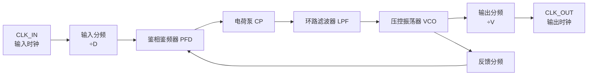

# Verilog

## Verilog 数值表示

### 数值种类

Verilog HDL 有下列四种基本的值来表示硬件电路中的电平逻辑：

- 0：逻辑 0 或 "假"
- 1：逻辑 1 或 "真"
- x 或 X：未知
- z 或 Z：高阻

**x** 意味着信号数值的不确定，即在实际电路里，信号可能为 1，也可能为 0。

**z** 意味着信号处于高阻状态，常见于信号（input, reg）没有驱动时的逻辑结果。例如一个 pad 的 input 呈现高阻状态时，其逻辑值和上下拉的状态有关系。上拉则逻辑值为 1，下拉则为 0 。


### 整数数值表示方法

数字声明时，合法的基数格式有 4 中，包括：十进制('d 或 'D)，十六进制('h 或 'H)，二进制（'b 或 'B），八进制（'o 或 'O）。数值可指明位宽，也可不指明位宽。

**指明位宽：**

```verilog
4'b1011     *// 4bit 数值*
32'h3022_c0de  *// 32bit 的数值*
```

其中，下划线 **_** 是为了增强代码的可读性。

**不指明位宽:**

一般直接写数字时，默认为十进制表示，例如下面的 3 种写法是等效的：

```verilog
counter = 'd100 ; *//一般会根据编译器自动分频位宽，常见的为32bit*
counter = 100 ;
counter = 32'h64 ;
```


**负数表示**

通常在表示位宽的数字前面加一个减号来表示负数。例如：

```verilog
-6'd15  
-15
```

-15 在 5 位二进制中的形式为 5'b10001, 在 6 位二进制中的形式为 6'b11_0001。

需要注意的是，减号放在基数和数字之间是非法的，例如下面的表示方法是错误的：

```verilog
4'd-2 //非法说明
```


### 实数表示方法

实数表示方法主要有两种方式：

**十进制：**

```verilog
30.123
6.0
3.0
0.001
```

**科学计数法：**

```verilog
1.2e4         //大小为12000
1_0001e4      //大小为100010000
1E-3          //大小为0.001
```


### 字符串表示方法

字符串是由双引号包起来的字符队列。字符串不能多行书写，即字符串中不能包含回车符。Verilog 将字符串当做一系列的单字节 ASCII 字符队列。例如，为存储字符串 "www.runoob.com", 需要 14*8bit 的存储单元。例如：

```verilog
reg [0: 14*8-1]       str ;
initial begin
    str = "www.runoob.com";
end  
```


## Verilog 数据类型

### 线网（wire）

wire 类型表示硬件单元之间的物理连线，由其连接的器件输出端连续驱动。如果没有驱动元件连接到 wire 型变量，缺省值一般为 "Z"。举例如下：

```verilog
wire   interrupt ;
wire   flag1, flag2 ;
wire   gnd = 1'b0 ; 
```

线网型还有其他数据类型，包括 wand，wor，wri，triand，trior，trireg 等


### 寄存器（reg）

寄存器（reg）用来表示存储单元，它会保持数据原有的值，直到被改写。声明举例如下：

```verilog
reg    clk_temp;
reg    flag1, flag2 ;
```

**在 always 块中，寄存器可能被综合成边沿触发器**，在组合逻辑中可能被综合成 wire 型变量。寄存器不需要驱动源，也不一定需要时钟信号。在仿真时，寄存器的值可在任意时刻通过赋值操作进行改写。

```verilog
reg rstn ;
initial begin
    rstn = 1'b0 ;
    #100 ;
    rstn = 1'b1 ;
end
```


### 向量

当位宽大于 1 时，wire 或 reg 即可声明为向量的形式。例如：

```verilog
reg [3:0]      counter ;    //声明4bit位宽的寄存器counter
wire [32-1:0]  gpio_data;   //声明32bit位宽的线型变量gpio_data
wire [8:2]     addr ;       //声明7bit位宽的线型变量addr，位宽范围为8:2
reg [0:31]     data ;       //声明32bit位宽的寄存器变量data, 最高有效位为0
```


## Verilog 多路分支语句

### case 

case 语句格式如下：

```
case(case_expr)
    condition1     :             true_statement1 ;
    condition2     :             true_statement2 ;
    ……
    default        :             default_statement ;
endcase
```

> case 语句执行时，如果 condition1 为真，则执行 true_statement1 ; 如果 condition1 为假，condition2 为真，则执行 true_statement2；依次类推。如果各个 condition 都不为真，则执行 default_statement 语句。
>
> default 语句是可选的，且在一个 case 语句中不能有多个 default 语句。
>
> 条件选项可以有多个，不仅限于 condition1、condition2 等，而且这些条件选项不要求互斥。虽然这些条件选项是并发比较的，但执行效果是谁在前且条件为真谁被执行。
>
> ture_statement1 等执行语句可以是一条语句，也可以是多条。如果是多条执行语句，则需要用 begin 与 end 关键字进行说明。
>
> **case 语句支持嵌套使用。**


# 逻辑模块示例

## top.v

```verilog
// 顶层模块

`timescale 1ns / 1ps

module traffic_light_top #(
    parameter integer CLK_FREQ_HZ = 2_500_000,  // 内部晶振输出时钟频率 2.5MHz
    parameter integer SCAN_FREQ_HZ = 2_000,     // 数码管动态扫描刷新频率 2kHz
    parameter [7:0]   GREEN_TIME  = 8'd15,      // 绿灯倒计时 15 秒
    parameter [7:0]   YELLOW_TIME = 8'd5        // 黄灯倒计时 5 秒
) (
    input  wire rst_n,
    input  wire key_emergency_n,
    output wire ns_red,
    output wire ns_yellow,
    output wire ns_green,
    output wire ew_red,
    output wire rgb_data,
    output wire [7:0] seg,
    output wire [2:0] sel
);
    wire       clk;
    wire       tick_1hz;    // 中转线，一边接分频器输出，一边接状态机输入
    wire       emergency;
    wire       ns_red_raw;
    wire       ns_yellow_raw;
    wire       ns_green_raw;
    wire       ew_red_raw;
    wire       ew_yellow_raw;
    wire       ew_green_raw;
    wire [7:0] ns_count;
    wire [7:0] ew_count;
    wire [2:0] state;

    gowin_internal_osc u_internal_osc (
        .oscout(clk)  // 把晶振输出的时钟接到这个信号
    );

    assign emergency = ~key_emergency_n;

    // Onboard LED1~LED3 show NS red/yellow/green. Onboard LED4 shows EW red.
    // EW yellow/green are shown on the serial RGB LED chain through rgb_data.
    assign ns_red    = ~ns_red_raw;
    assign ns_yellow = ~ns_yellow_raw;
    assign ns_green  = ~ns_green_raw;
    assign ew_red    = ~ew_red_raw;

    // .子模块端口名(顶层信号名) 功能匹配即可传递信号
    clk_div #(
        .CLK_FREQ_HZ(CLK_FREQ_HZ)
    ) u_clk_div (
        .clk(clk),
        .rst_n(rst_n),
        .tick_1hz(tick_1hz)
    );

    traffic_fsm #(
        .GREEN_TIME(GREEN_TIME),
        .YELLOW_TIME(YELLOW_TIME)
    ) u_traffic_fsm (
        .clk(clk),
        .rst_n(rst_n),
        .tick_1hz(tick_1hz),
        .emergency(emergency),
        .ns_red(ns_red_raw),
        .ns_yellow(ns_yellow_raw),
        .ns_green(ns_green_raw),
        .ew_red(ew_red_raw),
        .ew_yellow(ew_yellow_raw),
        .ew_green(ew_green_raw),
        .ns_count(ns_count),
        .ew_count(ew_count),
        .state(state)
    );

    seg_display #(
        .CLK_FREQ_HZ(CLK_FREQ_HZ),
        .SCAN_FREQ_HZ(SCAN_FREQ_HZ),
        .COMMON_CATHODE(1'b1)
    ) u_seg_display (
        .clk(clk),
        .rst_n(rst_n),
        .ns_count(ns_count),
        .ew_count(ew_count),
        .seg(seg),
        .sel(sel)
    );

    rgb_status_led #(
        .CLK_FREQ_HZ(CLK_FREQ_HZ),
        .LED_COUNT(4)
    ) u_rgb_status_led (
        .clk(clk),
        .rst_n(rst_n),
        .ew_yellow(ew_yellow_raw),
        .ew_green(ew_green_raw),
        .rgb_data(rgb_data)
    );
endmodule
```


## gowin_internel_osc.v

```verilog
// 高云 FPGA 专属片内振荡器时钟源模块

`timescale 1ns / 1ps

module gowin_internal_osc (
    output wire oscout
);

`ifdef SIMULATION
    reg osc_reg;  // 仿真用寄存器，用来生成方波时钟

    initial begin
        osc_reg = 1'b0;
    end
    
    always #5 osc_reg = ~osc_reg;
    assign oscout = osc_reg;
`else
    OSC u_osc (   // 片内内置振荡器
        .OSCOUT(oscout)
    );
    defparam u_osc.FREQ_DIV = 100;  // 配置振荡器分频系数为100
`endif

endmodule
```


## clk_div.v

```verilog
/* 功能：输入 50MHz 高频时钟，输出每秒 1 次的高电平脉冲（1Hz 信号tick_1hz） */

`timescale 1ns / 1ps
// parameter 关键字，代表是模块参数
module clk_div #(parameter integer CLK_FREQ_HZ = 50_000_000  // 输入时钟频率，默认50MHz
) (
    input  wire clk,        // 输入系统时钟
    input  wire rst_n,      // 低电平复位信号
    output reg  tick_1hz    
);
	// localparam：本地参数，仅当前模块内部可用，外部例化时不能修改
    localparam integer CNT_WIDTH = 26;  // 计数器位宽 26 位  2^26 > 50M,足够用来计数
    localparam [CNT_WIDTH-1:0] CNT_MAX_VALUE = CLK_FREQ_HZ - 1; // 设置计数上限

    reg [CNT_WIDTH-1:0] cnt;  //定义 26 位寄存器cnt，作为循环计数器
    
	// posedge：上升沿  negedge：下降沿
    always @(posedge clk or negedge rst_n) begin
        if (!rst_n) begin // 复位信号为低，复位生效
            cnt      <= {CNT_WIDTH{1'b0}}; // 位拼接运算符，生成 26 位全 0，计数器清零
            tick_1hz <= 1'b0;              // 输出脉冲拉低，保持低电平
        end else if (cnt == CNT_MAX_VALUE) begin
            cnt      <= {CNT_WIDTH{1'b0}};
            tick_1hz <= 1'b1;              // 拉高电平，输出1Hz脉冲
        end else begin
            cnt      <= cnt + 1'b1;  // 计数+1
            tick_1hz <= 1'b0;
        end
    end
endmodule
```


## .cst 引脚约束

```verilog
// Pin constraints extracted from the board schematic PDF.
// Target device: GW1NR-LV9QN88C6/I5.
// Board notes:
// - KEY1 is active-low: released=1, pressed=0.
// - LED outputs are active-low because LEDs are connected to VCC3V3.
// - The 3661AS display in the schematic is common-cathode.
// - Seven-segment pins are active-high.
// - The system clock is generated by the internal oscillator; no external clk pin is constrained.

IO_LOC "rst_n" 11;   // 绑定芯片11号引脚
// 设置电平标准 3.3V 内部上拉电阻，自动保持高电平
IO_PORT "rst_n" IO_TYPE=LVCMOS33 PULL_MODE=UP;

// 紧急停止按键引脚约束
IO_LOC "key_emergency_n" 14;
IO_PORT "key_emergency_n" IO_TYPE=LVCMOS33 PULL_MODE=UP;

// Traffic-light LEDs.
// LED1/LED2/LED3 show NS red/yellow/green. LED4 shows EW red.
// EW yellow/green are shown by the onboard serial RGB LED chain on RGB_DATA.
IO_LOC "ns_red" 3;
IO_LOC "ns_yellow" 85;
IO_LOC "ns_green" 86;
IO_LOC "ew_red" 84;
IO_LOC "rgb_data" 17;
IO_PORT "ns_red" IO_TYPE=LVCMOS33 DRIVE=8;  // 设置 IO 输出驱动电流为 8mA
IO_PORT "ns_yellow" IO_TYPE=LVCMOS33 DRIVE=8;
IO_PORT "ns_green" IO_TYPE=LVCMOS33 DRIVE=8;
IO_PORT "ew_red" IO_TYPE=LVCMOS33 DRIVE=8;
IO_PORT "rgb_data" IO_TYPE=LVCMOS33 DRIVE=8;

// 数码管引脚约束
// Segment order in RTL is {dp,g,f,e,d,c,b,a}.
// seg[0]=A, seg[1]=B, seg[2]=C, seg[3]=D,
// seg[4]=E, seg[5]=F, seg[6]=G, seg[7]=DOT.
IO_LOC "seg[0]" 42;
IO_LOC "seg[1]" 48;
IO_LOC "seg[2]" 56;
IO_LOC "seg[3]" 47;
IO_LOC "seg[4]" 57;
IO_LOC "seg[5]" 55;
IO_LOC "seg[6]" 54;
IO_LOC "seg[7]" 53;
IO_PORT "seg[0]" IO_TYPE=LVCMOS33 DRIVE=8;
IO_PORT "seg[1]" IO_TYPE=LVCMOS33 DRIVE=8;
IO_PORT "seg[2]" IO_TYPE=LVCMOS33 DRIVE=8;
IO_PORT "seg[3]" IO_TYPE=LVCMOS33 DRIVE=8;
IO_PORT "seg[4]" IO_TYPE=LVCMOS33 DRIVE=8;
IO_PORT "seg[5]" IO_TYPE=LVCMOS33 DRIVE=8;
IO_PORT "seg[6]" IO_TYPE=LVCMOS33 DRIVE=8;
IO_PORT "seg[7]" IO_TYPE=LVCMOS33 DRIVE=8;

// 3-8 译码器引脚约束
// 74HC238 digit selector inputs.
// sel=000 selects digit 1, sel=001 digit 2, sel=010 digit 3, sel=011 digit 4.
IO_LOC "sel[0]" 39;
IO_LOC "sel[1]" 40;
IO_LOC "sel[2]" 41;
IO_PORT "sel[0]" IO_TYPE=LVCMOS33 DRIVE=8;
IO_PORT "sel[1]" IO_TYPE=LVCMOS33 DRIVE=8;
IO_PORT "sel[2]" IO_TYPE=LVCMOS33 DRIVE=8;
```


# Verilog HDL 程序设计

## 综合

### 二选一数据选择器的行为级描述

```verilog
module muxtwo (out,a,b,s1);
    input a,b,s1;
    output out;
    reg out;   // 存储 always 最终运算结果，必须是reg类型
    // always @(s1,a,b) 新写法
    always @(s1 or a or b)  // 三个信号任意电平变化，立刻执行下面 if/else
        if (!s1) out=a;
        else out=b;
endmodule
```


#### `always` 关键字

Verilog 中**循环执行块**，分两种用途：

1. 时序逻辑（带时钟，生成触发器）；

2. 组合逻辑（无时钟，仅做纯电路运算，本例属于此类）。

   ```verilog
   always
   ```

    块内部可以使用  `if/else  case 等分支语句，

   块内赋值目标必须定义为`reg`类型

   ```verilog
   reg out;
   ```

#### `@()` 敏感事件列表（敏感表）

> `@` 代表触发条件：括号内任意一个信号发生电平变化，就会立刻执行一次`always`块内部的逻辑。


### 二选一数据选择器的数据流描述

```verilog
module muxtwo (out,a,b,s1);
        input a,b,s1;
        output out;
        wire ns1,se1a,se1b;  // 定义三根内部导线，用来临时存放中间运算结果
        assign ns1 = ~s1;    // assign：连续赋值语句，导线信号会实时跟随等号右侧表达式变化
        assign se1a = a & ns1;
        assign se1b = b & s1;
        assign out = se1a | se1b;
endmodule
```


### 二选一数据选择器的门级描述

```verilog
module muxtwo(out,a,b,s1);
        input a,b,s1;
        output out;
        not ul(ns1,s1);        // not：非门（反相器）
        and u2(sela,a,ns1);    // and：二输入与门
        and u3(selb,b,s1);     // or：二输入或门
        or u4(out,sela,selb);
endmodule
```


## verilog 模块模板

```verilog
module <顶层模块名> (<输入输出端口列表>);
	output 输出端口列表; //输出端口声明
	input 输入端口列表; //输入端口声明
	reg 信号名；// 端口定义
	assign <结果信号名>=<表达式>； //1使用assign语句定义逻辑功能
    always @ (<敏感信号表达式>)   //2用always过程块描述逻辑功能
    begin
        //过程赋值
        //if-else，case语句
        //while，repeat，for循环语句
        //task，function调用
    end
    //3门元件例化
    门元件关键字 <例化门元件名> (<端口列表port_list>);
    //4调用其他模块
    <调用模块名module_name > <例化模块名> (<端口列表port_list>);
endmodule
```


# 硬件功能实现示例

## ALU

```verilog
// 实验 3：8 位 ALU
// 非阻塞赋值 <= 表示多个寄存器在同一个时钟沿并行更新。
module lab03_top(
    input        clk_50m,
    input        rst_n,
    input  [3:0] sw,
    input  [1:0] key_n,
    output [3:0] led_n,
    output [2:0] seg_sel,
    output [7:0] seg
);

reg [7:0] a;
reg [7:0] b;
reg [7:0] result;
reg [1:0] preset;
reg       key_run_d;
reg       key_next_d;
reg [8:0] wide;

wire run_pulse  = key_run_d  & ~key_n[0];
wire next_pulse = key_next_d & ~key_n[1];

always @(posedge clk_50m or negedge rst_n) begin
    if(!rst_n) begin
        a          <= 8'h03;
        b          <= 8'h05;
        result     <= 8'h00;
        preset     <= 2'd0;
        key_run_d  <= 1'b1;
        key_next_d <= 1'b1;
        wide       <= 9'd0;
    end
    else begin
        key_run_d  <= key_n[0];
        key_next_d <= key_n[1];

        if(next_pulse) begin
            preset <= preset + 2'd1;

            case(preset + 2'd1)
                2'd0: begin
                    a <= 8'h03;
                    b <= 8'h05;
                end
                2'd1: begin
                    a <= 8'hff;
                    b <= 8'h01;
                end
                2'd2: begin
                    a <= 8'h0f;
                    b <= 8'h03;
                end
                default: begin
                    a <= 8'h55;
                    b <= 8'haa;
                end
            endcase
        end

        if(run_pulse) begin
            case(sw)
                4'd0: begin
                    wide   <= a + b;
                    result <= a + b;
                end
                4'd1: result <= a - b;
                4'd2: result <= a << 1;
                4'd3: result <= a >> 1;
                4'd4: result <= a & b;
                4'd5: result <= a | b;
                4'd6: result <= ~a;
                4'd7: result <= 8'h00;
                4'd8: result <= (a == b);
                default: result <= 8'h00;
            endcase
        end
    end
end

assign seg_sel = 3'd0;
assign seg     = hex7(result[3:0]);
assign led_n   = ~{(a == b), (a < b), wide[8], result[7]};

function [7:0] hex7;
    input [3:0] x;
    begin
        case(x)
            4'h0: hex7 = 8'h3f;
            4'h1: hex7 = 8'h06;
            4'h2: hex7 = 8'h5b;
            4'h3: hex7 = 8'h4f;
            4'h4: hex7 = 8'h66;
            4'h5: hex7 = 8'h6d;
            4'h6: hex7 = 8'h7d;
            4'h7: hex7 = 8'h07;
            4'h8: hex7 = 8'h7f;
            4'h9: hex7 = 8'h6f;
            4'ha: hex7 = 8'h77;
            4'hb: hex7 = 8'h7c;
            4'hc: hex7 = 8'h39;
            4'hd: hex7 = 8'h5e;
            4'he: hex7 = 8'h79;
            default: hex7 = 8'h71;
        endcase
    end
endfunction

endmodule
```


## 有限状态机实现

```verilog
module lab04_top(
    input        clk_50m,  // 50MHz 外部晶振时钟输入
    input        rst_n,
    input  [3:0] sw,       // 4 位拨码开关输入，4 根 IO 线组成 4bit 信号
    input        key_n,    // 低电平有效独立按键
    output       led_n     // 低电平点亮 LED 输出
);

localparam 
    S0 = 3'd0,
    S1 = 3'd1,
    S2 = 3'd2,
    S3 = 3'd3,
    S4 = 3'd4;

reg [2:0] state;
reg        key_d;  // 上一个时钟周期保存的 key_n
reg        ok;

wire valid = key_d & ~key_n;  // valid 只在按键按下的那一个时钟周期等于 1，产生一个单周期脉冲

always @(posedge clk_50m or negedge rst_n) begin
    if(!rst_n) begin
        state <= S0;
        key_d <= 1'b1;
        ok    <= 1'b0;
    end
    else begin
        key_d <= key_n;
        ok    <= 1'b0;

        if(valid) begin
            case(state)
                S0: state <= (sw == 4'd1) ? S1 : S0;
                S1: state <= (sw == 4'd2) ? S2 : ((sw == 4'd1) ? S1 : S0);
                S2: state <= (sw == 4'd3) ? S3 : ((sw == 4'd1) ? S1 : S0);
                S3: state <= (sw == 4'd4) ? S4 : ((sw == 4'd1) ? S1 : S0);
                default: begin
                    if(sw == 4'd5) begin
                        ok <= 1'b1;
                    end
                    state <= (sw == 4'd1) ? S1 : S0;
                end
            endcase
        end
    end
end

assign led_n = ~ok; 
// LED turns on for one clean input event after 12345.

endmodule
```


## 串口通信

```verilog
// 实验 5：115200/N/8/1 UART 收发
// baud tick 类似 MCU 的定时器更新事件，但它在 FPGA 中是时钟使能信号。
module lab05_top(
    input        clk_50m,
    input        rst_n,
    input        key_n,
    input        uart_rx,
    output       uart_tx,
    output [2:0] seg_sel,  // 数码管位选
    output [7:0] seg       // 数码管段选
);

localparam DIV = 9'd434;

reg [8:0] div;
reg [3:0] tx_bit;    // 当前发送的位索引
reg [3:0] rx_bit;
reg [9:0] frame;     // 发送帧：{停止位, 8位数据, 起始位}
reg       busy;      // 发送忙标志
reg       txd;       // 发送数据线
reg       key_d;
reg [7:0] rx_data;
reg [1:0] rx_sync;   // 专门处理外部串口输入 uart_rx
reg       rx_busy;   // 接收忙标志

wire tick = (div == DIV - 9'd1);   // 波特率时钟脉冲
wire send = key_d & ~key_n;   // 按键触发发送

always @(posedge clk_50m or negedge rst_n) begin
    if(!rst_n) begin
        div     <= 9'd0;
        tx_bit  <= 4'd0;
        frame   <= 10'h3ff;
        busy    <= 1'b0;
        txd     <= 1'b1;
        key_d   <= 1'b1;
        rx_sync <= 2'b11;
        rx_bit  <= 4'd0;
        rx_busy <= 1'b0;
        rx_data <= 8'h00;
    end
    else begin
        key_d   <= key_n;
        rx_sync <= {rx_sync[0], uart_rx};  // 两级同步，防止亚稳态
        div     <= tick ? 9'd0 : div + 9'd1;  // 计数

        // UART 帧：1 个起始位、8 个数据位、1 个停止位。
        if(send && !busy) begin  // 不忙时启动发送
            frame  <= {1'b1, 8'h56, 1'b0};  // 拼接数据
            tx_bit <= 4'd0;  // 从第0位开始发
            busy   <= 1'b1;  // 标记：正在发送，防止重复发送
        end

        if(busy && tick) begin    // 处于发送状态时
            txd <= frame[tx_bit]; // 更新引脚电平，一位一位发送出去

            if(tx_bit == 4'd9) begin
                busy <= 1'b0; // 10位全部发完，发送结束
            end
            else begin
                tx_bit <= tx_bit + 4'd1; // 序号+1，下一拍发下一位
            end
        end

        // 检测 RX 的低电平起始位。
        if(!rx_busy && (rx_sync[1] == 1'b0)) begin
            rx_busy <= 1'b1;
            rx_bit  <= 4'd0;
        end
        else if(rx_busy && tick) begin  // 跟随 tick 节拍逐位移位输出
            if(rx_bit < 4'd8) begin // 只有当前正在采集第 0~8 位时，才存储电平
                rx_data[rx_bit] <= rx_sync[1];
            end

            if(rx_bit == 4'd9) begin
                rx_busy <= 1'b0;
            end
            else begin
                rx_bit <= rx_bit + 4'd1;
            end
        end
    end
end

assign uart_tx = txd;
assign seg_sel = 3'd0;  // 3'd0 代表只打开第 0 个数码管
assign seg     = hex7(rx_data[3:0]);   // 将接收的低四位传给 hex7

function [7:0] hex7;  // Verilog 组合逻辑函数
    input [3:0] x;
    begin
        case(x)
            4'h0: hex7 = 8'h3f; // 显示数字0
            4'h1: hex7 = 8'h06; // 显示数字1
            4'h2: hex7 = 8'h5b;
            4'h3: hex7 = 8'h4f;
            4'h4: hex7 = 8'h66;
            4'h5: hex7 = 8'h6d;
            4'h6: hex7 = 8'h7d;
            4'h7: hex7 = 8'h07;
            4'h8: hex7 = 8'h7f;
            4'h9: hex7 = 8'h6f;
            4'ha: hex7 = 8'h77; // 显示字母A
            4'hb: hex7 = 8'h7c;
            4'hc: hex7 = 8'h39;
            4'hd: hex7 = 8'h5e;
            4'he: hex7 = 8'h79;
            default: hex7 = 8'h71;
        endcase
    end
endfunction

endmodule
```

| 输入 4 位值 | 数字 / 字符 | 段码 8 位 (dp,g,f,e,d,c,b,a) | 十六进制 | 点亮段                 |
| ----------- | ----------- | ---------------------------- | -------- | ---------------------- |
| 4'h0        | 0           | 00111111                     | 8'h3f    | a,b,c,d,e,f （g 熄灭） |
| 4'h1        | 1           | 00000110                     | 8'h06    | b,c                    |
| 4'h2        | 2           | 01011011                     | 8'h5b    | a,b,g,e,d              |
| 4'h3        | 3           | 01001111                     | 8'h4f    | a,b,g,c,d              |
| 4'h4        | 4           | 01100110                     | 8'h66    | f,g,b,c                |
| 4'h5        | 5           | 01101101                     | 8'h6d    | a,f,g,c,d              |
| 4'h6        | 6           | 01111101                     | 8'h7d    | a,f,g,c,d,e            |
| 4'h7        | 7           | 00000111                     | 8'h07    | a,b,c                  |
| 4'h8        | 8           | 01111111                     | 8'h7f    | a~g 全部点亮           |
| 4'h9        | 9           | 01101111                     | 8'h6f    | a,b,c,d,f,g            |
| 4'ha        | A           | 01110111                     | 8'h77    | a,b,c,e,f,g            |
| 4'hb        | b           | 01111100                     | 8'h7c    | c,d,e,f,g              |
| 4'hc        | C           | 00111001                     | 8'h39    | a,d,e,f                |
| 4'hd        | d           | 01011110                     | 8'h5e    | b,c,d,e,g              |
| 4'he        | E           | 01111001                     | 8'h79    | a,d,e,f,g              |


## DDS_DAC

```verilog
// 实验 7：DDS 相位累加器与 10 位 DAC
// MCU 常修改定时器或 DAC 更新参数；FPGA 在每个时钟沿直接累加相位。
module lab07_top(
    input        clk_50m,
    input        rst_n,
    input  [1:0] key_n,
    output       dac_clk,
    output [9:0] dac_data
);

localparam STEP_1KHZ  = 32'd85_899;
localparam STEP_20KHZ = 32'd1_717_980;

reg [31:0] phase;     // 32 位 DDS 相位累加器
reg [31:0] step;      // 频率控制字 FCW，决定三角波输出频率
reg        key_up_d;
reg        key_down_d;

wire key_up_pulse   = key_up_d   & ~key_n[0];
wire key_down_pulse = key_down_d & ~key_n[1];

always @(posedge clk_50m or negedge rst_n) begin
    if(!rst_n) begin
        phase      <= 32'd0;
        step       <= STEP_1KHZ;
        key_up_d   <= 1'b1;
        key_down_d <= 1'b1;
    end
    else begin
        key_up_d   <= key_n[0];
        key_down_d <= key_n[1];
        phase      <= phase + step;

        if(key_up_pulse && (step < STEP_20KHZ)) begin
            step <= step + STEP_1KHZ;
        end

        if(key_down_pulse && (step > STEP_1KHZ)) begin
            step <= step - STEP_1KHZ;
        end
    end
end

// 最高相位位区分上升半周和下降半周，高 10 位形成三角波幅值。
assign dac_data = phase[31] ? ~phase[30:21] : phase[30:21];
assign dac_clk  = clk_50m;

endmodule
```


# FPGA

## FPGA 基本结构

一个典型的 FPGA 结构包括以下几个关键组件：

- LUT（查找表）：用于实现组合逻辑功能。

- 触发器（Flip-Flop）：用于存储状态，构成时序逻辑。
- DSP 单元：用于高效执行乘法和加法操作，适用于信号处理。
- Block RAM（BRAM）：片上存储器，可存储数据和指令。
- I/O 端口：用于与外部设备通信。
- 下图展示了 FPGA 内部的基本架构：

```
+--------------------------------------+
|      可编程互连（Routing）             |
| +-------+  +-------+  +-------+  +---+ |
| |  LUT  |  |  LUT  |  |  LUT  |  |...| |
| +-------+  +-------+  +-------+  +---+ |
| +-------+  +-------+  +-------+  +---+ |
| | FF    |  | FF    |  | FF    |  |...| |
| +-------+  +-------+  +-------+  +---+ |
|    可编程逻辑单元（Logic Blocks）      |
+--------------------------------------+
————————————————
```


## 开发流程

- 需求分析：确定 FPGA 需要实现的功能。
- 硬件描述：使用 Verilog 或 VHDL 编写逻辑设计。
- 综合（Synthesis）：将 HDL 代码转换为门级电路。
- 布局布线（Place & Route）：将逻辑映射到 FPGA 硬件资源。
- 仿真测试：使用仿真工具（如 ModelSim）验证设计是否正确。
- 编程下载：将比特流文件下载到 FPGA 芯片。


## 时钟分频

### PLL




## PWM

```verilog
module pwm_generator
#(
    parameter PERIOD_W  = 16,   // 计数器位宽
    parameter PWM_PERIOD = 999  // 计数最大值，PWM周期=PERIOD+1
)
(
    input  wire                   clk,
    input  wire                   rst_n,
    input  wire [PERIOD_W-1:0]    duty,  // 占空比阈值 0~PWM_PERIOD
    output reg                    pwm_out
);

// 1. 循环计数器
reg [PERIOD_W-1:0] cnt;
always @(posedge clk or negedge rst_n) begin
    if(!rst_n) begin
        cnt <= 'd0;
    end
    else if(cnt >= PWM_PERIOD) begin
        cnt <= 'd0;  // 计数溢出，归零
    end
    else begin
        cnt <= cnt + 1'b1;
    end
end

// 2. 比较输出PWM波形
always @(posedge clk or negedge rst_n) begin
    if(!rst_n) begin
        pwm_out <= 1'b0;
    end
    else begin
        pwm_out <= (cnt < duty) ? 1'b1 : 1'b0;
    end
end

endmodule
```


## ADC

```verilog
module adc0832_driver
#(
    parameter SYS_CLK_FREQ = 50_000_000,  // 系统输入时钟50M
    parameter ADC_CLK_FREQ  = 200_000       // ADC工作时钟200K
)
(
    input  wire               clk,         // 系统时钟
    input  wire               rst_n,       // 低电平复位
    input  wire               ch_sel,      // 通道选择 0:CH0 1:CH1
    input  wire               adc_start,   // 单次采集启动信号
    output reg                adc_cs_n,    // ADC片选 低有效
    output reg                adc_clk,     // ADC串行时钟
    output reg                adc_di,      // FPGA发送控制指令给ADC
    input  wire               adc_do,      // ADC返回采样数据给FPGA
    output reg                data_valid,  // 采样数据有效标志
    output reg [7:0]          adc_data     // 8位AD采样结果
);

// ------------------- 分频产生ADC低速时钟 -------------------
localparam DIV_CNT = SYS_CLK_FREQ / ADC_CLK_FREQ;
reg [15:0] div_cnt;
always @(posedge clk or negedge rst_n) begin
    if(!rst_n)
        div_cnt <= 16'd0;
    else if(div_cnt >= DIV_CNT - 1'b1)
        div_cnt <= 16'd0;
    else
        div_cnt <= div_cnt + 1'b1;
end
wire adc_clk_en = (div_cnt == DIV_CNT - 1'b1);

// ------------------- 状态机定义 -------------------
localparam IDLE     = 3'b001;  // 空闲
localparam SEND_CMD = 3'b010;  // 发送通道控制指令
localparam READ_DATA= 3'b100;   // 读取8位采样数据

reg [2:0] curr_state;
reg [2:0] next_state;
reg [3:0] bit_cnt;  // 发送/接收比特计数
reg [7:0] data_buf; // 采样数据缓存

// 第一段：时序逻辑 状态寄存器
always @(posedge clk or negedge rst_n) begin
    if(!rst_n)
        curr_state <= IDLE;
    else
        curr_state <= next_state;
end

// 第二段：组合逻辑 状态跳转
always @(*) begin
    next_state = curr_state;
    case(curr_state)
        IDLE: begin
            if(adc_start)
                next_state = SEND_CMD;
        end
        SEND_CMD: begin
            if(bit_cnt == 4'd2) // 发送2bit控制指令完成
                next_state = READ_DATA;
        end
        READ_DATA: begin
            if(bit_cnt == 4'd8) // 读完8位采样数据
                next_state = IDLE;
        end
    endcase
end

// 第三段：时序逻辑 输出、计数器、缓存
always @(posedge clk or negedge rst_n) begin
    if(!rst_n) begin
        adc_cs_n    <= 1'b1;
        adc_clk      <= 1'b0;
        adc_di       <= 1'b0;
        data_valid   <= 1'b0;
        adc_data     <= 8'd0;
        bit_cnt      <= 4'd0;
        data_buf     <= 8'd0;
    end
    else if(adc_clk_en) begin
        data_valid <= 1'b0;
        case(curr_state)
            IDLE: begin
                adc_cs_n <= 1'b1;
                adc_clk  <= 1'b0;
                adc_di   <= 1'b0;
                bit_cnt  <= 4'd0;
            end
            SEND_CMD: begin
                adc_cs_n <= 1'b0;
                adc_clk  <= ~adc_clk;
                if(adc_clk == 1'b0) begin
                    // 发送2bit指令：起始位1 + 通道选择位
                    case(bit_cnt)
                        4'd0: adc_di <= 1'b1;
                        4'd1: adc_di <= ch_sel;
                    endcase
                    bit_cnt <= bit_cnt + 1'b1;
                end
            end
            READ_DATA: begin
                adc_cs_n <= 1'b0;
                adc_clk  <= ~adc_clk;
                if(adc_clk == 1'b1) begin
                    // 上升沿读取ADC输出bit
                    data_buf <= {data_buf[6:0], adc_do};
                    bit_cnt  <= bit_cnt + 1'b1;
                    // 8bit读完，输出数据并拉高有效标志
                    if(bit_cnt == 4'd7) begin
                        adc_data   <= {data_buf[6:0], adc_do};
                        data_valid <= 1'b1;
                    end
                end
            end
        endcase
    end
end

endmodule
```


## 时序约束与跨时钟域

建立时间是采样边沿前输入需要稳定的时间，保持时间是边沿后需要继续稳定的时间。违反约束可能导致亚稳态或采样错误，不能用“降低频率”保证解决所有跨时钟域问题。

异步单比特控制信号可使用多级同步器降低亚稳态传播概率；短脉冲还需展宽、握手或翻转编码。多比特数据不能简单地对每一位各加两级寄存器后假定数据一致，通常采用握手或异步 FIFO。

同步 FIFO 共用读写时钟；异步 FIFO 的指针跨域通常使用 Gray 编码与同步器，满空判断在各自时钟域完成。异步复位的释放需按时钟域同步，避免不同寄存器在不一致的周期解除复位。

## 组合逻辑、寄存器与存储资源

组合逻辑输出取决于当前输入，时序逻辑还依赖保存状态。Verilog `reg` 表示过程赋值变量，可能综合为组合逻辑、锁存器或触发器，并不自动意味着一个硬件寄存器。`wire` 表示由驱动源驱动的线网。

组合过程未覆盖所有输出赋值路径可能推断锁存器。组合路径不同延迟可能产生毛刺，在时钟边沿附近被采样会影响状态。增加输出寄存器可隔离部分组合毛刺，但输入仍须满足时序和跨域约束。

LUT 实现布尔查表，分布式 RAM 使用相应可配置逻辑资源，BRAM 使用专用存储块。分布式 RAM 不应与外部动态存储器 DRAM 混同。PLL、MMCM 的倍分频、相位调节与动态重配置能力取决于器件，不能宣称所有 PLL 都只支持整数分频。

## 时钟资源与存储资源的器件差异

PLL、MMCM 等时钟资源的分频范围、分数分频、相移、抖动与动态重配置能力由 FPGA 家族定义，MMCM 不是所有厂商共有名称，也不能简单断言 PLL 只能整数分频或 MMCM 总有更低抖动。

BRAM 是专用块存储资源，分布式 RAM 利用支持该功能的 LUT 资源，读写方式及端口限制随器件变化。DRAM 常指动态随机存储器，不能在未说明语境时当作 distributed RAM 的统一缩写。

Verilog reg 表示过程赋值变量，并不必然综合成触发器；组合过程若赋值完整也可综合为组合逻辑。wire 为网络类型，可由连续赋值和模块连接等驱动，不应概括为只能用于 assign。跨时钟域多位数据不能简单逐位使用两级同步器替代握手或异步 FIFO。
