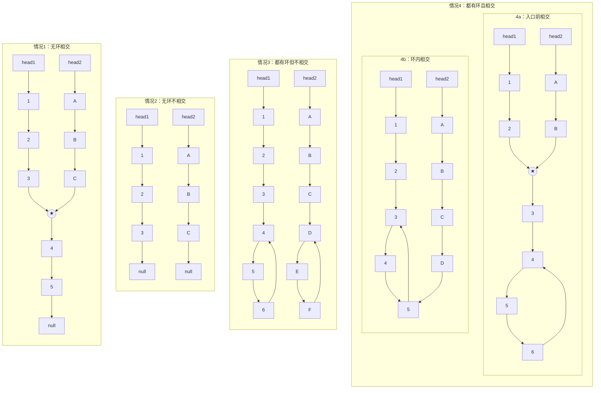
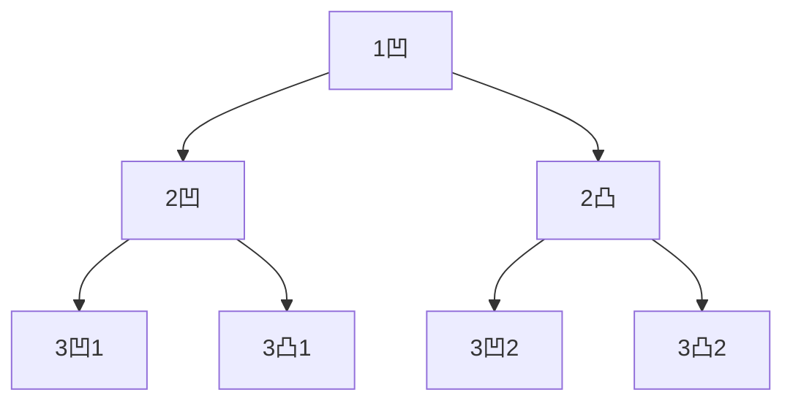
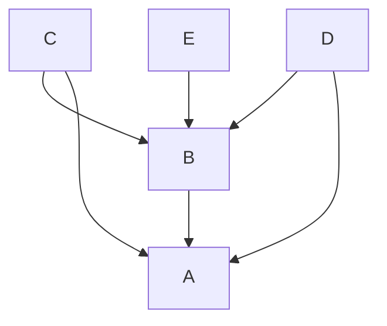

## 选择排序

> 时间复杂度固定为 **O(n²)**，空间复杂度 **O(1)**，且**不稳定**

```C++
void selectionSort(vector<int>& arr) {
	if(arr.size() < 2) return;
    for (int i = 0; i < arr.size() - 1; i++) {
        int minIndex = i;   // 最小值标记
        for (int j = i + 1; j < arr.size(); j++) {
            minIndex = arr[j] < arr[minIndex] ? j : minIndex;
        }
        swap(arr[minIndex], arr[i]);   // #include <algorithm>
    }
}
```

 

## 冒泡排序

> 平均和最坏时间复杂度为 **O(n²)**，但最好情况（已有序）可优化到 **O(n)**，空间复杂度 **O(1)**，**稳定**

```C++
void bubbleSort(vector<int>& arr) {
	if (arr.size() < 2) return;
	for (int i = 0; i < arr.size() - 1; i++) {
		bool swapped = false;
		for (int j = 0; j < arr.size() - 1 - i; j++) {
			if (arr[j] > arr[j + 1]) {
				swap(arr[j], arr[j + 1]);
				swapped = true;
			}
		}
		if (!swapped) break; // 本轮未发生交换，已经有序
	}
}
```


## 插入排序

保持前 n 项有序

> 平均和最坏时间复杂度为 **O(n²)**，最好情况（已有序）为 **O(n)**，空间复杂度 **O(1)**，**稳定**，且在小数据或基本有序时表现最好

```C++
void insertionSort(vector<int>& arr)
{
	if (arr.empty()) return;
	for (int i = 1; i < arr.size(); i++) {
		for (int j = i; j > 0; j--) {
			if (arr[j] < arr[j - 1])
				swap(arr[j], arr[j - 1]);
			else break;
		}
	}
}
```


## SWAP

```C++
void swap(int& a, int& b)
{ // a 和 b 必须是两块独立的内存
    if (&a == &b) return;
	a = a ^ b;
	b = a ^ b;
	a = a ^ b;
}
```


## 异或

| 性质   | 公式                        | 说明                 |
| :----- | :-------------------------- | :------------------- |
| 交换律 | `a ^ b = b ^ a`             | 顺序无关             |
| 结合律 | `(a ^ b) ^ c = a ^ (b ^ c)` | 任意组合             |
| 自反性 | `a ^ a = 0`                 | 自己异或自己等于0    |
| 恒等性 | `a ^ 0 = a`                 | 任何数异或0等于本身  |
| 归零律 | `a ^ a ^ b = b`             | 应用自反+结合        |
| 逆运算 | `a ^ b ^ b = a`             | 异或自己两次恢复原值 |

要求：时间复杂度 $O(N)$ 空间复杂度 $O(1)$

1. 在一个数组中，只有一个数出现了奇数次，其余数都出现偶数次

   ```C++
   int printOddTimesNum1(vector<int>& arr)
   {
   	int eor = 0;
   	for (int cur : arr)
   		eor ^= cur;
   	return eor;
   }
   ```

2. 在一个数组中，只有两个数出现了奇数次，其余数都出现偶数次

   ```c++
   vector<int> printOddTimesNum2(vector<int>& arr)
   {
   	vector<int> res;
   	int eor = 0;
   	for (int cur : arr)
   		eor ^= cur;
   	int rightOne = eor & (~eor + 1); // 取出最右侧的 1
   
   	int eor1 = 0;
   	for (int temp : arr) {
   		if ((rightOne & temp) != 0) {
   			eor1 ^= temp;    // 得到其中一个数
   		}
   	}
   	res.push_back(eor1);
   	res.push_back(eor1 ^ eor);
   	return res;
   }
   ```

   


## 二分法

1. 在一个有序数组中，找某个数是否存在

   ```C++
   int binarySearch(int target, vector<int>& nums)
   {
   	if (nums.empty()) return 0;
   	int left = 0, right = nums.size() - 1;
   	while (left <= right) {
   		int mid = left + (right - left) / 2;
   		if (nums[mid] == target)
   			return mid;
   		else if (nums[mid] < target)
   			left = mid + 1;
   		else if (nums[mid] > target)
   			right = mid - 1;
   	}
   	return -1;
   }
   ```

2. 在一个有序数组中，找 >= 某个数最左侧的位置

   ```C++
   int binarySearch(int target, vector<int>& nums)
   {
       if (nums.empty()) return 0;
       int left = 0, right = nums.size() - 1;
       int ans = 0;
       if (target > nums[nums.size() - 1]) return nums.size();
       while (left <= right) {
           int mid = left + (right - left) / 2;
           if (nums[mid] >= target) {
               ans = mid;     // 记录这个位置
               right = mid - 1;
           }
           else
               left = mid + 1;
       }
       return ans;
   }
   ```

3. 局部最小值问题（这个数小于左右两侧；左右只有一边有数字时，只需要小于仅有的数）

   ```c++
   // 前提条件：相邻元素不相等
   int findLocalMinimum(int target, vector<int>& nums)
   {
       if (nums.empty()) return 0;
       int n = nums.size();
       // 处理边界
       if (n == 1 || nums[0] < nums[1]) return 0;
       if (nums[n - 1] < nums[n - 2]) return n - 1;
   
       int left = 0, right = n - 1;
       while (left <= right) {
           int mid = left + (right - left) / 2;
           if (nums[mid] < nums[mid + 1] && nums[mid] < nums[mid - 1]) return mid;
           if (nums[mid] > nums[mid + 1]) left = mid + 1;
           else if (nums[mid] < nums[mid + 1]) right = mid - 1;      
       }
       return -1;
   }
   ```
   


## 递归求最大值

时间复杂度 $Oleft(N^{log_{2}2}right)$ = $Oleft(Nright)$

```C++
// 求arr[L..R]区间最大值，L、R为下标，左右边界都包含
int process(const vector<int>& arr, int L, int R) {
    if (L == R) return arr[L];
    int mid = L + ((R - L) >> 1);
    int leftMax = process(arr, L, mid);
    int rightMax = process(arr, mid + 1, R);
    return max(leftMax, rightMax);
}
```


## master 公式

$$
T(N) = a * T(N/b) + O(N^d)
$$

情况1： $log_b(a) > d$ → 时间复杂度为 $Oleft(N^{log_{b}a}right)$

情况2： $log_b(a) = d$ → 时间复杂度为 $ O(N^d * log N)$

情况3：$ log_b(a) < d$ → 时间复杂度为 $O(N^d)$


## 归并排序

1. 分（Divide）：将数组从中间分成左右两半
2. 治（Conquer）：分别对左右两半递归排序
3. 合（Combine）：将两个有序子数组合并成一个有序数组

a = 2, b = 2, d = 1  时间复杂度为 $ O(N * log N)$ ，额外空间复杂度 $O(N)$

```C++
void merge(vector<int>& arr, int L, int mid, int R) {
    // 临时数组，存放合并结果
    vector<int> temp(R - L + 1);
    int i = L;        // 左半部分起始位置
    int j = mid + 1;  // 右半部分起始位置
    int k = 0;        // temp 数组当前位置
    
    // 比较左右两部分，将较小的放入 temp
    while (i <= mid && j <= R) {
        if (arr[i] <= arr[j])  temp[k++] = arr[i++];
		else  temp[k++] = arr[j++];
    }
    // 左半部分有剩余，全部拷贝到 temp
    while (i <= mid) temp[k++] = arr[i++];
    // 右半部分有剩余，全部拷贝到 temp
    while (j <= R) temp[k++] = arr[j++];
    // 将 temp 拷贝回原数组
    for (int i = 0; i < temp.size(); i++)
        arr[L + i] = temp[i];
}

// 归并排序递归函数
void mergeSort(vector<int>& arr, int L, int R) {
    if (L == R) return;  // base case：只有一个元素
    int mid = L + ((R - L) >> 1);  // 计算中点，防溢出
    mergeSort(arr, L, mid);        // 左半部分排序
    mergeSort(arr, mid + 1, R);    // 右半部分排序
    merge(arr, L, mid, R);         // 合并两个有序部分
}
```


### 小和问题

> 在一个数组中，每一个数左边比当前数小的数累加起来，叫做这个数组的小和。
> 求一个数组的小和。

```C++
int merge(vector<int>& arr, int L, int M, int R)
{
	vector<int> temp(R - L + 1);
	int i = L;
	int j = M + 1;
	int k = 0;
	int res = 0;   // 存储小和结果

	while (i <= M && j <= R) {
		if (arr[i] < arr[j]) {
			res += arr[i] * (R - j + 1);
			temp[k++] = arr[i++];
		}
		else temp[k++] = arr[j++];
	}
	while (i <= M) temp[k++] = arr[i++];
	while (j <= R) temp[k++] = arr[j++];
	for (int i = 0; i < temp.size(); i++)
		arr[L + i] = temp[i];
	return res;
}

int mergeSort(vector<int>& arr, int L, int R)
{
	if (L == R) return 0;
	int M = L + ((R - L) >> 1);
	return mergeSort(arr, L, M) +
		mergeSort(arr, M + 1, R) +
		merge(arr, L, M, R);
}
```


### 逆序对问题

> 在一个数组中，左边的数如果比右边的数大，则折两个数构成一个逆序对，打印所有逆序对。
>
> `[3, 1, 4, 2]`    逆序对：`(3,1) (3,2) (4,2)`

```C++
void merge(vector<int>& arr, int L, int M, int R)
{
	vector<int> temp(R - L + 1);
	int i = L;
	int j = M + 1;
	int k = 0;

	while (i <= M && j <= R) {
		if (arr[i] > arr[j]) {
			// 主要修改
			for (int p = j; p <= R; p++)
				cout << '[' << arr[i] << ',' << arr[p] << ']' << endl;
			temp[k++] = arr[j++];
		}
		else temp[k++] = arr[i++];
	}
	while (i <= M) temp[k++] = arr[i++];
	while (j <= R) temp[k++] = arr[j++];
	for (int i = 0; i < temp.size(); i++)
		arr[L + i] = temp[i];
}

void mergeSort(vector<int>& arr, int L, int R)
{
	if (L == R) return;
	int M = L + ((R - L) >> 1);
	mergeSort(arr, L, M);
	mergeSort(arr, M + 1, R);
	merge(arr, L, M, R);
}
```


## 快速排序

### 荷兰国旗问题

#### 问题一

给定一个数组 `arr`，和一个数 `num`，请把小于等于 `num` 的数放在数组的左边，大于 `num` 的数放在数组的右边。要求额外空间复杂度 $O (1)$，时间复杂度 $O (N)$​

> 界定一个 `<= num` 的区域，初始在数组 `< 0` 的区域，然后不断向数组内部延伸
> 情况 1 ：`nums[i] <= num ，nums[i]` 和区域的下一个位置交换，且延伸区域
> 情况 2 ： `nums[i] > num ，i++`

#### 问题二

给定一个数组 `arr`，和一个数 `num`，请把小于 `num` 的数放在数组的左边，等于 `num` 的数放在中间，大于 `num` 的数放在数组的右边。要求额外空间复杂度 $O (1)$，时间复杂度 $O (N)$​

> 界定 `<= num` `>= num` 两个区域
> 情况 1 ：`nums[i] < num ，nums[i]` 和小于区域的下一个位置交换，且延伸区域
> 情况 2 ： `nums[i] == num ，i++`
> 情况 3 ：`nums[i] > num ，nums[i]` 和大于区域的前一个位置交换，且延伸区域

### 改进快速排序实现

平均时间 $O(N log N)$，最坏 $O(N²)$；平均空间 $O(log N)$，最坏 $O(N)$（递归栈深度）

```C++
vector<int> partition(vector<int>& arr, int L, int R)
{
	int less = L - 1;  // 小于区域右边界
	int more = R;      // 大于区域左边界
	while (L < more) {
		if (arr[L] < arr[R])  // 当前值 < 划分值
			swap(arr[++less], arr[L++]);
		else if (arr[L] > arr[R])   // 当前值 > 划分值
			swap(arr[--more], arr[L]);
		else L++;
	}
	swap(arr[more], arr[R]);  // 将基准值放到等于区域
	return { less + 1, more };
}


void quickSort(vector<int>& arr, int L, int R)
{
	if (L < R) {
		int randomIndex = L + rand() % (R - L + 1); // #include <cstdlib>
		swap(arr[R], arr[randomIndex]);
		// 分区，得到等于 arr[randomIndex] 区域的左右边界
		vector<int> p = partition(arr, L, R);
		// 递归排序
		quickSort(arr, L, p[0] - 1);  // < 区
		quickSort(arr, p[1] + 1, R);  // > 区
	}
}
```


## 堆排序

### 完全二叉树

索引关系 （自身节点索引为 n）：

> 左孩子 ：2 * n + 1
> 右孩子 ：2 * n + 2
> 父节点 ：(n - 1) / 2

```
          完全二叉树（索引）

              1
            /   
           2     3
          /    / 
         4   5 6   7
        /
       8
  按层序从左到右填满，
  最后一层可不满，但须靠左。
```


### 大根堆和小根堆

大根堆和小根堆是两种特殊的完全二叉树，用数组存储，核心区别在于父节点与子节点的值的大小关系：

- **大根堆**：每个父节点的值都 **≥** 其左右子节点的值。堆顶（根节点）是**最大值**。
- **小根堆**：每个父节点的值都 **≤** 其左右子节点的值。堆顶（根节点）是**最小值**。

```
        大根堆                    小根堆

          9                         1
         /                        / 
        5   7                     3   2
       /                        / 
      3   2                     6   5
```

```C++
1. 大根堆
// 某个数处在 index 位置，往上继续移动
void heapInsert(vector<int>& arr, int index) {
	while (arr[index] > arr[(index - 1) / 2]) {
		swap(arr[index], arr[(index - 1) / 2]);
		index = (index - 1) / 2;
	}
}
// 某个数处在 index 位置，能否往下移动
void heapify(vector<int>& arr, int index, int heapSize) {
	int left = index * 2 + 1;
	while (left < heapSize) {  // 下方还有孩子时
		int larger = left + 1 < heapSize && arr[left + 1] > arr[left] 
			? left + 1 : left;   // 选出较大的孩子
		larger = arr[larger] > arr[index] ? larger : index;  // 父子比较
        if (larger == index) break;  // 已经是最大，停止往下走
		swap(arr[larger], arr[index]);
		index = larger;
		left = index * 2 + 1;
	}
}
```


### 堆排序实现 (大根堆)

> 将无序数组调整成大根堆，使每个父节点都 ≥ 子节点，堆顶就是最大值。
> 从最后一个非叶子节点开始，从右往左、从下往上，依次对每个节点调用 `heapify`（下沉操作）。

```C++
void heapSort(vector<int>& arr)
{
	for (int i = 0; i < arr.size(); i++)
		heapInsert(arr, i);
	// 开始排序
	for (int i = 0; i < arr.size(); i++) {
		swap(arr[arr.size() - 1 - i], arr[0]);
		heapify(arr, 0, arr.size() - 1 - i);
	}
}
```


### 优先级队列结构

> 优先级队列结构就是堆结构


### 堆排序拓展（优先队列，小根堆）

> 已知一个几乎有序的数组，几乎有序是指，如果把数组排好顺序的话，每个元素移动的距离可以不超过 k，并且 k 相对于数组来说比较小。请选择一个合适的排序算法针对这个数据进行排序

1. 维护一个大小为 k 的小根堆
2. 先将前 k 个元素入堆
3. 每次从堆顶取出最小值放到当前位置 i
4. 然后将下一个元素 (i+k) 入堆
5. 重复直到所有元素处理完

复杂度 $O(nlogk)$

```C++
void sortedArrDistanceLessk(vector<int>& arr, int k)
{
	priority<int, vector<int>, greater<int>> minHeap; // #include <queue>
	int index = 0;
	for (; index < min(arr.size(), k); index++)
		heap.add(index);
	int i = 0;
	for (; index < arr.size(); i++, index++) {
		minHeap.push(arr[index]);
		arr[i] = minHeap.top();
		minHeap.pop();
	}
	while (!minHeap.empty()) {
		arr[i++] = heap.top();
		minHeap.pop();
	}
}
```


## 比较器的使用

1. 比较器的实质就是重载比较运算符
2. 比较器可以很好的应用在特殊标准的排序上 
3. 比较器可以很好的应用在根据特殊标准排序的结构上

```C++
#include <iostream>
#include <vector>
#include <algorithm>
using namespace std;

//=========== 函数指针 =============
// 升序排列
bool compare(int a, int b) {
    return a < b;  // 如果a应该排在b前面，返回true
}
sort(vec.begin(), vec.end(), compare);

//========== 函数对象（仿函数）===========
struct Student {
    int id;
    string name;
};
struct IdAscendingComparator {
    // 函数调用运算符
    bool operator()(const Student& a, const Student& b) const {
        return a.id < b.id;  // 升序
    }
};  // 可以默认构造，不需要传入比较器对象
priority_queue<Student*, vector<Student*>, IdAscendingComparator> priQue;

//============== lambda ==============
// auto 自动推导类型，maxCmp变量接收一个 lambda 匿名函数，用作堆比较器
auto maxCmp = [&](int a, int b) {
    return profits[a] < profits[b];
};
// decltype: 推导 maxCmp 这个 lambda 函数的类型
//  模板名称     类型   容器类型        比较器类型            传入比较器对象
priority_queue<int, vector<int>, decltype(maxCmp)> maxHeap(maxCmp);
```


使用记录

```C++
// 重载比较器
auto compare = [&](pair<string ,int>& a, pair<string ,int>& b) {
    if(a.second != b.second)
        return a.second < b.second;
    else
        return a.first < b.first; //次数相同，字符串字典序小放前面
};
sort(rec.begin(), rec.end(), compare);
```


## 桶排序

> 不基于比较的排序，时间复杂度为 $O(N)$，额外空间复杂度为 $O(M)$

### 计数排序

> 通过统计每个值出现的次数，直接确定元素位置的非比较排序，适合数据范围小且密集的场景

### 基数排序

> 通过从低位到高位多次**按位分配**和收集，利用稳定排序实现整体有序的非比较排序，适合整数或定长字符串排序

```C++
int maxbits(const vector<int>& arr) {
    int max_val = arr[0];
    for (int x : arr)
        max_val = max(max_val, x);

    int bits = 0;
    while (max_val) {
        bits++;
        max_val /= 10;  // 十进制
    }
    return bits;
}

int getDigit(int x, int d) {
    for (int i = 0; i < d; i++)
        x /= 10;
    return x % 10;
}

void RadixSort(vector<int>& arr)
{
	if (arr.empty() || arr.size() < 2) return;
    radixSort(arr, 0, arr.size() - 1, maxbits(arr));
}

void radixSort(vector<int>& arr, int L, int R, int digit)
{
    const int radix = 10;
    int i = 0, j = 0;
    vector<int> bucket(R - L + 1, 0);  // 准备辅助空间
    for (int d = 0; d < digit; d++) {
        vector<int> count(radix, 0);
        for (i = L; i <= R; i++) {
            j = getDigit(arr[i], d);
            count[j]++;   // 入桶
        }
        for (i = 1; i < radix; i++)  // 得到该位<=i的数量
            count[i] = count[i] + count[i - 1];
        for (i = R; i >= L; i--) {   // 从末尾依次取出排序
            j = getDigit(arr[i], d);
            bucket[count[j] - 1] = arr[i];
            count[j]--;
        }
        for (i = L, j = 0; i <= R; i++, j++)
            arr[i] = bucket[j];   // 排序后拷贝回原数组
    }
}
```


## 稳定性

> 稳定性指排序后相等元素的相对顺序不变（即原数组中相同的值，排序后它们的先后位置保持原样）。

| 排序算法           | 时间复杂度 | 空间复杂度 | 是否稳定 |
| ------------------ | ---------- | ---------- | -------- |
| 选择               | O(N2)      | O(1)       | ×        |
| 冒泡               | O(N2)      | O(1)       | √        |
| 插入               | O(N2)      | O(1)       | √        |
| 归并               | O(NlogN)   | O(N)       | √        |
| 快排（随机选基准） | O(NlogN)   | O(logN)    | ×        |
| 堆                 | O(NlogN)   | O(1)       | ×        |


## 哈希表

> 如果放入哈希表的是基础类型，内部按值传递，内存占用就是这个东西的大小
> 如果放入的不是基础类型，内部按引用传递，内存占用是这个东西内存地址的大小


## 有序表

如果放入有序表的是基础类型，内部按值传递，内存占用就是这个东西的大小
如果放入的不是基础类型，**必须提供比较器**（不提供的话，不知道如何对类型排序），内部按引用传递，内存占用是这个东西内存地址的大小


## 链表

### 1.

分别实现反转单向链表和反转双向链表的函数 （要求时间复杂度为 $O(N)$，额外空间复杂度为 $O(1)$）

```C++
1. 反转单向链表
struct ListNode {
	int val;
	ListNode* next;
	ListNode(int x) : val(x), next(nullptr) {}
};

ListNode* reverseList(ListNode* head)
{
    if (!head) return nullptr;
	// 初始化节点
	ListNode* prev = nullptr;
	ListNode* cur = head;
	while (cur) {
		ListNode* next = cur->next;  // 保存下一个节点
		cur->next = prev;            // 反转指针
		prev = cur;                  // 前移
		cur = next;                  // 前移
	}
	return prev;
}

2. 反转双向链表
struct ListNode {
	int val;
	ListNode* next;
	ListNode* prev;
	ListNode(int x) : val(x), next(nullptr), prev(nullptr) {}
};

ListNode* reverseList(ListNode* head)
{
	if (!head) return nullptr;
	// 初始化节点
	ListNode* newhead = nullptr;
	ListNode* cur = head;
	while (cur) {
		ListNode* next = cur->next;
		cur->next = cur->prev;
		cur->prev = next;
		newhead = cur;   // 更新头节点
		cur = next;
	}

	return newhead;
}
```


打印两个有序（val 有序）链表的公共部分

> 思路：双指针，谁小谁移动

```C++
void printSameVal(ListNode* head1, ListNode* head2)
{
	while (head1 && head2) {
		if (head1->val == head2->val) {
			cout << head1->val;
			head1 = head1->next;
			head2 = head2->next;
		}
		else
			head1->val < head2->val ? 
			head1 = head1->next : head2 = head2->next;
	}
}
```


判断一个链表是否是回文链表

> 思路 1 ：遍历链表 -> 将 val 压栈，再次遍历链表依次出栈判断；

```C++
bool idetifyList(ListNode* head)
{
	ListNode* cur = head;
	stack<int> st;  // #include <stack>
	while (cur) {
		st.push(cur->val);
		cur = cur->next;
	}
	while (head) {
		if (head->val != st.top())
			return false;
		st.pop();
		head = head->next;
	}
	return true;
}
```

> 思路 2 ：快慢指针折叠链表，只将链表的一半压栈再对比

```C++
bool idetifyList(ListNode* head)
{
	if (!head || !head->next) return true;  // 空链表和单节点
	ListNode* fast = head;
	ListNode* slow = head;
	stack<int> st;
	while (fast->next && fast->next->next) { // 重要循环条件！！！
		slow = slow->next;
		fast = fast->next->next;
	}
	while (slow) {
		st.push(slow->val);
		slow = slow->next;
	}
	while (!st.empty()) {
		if (head->val != st.top()) return false;
		head = head->next;
		st.pop();
	}
	return true;
}
```

如果要求额外空间复杂度为 $O(1)$​ 呢（面试）

> 思路 ：快慢指针，慢指针指到中间时，反转后半部分链表，然后从头尾同时开始走
> 注意 ： 返回 bool 结果之前要恢复链表


### 2. (代码待实现)

将单向链表按某值划分成左边小、中间相等、右边大的形式

【题目】给定一个单链表的头节点 head，节点的值类型是整型，再给定一个整数 pivot。实现一个调整链表的函数，将链表调整为左部分都是值小于 pivot 的节点，中间部分都是值等于 pivot 的节点，右部分都是值大于 pivot 的节点。

【进阶】在实现原问题功能的基础上增加如下的要求 
【要求】调整后所有小于 pivot 的节点之间的相对顺序和调整前一样 
【要求】调整后所有等于 pivot 的节点之间的相对顺序和调整前一样 
【要求】调整后所有大于 pivot 的节点之间的相对顺序和调整前一样 
【要求】时间复杂度请达到 O (N)，额外空间复杂度请达到 O (1)

**笔试解法 ：建立 ListNode 类型的数组，然后进行 partition，最后按照数组顺序将节点串起来**

```C++
ListNode* partitionLinkedList(ListNode* head, int pivot)
{
	vector<ListNode*> temp;
	ListNode* cur = head;
	while (cur) {
		temp.push_back(cur);
		cur = cur->next;
	}
	int left = 0;   // 定义左区域边界
	int right = temp.size() - 1;  // 定义右区域边界
	int i = 0;
	// partition 过程
	while (i <= right) {  // 标准三路快排条件 ！！！
		if (temp[i]->val < pivot)
			swap(temp[i++], temp[left++]);
		else if (temp[i]->val == pivot)
			i++;
		else if (temp[i]->val > pivot)
			swap(temp[i], temp[right--]);
	}
	for (int i = 0; i < temp.size() - 1; i++)
		temp[i]->next = temp[i + 1];
	temp[temp.size() - 1]->next = nullptr;
	return temp[0];
}
```

面试解法 ：定义 6 个变量（形成三个链表），小于链表头 SH，小于链表尾 ST，等于链表头 EH，等于链表尾 ET，大于链表头 BH，大于链表尾 BT。最后让 ST -> EH，ET -> BH

```
4 → 6 → 3 → 5 → 8 → 5 → 2 → 5 → 9

SH = 4                 EH = 5                   BH = 6
     ↓                      ↓                        ↓
     3                      5                        8
     ↓                      ↓                        ↓
ST = 2                 ET = 5                   BT = 9
```

```C++

```


### 3. (代码待实现)

【题目】一种特殊的单链表节点类描述如下

```C++
class Node {
    int value;
    Node next;
    Node rand;
    Node(int val) {
        value = val;
    }
}
```

rand 指针是单链表节点结构中新增的指针，rand 可能指向链表中的任意一个节点，也可能指向 null。给定一个由 Node 节点类型组成的无环单链表的头节点 head，请实现一个函数完成这个链表的复制，并返回复制的新链表的头节点。

【要求】时间复杂度 O (N)，额外空间复杂度 O (1)

> 思路 1 ：如果用额外空间，使用哈希表 — key对应老节点、value对应克隆出来的新节点，依次设置每个节点的 next 和 rand 指针，最后返回第一个克隆出来的新节点

```C++

```

> 思路 2 ：先把每个复制节点插入对应原节点后，借助原节点 rand 指针快速确定复制节点的 rand 指向，最后分离两条链表，实现 $O(N)$ 时间、$O(1)$ 额外空间的链表复制。

```
┌────────rand────────┐
│                    ▼
1 ───────▶ 2 ──────▶ 3 ──────▶ null
▲          │         │
└───rand───┘       null

┌─────────────────────────────────────┐
│                                     ▼
1 ─────▶ 1' ─────▶ 2 ─────▶ 2' ─────▶ 3 ─────▶ 3' ────▶ null
▲                  │                  │
└───────rand───────┘                 null
```

```C++
while (cur != null) {
    next = cur.next;
    cur.next = new Node(cur.value);
    cur.next.next = next;
    cur = next;
}

cur = head;
Node curCopy = null;
// set copy node rand
// 1 -> 1' -> 2 -> 2'
while (cur != null) {
    next = cur.next.next;
    curCopy = cur.next;
    curCopy.rand = cur.rand != null ? cur.rand.next : null;
    cur = next;
}

Node res = head.next;
cur = head;
// split
while (cur != null) {
    next = cur.next.next;
    curCopy = cur.next;
    cur.next = next;
    curCopy.next = next != null ? next.next : null;
    cur = next;
}
return res;

```


### <u>4.</u> 未手写

两个单链表相交的一系列问题 

【题目】给定两个可能有环也可能无环的单链表，头节点 head1 和 head2。请实现一个函数，如果两个链表相交，请返回相交的 第一个节点。如果不相交，返回 null 

【要求】如果两个链表长度之和为 N，时间复杂度请达到 O (N)，额外空间复杂度请达到 O (1)。

> 对于单个有环链表，如何找到第一个入环节点 ：1. 先用快慢指针找到相遇点，然后让快指针回到 head，两指针按照相同速度同时走，会在第一个入环点相遇。2. 可以使用额外空间的话使用哈希表
>
> 情况 1 ：分别记录两条链表的头部、尾部（先判断是否相同）和长度，长的先走多的步数，然后两条同时走
> 情况 4a ：如果是两个有环链表在相交，思路同上，**将环的入口当作链表结束点** 
> 情况 4b ：返回任意一个相交节点都可以



```C++
// ========== 判断链表是否有环，返回环入口节点 ==========
Node* getLoopNode(Node* head) {
    if (head == nullptr || head->next == nullptr || head->next->next == nullptr)
        return nullptr;
    
    Node* slow = head->next;
    Node* fast = head->next->next;
    
    while (slow != fast) {
        if (fast->next == nullptr || fast->next->next == nullptr)
            return nullptr;  // 无环直接返回，有环退出循环
        slow = slow->next;
        fast = fast->next->next;
    }
    
    fast = head;     // 从头开始走
    while (slow != fast) {
        slow = slow->next;
        fast = fast->next;
    }
    return slow;
}

// ========== 两个无环链表，返回第一个相交节点 ==========
Node* noLoop(Node* head1, Node* head2) {
    if (head1 == nullptr || head2 == nullptr)
        return nullptr;
    
    Node* cur1 = head1;
    Node* cur2 = head2;
    int n = 0;
    
    // 统计 head1 长度
    while (cur1->next != nullptr) {
        n++;
        cur1 = cur1->next;
    }
    // 统计 head2 长度，做减法
    while (cur2->next != nullptr) {
        n--;
        cur2 = cur2->next;
    }
    
    // 尾节点不同，不相交
    if (cur1 != cur2)
        return nullptr;
    
    // cur1 指向较长的链表头
    cur1 = n > 0 ? head1 : head2;
    cur2 = (cur1 == head1) ? head2 : head1;
    n = abs(n);
    
    // 长链表先走差值步
    while (n != 0) {
        n--;
        cur1 = cur1->next;
    }
    
    // 同步走，相遇点即为第一个相交节点
    while (cur1 != cur2) {
        cur1 = cur1->next;
        cur2 = cur2->next;
    }
    return cur1;
}

// ========== 两个有环链表，返回第一个相交节点 ==========
Node* bothLoop(Node* head1, Node* loop1, Node* head2, Node* loop2) {
    Node* cur1 = nullptr;
    Node* cur2 = nullptr;
    
    // 情况1：环入口相同
    if (loop1 == loop2) {
        cur1 = head1;
        cur2 = head2;
        int n = 0;
        
        // 统计 head1 到 loop1 的长度
        while (cur1 != loop1) {
            n++;
            cur1 = cur1->next;
        }
        // 统计 head2 到 loop2 的长度，做减法
        while (cur2 != loop2) {
            n--;
            cur2 = cur2->next;
        }
        
        // cur1 指向较长的链表头
        cur1 = n > 0 ? head1 : head2;
        cur2 = (cur1 == head1) ? head2 : head1;
        n = abs(n);
        
        // 长链表先走差值步
        while (n != 0) {
            n--;
            cur1 = cur1->next;
        }
        
        // 同步走，相遇点即为第一个相交节点
        while (cur1 != cur2) {
            cur1 = cur1->next;
            cur2 = cur2->next;
        }
        return cur1;
    } 
    // 情况2：环入口不同
    else {
        // 从 loop1 绕环走一圈，看是否能遇到 loop2
        cur1 = loop1->next;
        while (cur1 != loop1) {
            if (cur1 == loop2) 
                return loop1;  // 在环内遇到 loop2 → 相交
            cur1 = cur1->next;
        }
        // 绕完一圈没遇到 loop2 → 不相交
        return nullptr;
    }
}

// ========== 主函数：判断两个链表是否相交 ==========
Node* getIntersectNode(Node* head1, Node* head2) {
    if (head1 == nullptr || head2 == nullptr) {
        return nullptr;
    }
    Node* loop1 = getLoopNode(head1);
    Node* loop2 = getLoopNode(head2);
    // 两个都无环
    if (loop1 == nullptr && loop2 == nullptr)
        return noLoop(head1, head2);
    
    // 两个都有环
    if (loop1 != nullptr && loop2 != nullptr)
        return bothLoop(head1, loop1, head2, loop2);
    
    return nullptr;  // 一个有环，一个无环 → 必不相交
}

```


## 二叉树

### 二叉树节点结构

```C++
typedef struct TreeNode {
    int val;                // 节点存储的值
    struct TreeNode* left;  // 左子节点指针
    struct TreeNode* right; // 右子节点指针
} TreeNode;
```


### 递归序

```C++
void preOrderRecur(TreeNode* head) {
	if (head == nullptr) return;
	// cout << head->val;  // 先序（头左右）
	preOrderRecur(head->left);
	// cout << head->val;  // 中序（左头右）
	preOrderRecur(head->right);
	// cout << head->val;  // 后序（左右头）
}
```


### 非递归行为

> 手动压栈，先压右再压左

1. 先序（先压右再压左）

```C++
void preOrderUnRecur(TreeNode* head)
{
	if (head) {  // 初始化过程
		stack<TreeNode*> st;
		st.push(head);
		while (!st.empty()) {
			head = st.top();
			st.pop();
			cout << head->val;  // 打印位置
			if (head->right) st.push(head->right);
			if (head->left) st.push(head->left);
		}
	}
	cout << endl;
}
```

2. 后序（先压左再压右，新建收集栈）

   > 压栈是左右，出栈入收集栈顺序就是右左，收集栈先压头再压右再压左，出栈就是左-右-头

```C++
void postOrderUnRecur(TreeNode* head)
{
	if (head) {  // 初始化过程
		stack<TreeNode*> st;
		stack<TreeNode*> collect;
		st.push(head);
		while (!st.empty()) {
			head = st.top();
			collect.push(head);
			st.pop();
			if (head->left) st.push(head->left);
			if (head->right) st.push(head->right);
		}
		while (!collect.empty()) {
			cout << collect.top()->val;  // 打印位置
			collect.pop();
		}
	}
	cout << endl;
}
```

3. 中序 

   > 每棵子树左边界进栈，依次弹出的过程中进栈，堆弹出节点右树重复此操作  （弹出时打印）

```C++
void postOrderUnRecur(TreeNode* head)
{
	if (head) {  // 初始化过程
		stack<TreeNode*> st;
		st.push(head);
		
		while (!st.empty() || head != nullptr) { // 关键判断条件
			if (head != nullptr) { // 左边界进栈
				st.push(head);
				head = head->left;
			}
			else {  // 无左边界，到右子树再压左边界
				head = st.top();
				cout << head->val;  // 弹出时打印
				st.pop();
				head = head->right;
			}
		}
	}
	cout << endl;
}
```


### 如何完成二叉树的宽度优先遍历

> 利用队列先进先出的特点

```C++
// 同级子树先入队列，优先弹出，实现层序遍历  1，2，3，4 ...(ndex)
void levelOrder(TreeNode* head)
{
	if (head == nullptr) return;
	queue<TreeNode*> que;
	que.push(head);
	while (!que.empty()) { // 将节点弹出再将子树压入队列
		cout << que.front()->val;
		if (que.front()->left) que.push(que.front()->left);
		if (que.front()->right) que.push(que.front()->right);
		que.pop();
	}
}
```


### <u>求一棵二叉树的宽度</u>

给你一棵二叉树的根节点 `root` ，返回树的 **最大宽度** 。

树的 **最大宽度** 是所有层中最大的 **宽度** 。

每一层的 **宽度** 被定义为该层最左和最右的非空节点（即，两个端点）之间的长度。将这个二叉树视作与满二叉树结构相同，两端点间会出现一些延伸到这一层的 `null` 节点，这些 `null` 节点也计入长度。

题目数据保证答案将会在 **32 位** 带符号整数范围内。

```C++
int widthOfBinaryTree(TreeNode* root)
{
	queue<pair<long long, TreeNode*>> que;
	que.push({ 0, root });   // 初始为0，用偏移计算，防止溢出
	int maxWidth = 0;
	while (!que.empty()) {
		int levelSize = que.size(); // 记录当前层的数量
		long long left = que.front().first;   // 记录左边界
		long long right = left;
		for (int i = 0; i < levelSize; i++) {
			auto cur = que.front();
			long long offset = cur.first;     // 防溢出处理
			// 压入子节点
			if (cur.second->left)
				que.push({ 2 * (offset - left), cur.second->left });
			if (cur.second->right)
				que.push({ 2 * (offset - left) + 1, cur.second->right });
			right = cur.first;
			que.pop();
		}
		maxWidth = max(maxWidth, (int)(right - left + 1));
	}
	return maxWidth;
}
```


### 如何判断一棵二叉树是否是搜索二叉树？

```
    4
   / 
  2   6        性质：任意节点，左子树全部节点值＜本节点；右子树全部节点值＞本节点
 /  / 
1  3 5  7      思路 ：中序遍历：1、2、3、4、5、6、7，得到严格递增序列
```

```C++
static int preval = INT_MIN;
bool checkBST(TreeNode* head) {
	if (!head) return true;
	bool isLeftBst = checkBST(head->left);
	if (!isLeftBst) return false;
	// 维护判断变量
	if (head->val <= preval) return false;
	else preval = head->val;
	return checkBST(head->right);
}
```

**递归法**

>  将性质转换成判断条件，找出子树需要传递给节点的数据

```C++
struct data* checkBST(TreeNode* head) {
	if (!head) return nullptr;
	// 获取子树数据
	struct data* leftTree = checkBST(head->left);
	struct data* rightTree = checkBST(head->right);
	// 构造自身数据
	int min = head->val;
	int max = head->val;
	if (head->left) {
        Min = min(Min, leftTree->min);
        Max = max(Max, leftTree->max);
    }
    if (head->right) {
        Min = min(Min, rightTree->min);
        Max = max(Max, rightTree->max);
	}
	bool isBST = true;
	if (leftTree != nullptr && (!leftTree->isBST || head->val <= leftTree->max))
		isBST = false;
	if (rightTree != nullptr && (!rightTree->isBST || head->val >= rightTree->min))
		isBST = false;
	struct data self = { Min, Max, isBST };
	return &self;
}
```


### 如何判断一棵二叉树是否是完全二叉树？

> 1. 任何节点，只有右孩子没有左孩子，直接 return false
> 2. 如果不违法 1 ，遇到了第一个左右不全的节点，后续都是页节点

```C++
bool isiCBT(TreeNode* head) {
	if (!head) return true;
	queue<TreeNode*> que;
	que.push(head);
	bool leaf = false;  // 标记是否出现左右不全的节点
	while (!que.empty()) {
		TreeNode* cur = que.front();
		que.pop();
		// 如果要求是叶子，但当前节点有任意孩子，违规
		if (leaf && (cur->left || cur->right))
			return false;
		// 这里限制要么只有左，要么都有或都没有
		if (cur->right && cur->left == nullptr) 
            return false; 
		if (!cur->right) {
			leaf = true;     // 只有左的话做标记
			if(cur->left) que.push(cur->left);
		}
		else { // 走到这里说明左右双全
			que.push(cur->left);
			que.push(cur->right);
		}
	}
	return true;
}
```


### 如何判断一棵二叉树是否是满二叉树？

> 节点数满足 $2^n - 1$​ 的就是满二叉树

```C++
bool isF(TreeNode* head) {
	pair<int, int> Data = isFull(head);
	int nodes = 1;
	for (int i = 0; i < Data.first; i++)
		nodes *= 2;
	if (nodes - 1 == Data.second) return true;
	else return false;
}
pair<int, int> isFull(TreeNode* head) {
	if (!head) return { 0, 0 };
	pair<int, int> leftTree = isFull(head->left);
	pair<int, int>	rightTree = isFull(head->right);
	int level = max(leftTree.first, rightTree.first) + 1;
	int nodes = leftTree.second + rightTree.second + 1;
	return make_pair(isBalanced, height);
}
```


### 如何判断一棵二叉树是否是平衡二叉树？

> 平衡二叉树 ：对于任意子树，左树和右数的高度差都不超过 1
>
> 要求 ：1. 左数平衡    2. 右数平衡   3. $|左高 - 右高| <= 1$

```C++
pair<bool, int> process(TreeNode* head) {
	if (!head) return { true, 0 };
	// 获取子树参数
	pair<bool, int> leftTree = process(head->left);
	pair<bool, int> rightTree = process(head->right);
	// 计算当前树的参数
	int height = max(leftTree.second, rightTree.second) + 1;  // 注意 +1
	bool isBalanced = leftTree.first && rightTree.first &&  // 三个条件判断
		abs(leftTree.second - rightTree.second) < 2;
	return { isBalanced， height };
}
```


### <u>给定两个二叉树的节点 node1 和 node2，找到他们的最低公共祖先节点</u>

解法 1（好理解）

```C++
void process(TreeNode* head, unordered_map<TreeNode*, TreeNode*>& mp) {
	if (!head) return;
	if (head->left) {
		mp.insert({ head->left, head });
		process(head->left);
	}
	if (head->right) {
		mp.insert({ head->right, head });
		process(head->right);
	}
}

TreeNode* lowestAncestor(TreeNode* node1, TreeNode* node2, TreeNode* head) {
	unordered_map<TreeNode*, TreeNode*> mp;
	mp.insert({ head, head });  // 根节点的父节点设为自身
	unordered_set<TreeNode*> set;
	process(head, mp);     // 存储父子关系
	set.insert(node1);
	while (node1 != mp[node1]) {
		set.insert(mp[node1]);
		node1 = mp[node1];
	}
	if (set.find(node2) != set.end())  // 先判断自己是否是公共父节点
		return node2;
	while (node2 != mp[node2]) {
		if (set.find(mp[node2]) != set.end())
			return mp[node2];
		node2 = mp[node2];
	}
	return nullptr; // 理论上不会走到这里
}
```

解法 2

```C++
// 整体思路：如果一棵子树上没有 node1,node2 那它一定会返回 nullptr
TreeNode* lowestAncestor(TreeNode* node1, TreeNode* node2, TreeNode* head) {
	if (head == nullptr || head == node1 || head == node2) 
		return head;  // 子树上没有 node1,node2,最终一定会返回 nullptr

	TreeNode* left = lowestAncestor(node1, node2, head->left);
	TreeNode* right = lowestAncestor(node1, node2, head->right);
	if (left != nullptr && right != nullptr) 
		return head; // 传递上来的两个节点汇聚的地方

	return left != nullptr ? left : right; // 左右两棵树并不都有返回值
}
```


### 求某个节点的后继节点

```C++

```


### 二叉树的序列化和反序列化

> 就是内存里的一棵树如何让变成字符串形式，又如何让从字符串形式变成内存里的树
>
> 如何让判断一棵二叉树是不是另一棵二叉树的子树

序列化

```C++
// 序列化入口函数：将二叉树序列化为先序遍历字符串
string serialize(TreeNode* root) {
    string result;
    serializePreOrder(root, result);
    if (!result.empty()) {
        result.pop_back(); // 移除末尾多余的"_"
    }
    return result;
}

// 递归辅助函数：先序遍历并拼接节点值和空标记
void serializePreOrder(TreeNode* node, string& str) {
    if (node == nullptr) {
        str += "#_"; // 空节点用"#"表示，后加分隔符"_"
        return;
    }
    str += to_string(node->val) + "_"; // 当前节点值转字符串并加分隔符
    serializePreOrder(node->left, str); // 递归序列化左子树
    serializePreOrder(node->right, str); // 递归序列化右子树
}
```

反序列化

```C++
// 从队列中依次取字符串重建树
TreeNode* reconPreOrder(queue<string>& q) {
    string val = q.front();
    q.pop();
    if (val == "#") return nullptr;       // #include <string>
    Node* head = new TreeNode(stoi(val)); // string to integer 将字符串转换为整数
    head->left = reconPreOrder(q);
    head->right = reconPreOrder(q);
    return head;
}
// 将输入的先序序列化字符串按 "_" 分割成子串存入队列
TreeNode* reconByPreString(string preStr) {
    queue<string> q;
    stringstream ss(preStr);  // 创建字符串流对象 ss
    string item;  // 存储
    while (getline(ss, item, '_')) q.push(item);
    return reconPreOrder(q);
}
```


### 折纸问题

将纸条竖着放，从下边向上方连续对折 N 次，要求从上到下打印每次折痕方向（凹下为 down，凸起为 up）



```C++
// i是当前节点层数，N是一共的总层数 down == true 凹  down == false 凸
void printProcess(int i, int N, bool down) {
	if (i > N) return;
	printProcess(i + 1, N, true);
	cout << (down ? "凹" ： "凸");
	printProcess(i + 1, N, false);
}
```


## 图

### 数据结构

```C++
struct Node {
    int value;
    int in;   // 入度
    int out;  // 出度
    vector<Node*> nexts;  // 邻接的后继节点
    vector<Edge*> edges;  // 从该节点出发的边
};

struct Edge {
    int weight;
    Node* from;
    Node* to;
};

struct Graph {
    unordered_map<int, Node*> nodes;// 存放所有顶点（编号 + 节点数据）
    unordered_set<Edge> edges;     // 存放所有边
};
```


### 图的宽度优先遍历 - BFS

1. 利用队列实现 
2. 从源节点开始依次按照宽度进队列，然后弹出 
3. 每弹出一个点，把该节点所有没有进过队列的邻接点放入队列 
4. 直到队列变空

```
      A
   /  |  \
  B   C   E
   \ / \ /
    D   F
顺序：A B C E D F
```

```C++
void bfs(Node* node) {
    if (!node) return;
    unordered_set<Node*> set; // 用来防止重复入队列
    queue<Node*> que;  // 先进先出，先遍历到的先处理
    set.insert(node);
    que.push(node);
    while (!que.empty()) {
        Node* cur = que.front();
        que.pop();
        cout << cur->value;   // 可以换成具体处理
        for (Node* next : cur->nexts) {
            if (set.count(next) == 0) { // 未被访问过
                que.push(next);
                set.insert(next);
            }
        }
    }
}
```


### 深度优先遍历 - DFS

1. 利用栈实现 
2. 从源节点开始把节点按照深度放入栈，然后弹出 
3. 每弹出一个点，把该节点下一个没有进过栈的邻接点放入栈 
4. 直到栈变空

```
        A
      / | \
     B--C--E
        | /
        |/
        D
顺序：A B C D E
```

```C++
// 一条没走的路走到底
void dfs(Node* node) {
    unordered_set<Node*> set;
    stack<Node*> st;
    st.push(node);
    set.insert(node);
    cout << node->value;  // 初始操作位置
    while (!st.empty()) {
        Node* cur = st.top();
        for (Node* next : cur->nexts) {
            if (set.count(next) == 0) {
                set.insert(next);
                st.push(next);
                cout << next->value;  // 可以换成具体处理
                break;
            }
        }
    }
}
```


### 拓扑排序算法

拓扑排序是对有向无环图节点排序，保证每条有向边起点都排在终点前面



顺序：E C D B A    关键参数指标：**入度**

```C++
list<Node*> sortedTopology(Graph graph) {
    unordered_map<Node*, int> map;   // 存储 节点+入度
    queue<Node*> que;  // 处理队列
    list<Node*> res;

    // 初始化，将所有入度为 0 的节点入队列
    for (auto& item : graph.nodes) {
        Node* cur = item.second;
        map[cur] = cur->in;
        if (cur->in == 0) {
            que.push(cur);
        }
    }

    // 取出逐个处理
    while (!que.empty()) {
        Node* x = que.front();
        res.push_back(x);
        que.pop();
        for (Node* y : x->nexts) {// 重新计算后续节点的入度
            map[y]--;
            if (map[y] == 0)
                que.push(y);
        }
    }
    return res;
}
```


### kruskal  （代码待实现）

> 要求无向图，求最小生成树


1. 把图中**所有边按权重从小到大排序**；

2. 依次从小到大取边，用并查集 (DSU)

    判断这条边的两个顶点是否已经连通：

   - 两点不连通：选中这条边，加入生成树；
   - 两点已连通：舍弃这条边（加入会形成环）；

```c++

```


### prim 算法

> 要求无向图，求最小生成树

从任意一个起点顶点开始，维护两个集合：

1. S：已经选入最小生成树的顶点；
2. T：未选入的顶点。 每一轮选一条连接 S、T 之间权重最小的边，把 T 里的顶点加入 S，直到 S 包含全部顶点。

```c++
/* 比较器返回 true 表示：a 的优先级低于 b
 * 即：如果 a->weight < b->weight，说明 a 的优先级更低
 * 那么 b 应该在上面（优先级高）
 */   
struct compareEdge { // 重载比较器
    bool operator()(Edge* a, Edge* b) const{
        return a->weight > b->weight;  // 区别于 sort
    }
};

unordered_set< Edge*> primMST(Graph graph) {
    // 解锁的边进入小根堆
    priority_queue<Edge*, compareEdge> priQue;
    unordered_set<Node*> set;  // 用来存放考察过的点
    unordered_set<Edge*> res;  // 存放依次挑选的的边
    // 如果已知连通图就不需要循环遍历
    for (auto& item : graph.nodes) { // 随便选一个点
        Node* cur = item.second;
        // 初始化过程
        if(set.count(cur) == 0)
            set.insert(cur);
        for (Edge* edge : cur->edges)
            priQue.push(edge);
        while (!priQue.empty()) {
            Edge* cur = priQue.top();
            priQue.pop();
            Node* toNode = cur->to;
            if (set.count(toNode) == 0) {
                set.insert(toNode);
                res.insert(cur);         // 将有效边存入结果
                for (Edge* edge : toNode->edges)
                    priQue.push(edge);   // 解锁新的边
            }
        }
    }
    return res;
}
```


### Dijkstra 算法  （代码待实现）

> 适用没有权值为负数的边

```C++

```


## 前缀树

> 前缀树是多叉树，专门用来存储、检索大量字符串，核心利用公共前缀共享节点，节省空间，快速匹配前缀

```C++
// 数据结构
struct TrieNode {
    int pass;        // 路过次数
    int end;         // 以当前节点结尾的单词数量
    TrieNode* nexts[26]; // unordered<char, TrieNode*> nexts
    
    // 构造函数初始化
    TrieNode() {
        pass = 0;
        end = 0;
        memset(nexts, 0, sizeof(nexts)); // 所有子节点置空
    }
};

class Trie {
private:
    TrieNode* root; // 根节点私有封装，外部不可直接访问

    // 递归删除节点及其所有子节点
    void deleteNode(TrieNode* node) {
        if (node == nullptr) return;
        // 先递归删除所有子节点
        for (int i = 0; i < 26; i++)
            if (node->nexts[i] != nullptr)
                deleteNode(node->nexts[i]);
        // 最后删除当前节点
        delete node;
    }

public:
    // 构造函数：创建根节点
    Trie() {
        root = new TrieNode();
    }

    // 插入单词
    void insert(const string& word) {
        if (word.empty()) return;
        TrieNode* node = root;
        node->pass++;
        int index = 0;
        // for循环遍历每个字符
        for (int i = 0; i < word.size(); i++) {
            index = word[i] - 'a';

            if (node->nexts[index] == nullptr)
                node->nexts[index] = new TrieNode();
            // 走到下一个节点
            node = node->nexts[index];
            node->pass++;
        }
        // 单词结尾end+1
        node->end++;
    }

    // 删除某个字符串
    void Delete(const string& word) {
        if (search(word) != 0) {
            TrieNode* node = root;
            node->pass--;
            int index = 0;
            for (int i = 0; i < word.size(); i++) {
                index = word[i] - 'a';
                // 节点 pass 已经为 0，那后续节点都可以直接删除了
                if (--node->nexts[index]->pass == 0) {
                    // 递归删除
                    deleteNode(node->nexts[index]);
                    node->nexts[index] = nullptr;
                    return;
                }
                node = node->nexts[index];
            }
            node->end--;
        }
    }

    // 查找单词加入过几次
    int search(const string& word) {
        if (word.empty()) return 0;
        TrieNode* node = root;
        int index = 0;
        for (int i = 0; i < word.size(); i++) {
            index = word[i] - 'a';
            if (node->nexts[index] == nullptr)
                return 0; // 走完了，说明没加入过
            node = node->nexts[index];
        }
        return node->end;
    }

    // 查找所有加入的字符串，有几个是以这个为前缀
    int search(const string& pre) {
        if (pre.empty()) return 0;
        TrieNode* node = root;
        int index = 0;
        for (int i = 0; i < pre.size(); i++) {
            index = pre[i] - 'a';
            if (node->nexts[index] == nullptr)
                return 0; // 走完了，说明没加入过
            node = node->nexts[index];
        }
        return node->pass;  // 关键区别
    }
};
```


## 贪心算法

> 在某一个标准下，优先考虑最满足标准的样本，最后考虑最不满足标准的样本，最终得到一个答案的算法，叫作贪心算法。
>
> 也就是说，不从整体最优上加以考虑，所做出的是在某种意义上的局部最优解。
>
> 局部最优 -?-> 整体最优

### 贪心策略的正确性验证

1. 实现一个不依靠贪心策略的解法 X，可以用最暴力的尝试 
2. 补出贪心策略 A、贪心策略 B、贪心策略 C... 
3. 用解法 X 和对数器，去验证每一个贪心策略，用实验的方式得知哪个贪心策略正确
4. 使用交换论证、反证或不变量说明贪心策略能够得到全局最优解


### ==金条分割最小代价问题==

​	将一块金条切为两段，**花费等于当前金条的长度**。例如长度 20 的金条，无论切成任意两段，都需要花费 20 铜板。 现有多人需要均分整块金条，给定数组代表每个人需要的金条长度，求分割金条的最小总花费。

> 输入数组 `{10, 20, 30}`，金条总长度 `10+20+30=60`，需要分割出 10、20、30 三段。 
>
> 方案 1：先切 60 为 10 和 50（花费 60），再切 50 为 20 和 30（花费 50），总花费 `60+50=110`。 
>
> 方案 2：先切 60 为 30 和 30（花费 60），再切其中一段 30 为 10 和 20（花费 30），总花费 `60+30=90`

```C++
#include <iostream>
#include <queue>

using namespace std;

int splitGoldBarMinCost(vector<int>& lens) {
	priority_queue<int, vector<int>, greater<int>> priQue;
	for (int x : lens)
		priQue.push(x);
	int sum = 0;  // 存储总金额
	while (priQue.size() > 1) {
		int a = priQue.top();
		priQue.pop();
		int cur = a + priQue.top(); // 将最小的两个求和
		priQue.pop();
		sum += cur;
		priQue.push(cur);  // 放回小根堆
	}
	return sum;
}

int main()
{
	vector<int> lens;
	int x;
	int res;
	while (cin >> x)
		lens.push_back(x);
	res = splitGoldBarMinCost(lens);
	cout << res;
	return 0;
}
```


### ==项目投资问题==

1. 正数数组 `costs`
2. 正数数组 `profits`
3. 正数 `k`
4. 正数 `m`

**参数含义**

1. `costs[i]`：第 `i` 个项目启动所需花费
2. `profits[i]`：第 `i` 个项目完成后，扣除成本纯赚的利润
3. `k`：最多只能串行完成 `k` 个项目
4. `m`：初始拥有的启动资金

**规则说明**

​	每完成一个项目，立刻获得该项目利润，新增资金可用于开启下一个项目。

**输出要求**

​	输出完成至多 k 个项目后，手里能拥有的最大总资金。

```C++
#include <iostream>
#include <queue>
#include <vector>
#include <unordered_set>

using namespace std;
int n;

int findMaxCapital(vector<int>& costs, vector<int>& profits, int k, int m) {
    priority_queue<int> maxHeap;  // 定义大根堆，存放利润
    vector<bool> used(n, false);  // 用数组标记下标，正确去重
    for (int i = 0; i < n; i++)
        if (costs[i] <= m) {
            maxHeap.push(profits[i]);
            used[i] = true;
        }

    while (!maxHeap.empty() && k) {
        int cur = maxHeap.top();
        maxHeap.pop();
        m += cur;
        k--;
        for (int i = 0; i < n; i++) {
            if (costs[i] <= m && used[i] == false) {
                maxHeap.push(profits[i]);
                used[i] = true;
            }
        }
    }
    return m;
}

int main()
{
	int k;
    int m;
    // 1. 读取costs数组
    cin >> n;
    vector<int> costs(n);
    vector<int> profits(n);
    for (int i = 0; i < n; i++)
        cin >> costs[i];
    for (int i = 0; i < n; i++)
        cin >> profits[i];
    cin >> k;
    cin >> m;
    int res = findMaxCapital(costs, profits, k, m);
    cout << res << endl;
}
```


==双堆解法（LeetCode 502 IPO）==

```C++
class Solution {
public:
    int findMaximizedCapital(int k, int w, vector<int>& profits, vector<int>& capital) {
        // 关键：堆存储的是索引
        // 小根堆：按下标对应的启动成本 capital 升序
        auto minCmp = [&](int a, int b) {
            return capital[a] > capital[b];
        };
        priority_queue<int, vector<int>, decltype(minCmp)> minHeap(minCmp);
        // 大根堆：按下标对应的利润 profits 降序
        auto maxCmp = [&](int a, int b) {
            return profits[a] < profits[b];
        };
        priority_queue<int, vector<int>, decltype(maxCmp)> maxHeap(maxCmp);
        for(int i = 0; i < profits.size(); i++) {
            if(capital[i] <= w)
                maxHeap.push(i);
            if(capital[i] > w)
                minHeap.push(i);
        }
        while(!maxHeap.empty() && k) {
            int cur = profits[maxHeap.top()];
            maxHeap.pop();
            w += cur;
            k--;
            // 在小根堆里面找已解锁的项目
            while(!minHeap.empty() && capital[minHeap.top()] <= w) {
                maxHeap.push(minHeap.top()); // 解锁的存入大根堆
                minHeap.pop();
            }
        }
        return w;
    }
};
```


## 递归解法

### ==数据流的中位数==

**中位数**是有序整数列表中的中间值。如果列表的大小是偶数，则没有中间值，中位数是两个中间值的平均值。

- 例如 `arr = [2,3,4]` 的中位数是 `3` 。
- 例如 `arr = [2,3]` 的中位数是 `(2 + 3) / 2 = 2.5` 。

实现 MedianFinder 类:

- `MedianFinder()` 初始化 `MedianFinder` 对象。
- `void addNum(int num)` 将数据流中的整数 `num` 添加到数据结构中。
- `double findMedian()` 返回到目前为止所有元素的中位数。与实际答案相差 $10^{-5}$ 以内的答案将被接受。

```
输入
["MedianFinder", "addNum", "addNum", "findMedian", "addNum", "findMedian"]
[[], [1], [2], [], [3], []]
输出
[null, null, null, 1.5, null, 2.0]

解释
MedianFinder medianFinder = new MedianFinder();
medianFinder.addNum(1);    // arr = [1]
medianFinder.addNum(2);    // arr = [1, 2]
medianFinder.findMedian(); // 返回 1.5 ((1 + 2) / 2)
medianFinder.addNum(3);    // arr[1, 2, 3]
medianFinder.findMedian(); // return 2.0
```

```C++
#include <iostream>
#include <vector>
#include <queue>

using namespace std;

class MedianFinder {
private:
	priority_queue<int, vector<int>, greater<int>> minHeap; // 创建小根堆，存放大于中位数的数
	priority_queue<int> maxHeap; // 创建大根堆，存放小于中位数的数

public:
	MedianFinder() {}

	void addNum(int num) {   // 数据流添加数字
		if (maxHeap.empty())
			maxHeap.push(num);
		else if (num > maxHeap.top())
			minHeap.push(num);  // 大的先入小根堆
		else
			maxHeap.push(num);

		// 平衡两堆内数据
		if (maxHeap.size() > minHeap.size() + 1) {// !!! 这里注意无符号整数下溢
			int a = maxHeap.top();
			maxHeap.pop();
			minHeap.push(a);
		}  // 保证小根堆不会比大根堆大
		else if (minHeap.size() > maxHeap.size()) {
			int a = minHeap.top();
			minHeap.pop();
			maxHeap.push(a);
		}
	}

	double findMedian() {    // 随时获取中位数
		if (maxHeap.empty() && minHeap.empty())
			return 0.0;
		
		if (maxHeap.size() > minHeap.size())
			return maxHeap.top();
		else if (maxHeap.size() == minHeap.size())
			return (minHeap.top() + maxHeap.top()) / 2.0;
        return maxHeap.top();  // 理论上不会走到这里
	}
};

int main() {
	MedianFinder obj;
	int n;  // 记录操作次数
	int x;  // 记录每次操作
	cin >> n;
	for (int i = 0; i < n; i++) {
		cin >> x;
		if (x > 0) {
			obj.addNum(x);
			// cout << "null" << endl;
		}
		else if(x == -1)
			cout << obj.findMedian() << endl;
	}
	return 0;
}
```


### N 皇后问题

N 皇后问题是指在 N*N 的棋盘上要摆 N 个皇后，要求任何两个皇后不同行、不同列，也不在同一条斜线上。 
给定一个整数 n，返回 n 皇后的摆法有多少种。
n=1，返回 1。 n=2 或 3，2 皇后和 3 皇后问题无论怎么摆都不行，返回 0。 n=8，返回 92。

> 每行只放一个，每列只放一个
> 可以使用暴力递归判断，也可以采用位运算传递限制信息

```C++

```


# 例题

## 滑动窗口+dp

给定一个有序数组 arr，代表数轴上从左到右有 n 个点 arr [0]、arr [1]...arr [n−1]，给定一个正数 L，代表一根长度为 L 的绳子，求绳子最多能覆盖其中的几个点。

LeetCode 2555


## 完全背包问题

小虎去附近的商店买苹果，奸诈的商贩使用了捆绑交易，只提供 6 个每袋和 8 个每袋的包装包装不可拆分。可是小虎现在只想购买恰好 n 个苹果，小虎想购买尽量少的袋数方便携带。如果不能购买恰好 n 个苹果，小虎将不会购买。输入一个整数 n，表示小虎想购买的个苹果，返回最小使用多少袋子。如果无论如何都不能正好装下，返回 - 1。

> 解法 1 ：贪心策略 — 先全部用 8 个苹果的袋子，然后逐步减少并增加 6 个苹果的袋子

LeetCode 322


## 博弈论

292. nim - 游戏

你和你的朋友，两个人一起玩 [Nim 游戏](https://baike.baidu.com/item/Nim游戏/6737105)：

- 桌子上有一堆石头。
- 你们轮流进行自己的回合， **你作为先手** 。
- 每一回合，轮到的人拿掉 1 - 3 块石头。
- 拿掉最后一块石头的人就是获胜者。

假设你们每一步都是最优解。请编写一个函数，来判断你是否可以在给定石头数量为 `n` 的情况下赢得游戏。如果可以赢，返回 `true`；否则，返回 `false` 

```C++
/*
 * @lc app=leetcode.cn id=292 lang=cpp
 *
 * [292] Nim 游戏
 */

// @lc code=start
class Solution {
public:
    bool canWinNim(int n) {
        return n % 4 != 0;
    }
};
// @lc code=end

// 问题：时间或内存超限
class Solution {
public:
    bool canWinNim(int n) {
        if(n < 4)
            return true;
        
        int base = 1;  // 先手决定拿掉的石头
        while(base <= n && base <= 3) {
            // 后手输就是先手赢
            if(canWinNim(n - base) == false)
                return true;
            
            if(base == n) break;  // 防溢出判断
            base++;
        }
        // 所有拿法后手都能赢，当前先手必败
        return false;
    }
};
```


## 预处理

LeetCode  1139.最大的以 1 为边界的正方形


## 不同的二叉搜索树

给你一个整数 `n` ，求恰由 `n` 个节点组成且节点值从 `1` 到 `n` 互不相同的二叉搜索树有多少种。返回满足题意的二叉搜索树的种数。

LeetCode  96.不同的搜索二叉树

```C++
class Solution {
public:
    int numTrees(int n) {
        if(n == 1 || n == 0) return 1;
        if(n == 2) return 2;
        
        int res = 0;
        for(int i = 0; i < n; i++) {
            int left = numTrees(i);
            int right = numTrees(n - 1 - i);
            res += left * right;
        }
        return res;
    }
};
```


## 最少添加括号使括号字符串有效

一个完整的括号字符串定义规则如下： ①空字符串是完整的。 ②如果 s 是完整的字符串，那么 (s) 也是完整的。 ③如果 s 和 t 是完整的字符串，将它们连接起来形成的 st 也是完整的。 例如，"(()())", ""和"(())()"是完整的括号字符串，"())(","()("和")" 是不完整的括号字符串。 牛牛有一个括号字符串 s, 现在需要在其中任意位置尽量少地添加括号，将其转化为一个完整的括号字符串。请问牛牛至少需要添加多少个括号。

LeetCode 921. 使括号有效的最少添加

```C++
class Solution {
public:
    int minAddToMakeValid(string s) {
        int count = 0; 
        int res = 0;
        for(char c : s) {
            if(c == '(')
                count++;
            else if(c == ')' && count == 0)
                res++;
            else 
                count--;
        }
        return res + count;
    }
};
```


## 集合平均值移动

给一个包含 n 个整数元素的集合 a，一个包含 m 个整数元素的集合 b。 定义 magic 操作为，从一个集合中取出一个元素，放到另一个集合里，且操作过后每个集合的平均值都大于操作前。 

注意以下两点：

-  不可以把一个集合的元素取空，这样就没有平均值了 
- 值为 x 的元素从集合 b 取出放入集合 a，但集合 a 中已经有值为 x 的元素，则 a 的平均值不变（因为集合元素不会重复），b 的平均值可能会改变（因为 x 被取出了） 

问最多可以进行多少次 magic 操作？

> 挑达标值最小的进行 magic

```C++
#include <vector>
#include <algorithm>
#include <unordered_set>
using namespace std;

double avg(double sum, int len) {
    return sum / len;
}

int maxOps(vector<int>& arr1, vector<int>& arr2) {
    double sum1 = 0;
    for (int v : arr1) sum1 += v;
    double sum2 = 0;
    for (int v : arr2) sum2 += v;

    if (avg(sum1, arr1.size()) == avg(sum2, arr2.size())) {
        return 0;
    }

    vector<int> arrMore, arrLess;
    double sumMore = 0, sumLess = 0;
    if (avg(sum1, arr1.size()) > avg(sum2, arr2.size())) {
        arrMore = arr1;
        sumMore = sum1;
        arrLess = arr2;
        sumLess = sum2;
    } else {
        arrMore = arr2;
        sumMore = sum2;
        arrLess = arr1;
        sumLess = sum1;
    }

    sort(arrMore.begin(), arrMore.end());
    unordered_set<int> setLess;
    for (int num : arrLess) {
        setLess.insert(num);
    }

    int moreSize = arrMore.size();
    int lessSize = arrLess.size();
    int ops = 0;

    for (int i = 0; i < arrMore.size(); i++) {
        double cur = (double)arrMore[i];
        if (cur < avg(sumMore, moreSize) && cur > avg(sumLess, lessSize)
            && !setLess.count(arrMore[i])) {
            sumMore -= cur;
            moreSize--;
            sumLess += cur;
            lessSize++;
            setLess.insert(arrMore[i]);
            ops++;
        }
    }
    return ops;
}
```


## 环形缓冲区的空满与所有权

容量为 N 的缓冲区若采用保留一个空槽的约定，读索引等于写索引表示空，`(write + 1) % N == read` 表示满，实际可存 N−1 个元素。也可使用额外计数或单调递增索引区分空满，但生产者与消费者必须遵循同一种约定。

单生产者单消费者模型中，先写入数据再发布写索引，先读取数据再发布读索引；跨线程或跨核需要满足对应的原子性和内存序。多生产者或多消费者需要更完整的并发协议，不能仅将索引声明为 `volatile` 就认为线程安全。
